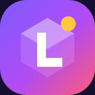
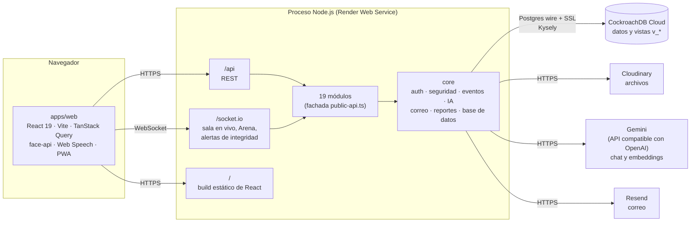
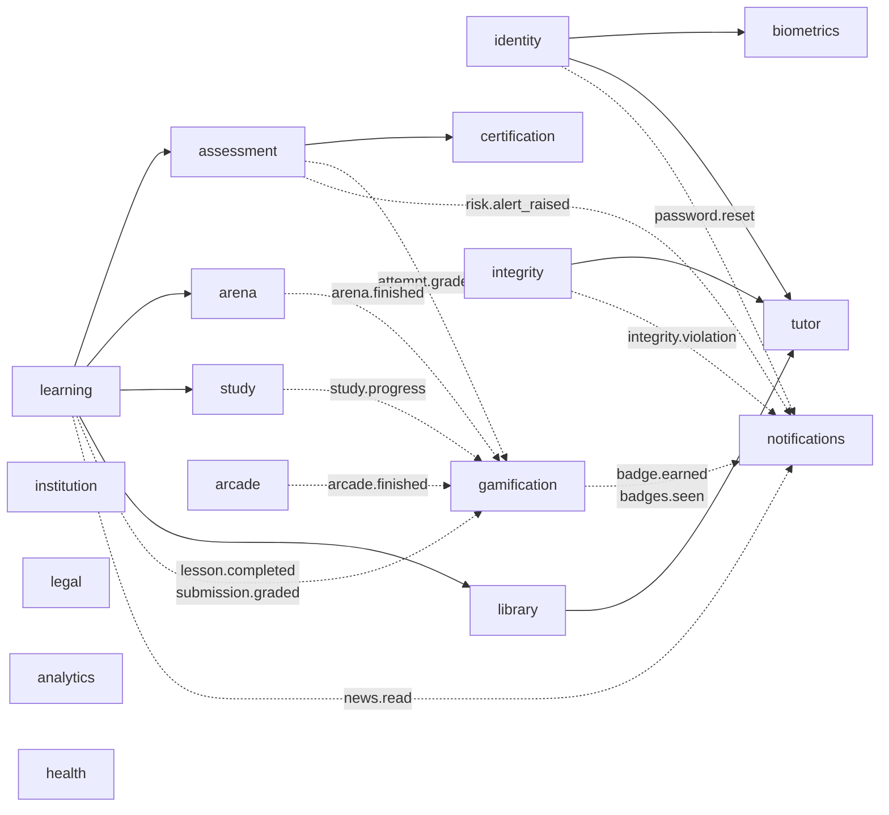

<div align="center">
  
  <h1>Ludoteka Campus</h1>
  <p><b>Campus virtual gamificado: aula, evaluación con integridad, calificaciones, estudio adaptativo e IA en una sola aplicación</b><br/>Desarrollado para el Colegio Francisco Arango (antes EduQuest)</p>

  <a href="https://ludoteka-campus.onrender.com"></a>
  
  
  
  
  
  <a href="LICENSE"></a>

  <p>
    <a href="https://ludoteka-campus.onrender.com"><b>Demo en vivo</b></a> ·
    <a href="docs/"><b>Documentación</b></a> ·
    <a href="docs/Architecture.md"><b>Arquitectura</b></a>
  </p>
</div>

<details>
<summary><b>English summary</b></summary>

Ludoteka Campus (formerly EduQuest) is a gamified virtual campus built for the Colegio Francisco Arango, a Colombian school. It brings together courses and lessons, question banks and proctored kiosk exams with integrity controls, a weighted gradebook with risk alerts for teachers and guardians, an isometric campus with XP, streaks and team-based Arena games, an adaptive mastery route, a library with an AI tutor that cites its sources, a natural-language-to-SQL "Observatory" for school leadership, passkeys and in-browser face login, and Colombian data-protection (Law 1581) workflows.

It is a modular monolith in a single npm workspace: a NestJS 11 API with Kysely on CockroachDB Cloud, a React 19 + Vite + TanStack Query frontend, and shared zod contracts. One Node process serves the REST API, Socket.IO and the built SPA, deployed as a single Render web service. The app is live at [ludoteka-campus.onrender.com](https://ludoteka-campus.onrender.com) with Playwright smoke tests covering WebKit (iPhone, iPad, Safari) and Chromium (Android).
</details>

## Qué es

El Colegio Francisco Arango no tenía un aula virtual propia. Las aplicaciones genéricas de quiz no conocen los grupos, no guardan el recorrido de cada estudiante, no avisan a tiempo cuando alguien va mal y no sostienen un examen en el aula frente a la copia. Docentes y coordinación llevaban notas, asistencia y reportes en hojas de cálculo.

Ludoteka Campus reúne todo eso en una sola aplicación web para seis roles (administrador, coordinación, rectoría, docente, estudiante y acudiente), con un MVP de Matemáticas de sexto grado. Está desplegada en producción y se apoya en CockroachDB como única base de datos; los servicios externos solo guardan lo que la base no debe guardar: archivos (Cloudinary), inferencia de IA (proveedor compatible con OpenAI, por defecto Gemini) y envío de correo (Resend).

## Funcionalidades

- **Aula:** cursos, unidades, lecciones, tareas, cartelera con confirmación de lectura y foros con reacciones, menciones, adjuntos de la biblioteca, XP por la mejor respuesta y resumen del hilo por Luka (con seudónimos).
- **Evaluación:** banco de preguntas, prácticas, exámenes en kiosco con control de integridad y quiz en vivo.
- **Libro de calificaciones:** ponderación por categorías (escala 1.0 a 5.0), asistencia, rúbricas y alertas de riesgo al docente y al acudiente.
- **Juego:** campus isométrico con los pendientes de cada edificio, XP, rachas, misiones, sala de trofeos (41 insignias con niveles, ocultas y de temporada), Arcade de 10 juegos calificados en el servidor con reto del día, y **Arena** por equipos con QR.
- **Avisos y voz:** notificaciones que llevan al lugar exacto, página `/app/notificaciones` con filtros y comandos de voz con panel «Qué puedo decir» («qué tengo pendiente», «léeme la lección», «busca en la biblioteca…»).
- **Estudio:**
  - Mi ruta adaptativa por maestría de temas;
  - Cuaderno con resumen IA y tarjetas SM-2;
  - metas y sesiones de enfoque.
- **Biblioteca:** archivos en Cloudinary, etiquetas, marcadores, glosario y tutor IA con citas a las guías. Trae 60 guías propias por grado y materia alineadas con los DBA, los DBA oficiales del MEN y libros abiertos de OpenStax, cada uno con su fuente y licencia (`npm run library:seed -w @eduquest/api`).
- **Observatorio:** preguntas en español convertidas a SQL de solo lectura sobre vistas `v_*`.
- **Cuentas institucionales:**
  - el administrador crea las cuentas (una a una o importando un Excel), y el usuario cambia la clave temporal en el primer ingreso;
  - el login pide contraseña y un código de 6 dígitos por correo (Resend), y el navegador puede quedar de confianza por 30 días;
  - después se registran passkeys (Face ID, Touch ID, huella o Windows Hello) para entrar sin contraseña.
- **Acceso facial:** face-api en el navegador, prueba de vida y plantilla cifrada con AES-256-GCM. Se registra desde Ajustes, con una sesión verificada.
- **Ajustes:** perfil, seguridad (passkeys, rostro, dispositivos y cerrar todas las sesiones), compañero IA (Luka o Luna, con voz elegible por dispositivo), apariencia y privacidad.
- **Voz:** dictado, comandos de navegación y lectura en voz alta.
- **Legal (Ley 1581):**
  - términos, tratamiento de datos y cookies versionados en `/legal/*`;
  - aceptación obligatoria, y el acudiente acepta por el menor;
  - descarga de los datos propios y solicitud de eliminación.
- **Seguridad:**
  - `helmet` con CSP estricta y HSTS;
  - límite de intentos por IP y por cuenta;
  - bloqueo progresivo;
  - refresh rotativo con detección de reuso;
  - build sin mapas de código.
- **Multiplataforma:** diseño propio para teléfono, compatible con Safari 14 o superior en iPhone, iPad y Mac, y con Chrome en Android y escritorio.
- **Reportes PDF/Excel** con consecutivo `LK-AAAA-NNNNNN` verificable en `/verificar-reporte/<código>`.

### Por rol

| Rol | Qué hace en el campus |
|---|---|
| Estudiante | Aprende y practica en el campus gamificado, presenta exámenes en kiosco, juega Arena y estudia con Mi ruta, el Cuaderno y el tutor |
| Docente | Publica contenido, arma el banco de preguntas, evalúa con integridad, califica con rúbricas y recibe alertas de riesgo |
| Coordinación | Atiende las alertas de riesgo de todos los grupos con una bitácora, consolida la asistencia con umbrales, cita a los acudientes (aviso y correo) y modera los foros |
| Rectoría | Tablero estratégico por periodo con comparación, firma de certificados y boletines, y comunicados oficiales en la cartelera |
| Acudiente | Sigue a cada hijo (lo que viene, notas, asistencia y alertas), confirma citaciones, escribe a los docentes, recibe un resumen semanal por correo, acepta los documentos legales por el menor y autoriza o revoca su acceso facial |
| Administrador | Gestiona años, grupos, materias, matrículas y cuentas (alta individual o importación por Excel) |

Solo el docente y la administración escriben contenido académico. Cada ruta de la web declara sus roles en `apps/web/src/app/nav.ts` y la API los exige con `@Roles`; la matriz completa está en [`docs/roles-y-permisos.md`](docs/roles-y-permisos.md).

## Arquitectura

Monolito modular: un repositorio, un proceso y una base de datos. En producción, el mismo proceso de NestJS entrega la API REST, el canal de Socket.IO y el build estático de React. En desarrollo, Vite sirve la web en `:5173` y hace proxy de `/api` y `/socket.io` hacia la API en `:3000`.



Los módulos de dominio solo se llaman de forma síncrona en una dirección; `gamification`, `analytics` y `notifications` no se importan desde ningún módulo, y gamificación y avisos reaccionan a eventos de dominio (`@nestjs/event-emitter`):



Decisiones técnicas principales (detalle y motivos en [`docs/Architecture.md`](docs/Architecture.md#decisiones-de-diseño)):

- **Monolito modular con fronteras exigidas:** cada módulo expone su fachada en `public-api.ts` y `dependency-cruiser` impide importar archivos internos de otro módulo (`npm run deps:check`).
- **Eventos para lo transversal:** gamificación y notificaciones escuchan eventos; la escritura de cada tabla la hace solo su módulo dueño y los tableros leen en solo lectura.
- **CockroachDB con Kysely y SQL versionado:** claves `UUID`, `withTx()` reintenta ante el SQLSTATE `40001` y las migraciones (`db/migrations`, 0000 a 0031) se aplican al arrancar la API (o a mano con `npm run migrate`).
- **Observatorio NL→SQL acotado:** la IA genera SQL que corre en una transacción `READ ONLY`, con `statement_timeout` y rol restringido, solo sobre vistas `v_*`.
- **Biometría en el navegador:** face-api calcula el descriptor de 128 dimensiones en el cliente; la API promedia de 3 a 10 muestras, las cifra con AES-256-GCM y compara por distancia euclidiana, con el marco de la Ley 1581.
- **IA con camino alterno:** `AiService` usa modelos de respaldo si el principal falla, cada función quita los datos personales que no necesita antes de enviar texto y cada una tiene una versión sin IA (el tutor responde con la lección, el Cuaderno usa un resumen local, Mi ruta usa plantillas).

## Stack tecnológico

| Capa | Tecnología |
|---|---|
| Frontend | React 19, Vite 7, TanStack Query 5, React Router 7, Radix UI, Framer Motion, vite-plugin-pwa |
| Biometría y voz | `@vladmandic/face-api`, Web Speech API, WebAuthn (`@simplewebauthn/browser`) |
| Backend | NestJS 11 (Express), Socket.IO 4, `@nestjs/event-emitter`, `@nestjs/throttler`, helmet |
| Datos | CockroachDB Cloud, Kysely 0.28, driver `pg` |
| Autenticación | JWT de acceso corto, refresh opaco en cookie `HttpOnly`, argon2id, passkeys (`@simplewebauthn/server`) |
| Contratos | zod 3 compartido en `packages/contracts` |
| Reportes | pdfkit, exceljs, qrcode |
| Servicios externos | Cloudinary (archivos), Gemini u otro proveedor compatible con OpenAI (IA), Resend (correo) |
| Pruebas y calidad | Playwright (WebKit y Chromium), dependency-cruiser, TypeScript 5 (`strict`) |
| Despliegue | Render (Web Service, Node 22) |

## Puesta en marcha

Requisitos: Node.js 20 o superior y una base de CockroachDB (la única base soportada).

```bash
npm install
cp apps/api/.env.example apps/api/.env   # y completa las variables
npm run dev
```

La API queda en `http://localhost:3000` y la web en `http://localhost:5173`. Al arrancar, la API aplica las migraciones pendientes y, si la tabla `users` está vacía, siembra el colegio de demo.

### Cuentas de laboratorio

La clave de todas es la que definas en `SEED_PASSWORD` dentro de `apps/api/.env`. En desarrollo, sin `RESEND_API_KEY`, el código de ingreso aparece en la pantalla y en el log de la API.

| Correo | Rol |
|--------|-----|
| admin@eduquest.local | Administrador |
| coordinacion@eduquest.local | Coordinación |
| rectoria@eduquest.local | Rectoría |
| docente@eduquest.local | Docente |
| estudiante@eduquest.local | Estudiante |
| estudiante2@eduquest.local | Estudiante |
| acudiente@eduquest.local | Acudiente |

### Variables de entorno

Los secretos viven en `apps/api/.env` (ignorado por Git) y, en producción, en el entorno de Render. La plantilla está en [`apps/api/.env.example`](apps/api/.env.example).

| Variable | Uso |
|---|---|
| `DATABASE_URL` | CockroachDB Cloud (única base permitida) |
| `JWT_SECRET`, `JWT_REFRESH_SECRET` | Firma de sesiones |
| `APP_PUBLIC_URL`, `CORS_ORIGIN` | Enlaces de correo y origen permitido |
| `AI_API_KEY`, `AI_BASE_URL`, `AI_MODEL`, `AI_MODEL_SMART`, `AI_FALLBACK_MODELS`, `AI_EMBED_MODEL`, `AI_EMBED_DIM` | Proveedor de IA compatible con OpenAI (por defecto Gemini) |
| `CLOUDINARY_URL` | Archivos de la biblioteca |
| `RESEND_API_KEY`, `MAIL_FROM` | Correo de recuperación y código de ingreso. Sin clave, el correo queda en `email_outbox` y en el log |
| `LAB_OTP_INBOX` | Buzón que recibe los códigos de las cuentas `@eduquest.local` (dominio sin buzón real). Vacía fuera del laboratorio |
| `FACIAL_*` | Umbral, bloqueo, versión de política y llave AES del acceso facial |
| `INTEGRITY_SUSPEND_AFTER` | Violaciones de integridad antes de suspender un intento de examen |
| `SEED_PASSWORD` | Clave de las cuentas demo. Defínela siempre; en producción debe ser fuerte |

### Scripts

| Comando | Qué hace |
|---|---|
| `npm run dev` | API y web en modo desarrollo |
| `npm run migrate` | Aplica `db/migrations` |
| `npm run seed` | Rehace el contenido demo del curso de sexto (no borra usuarios) |
| `npm run typecheck` | Tipos de contratos, API y web |
| `npm run deps:check` | Exige las fronteras entre módulos |
| `npm run build && npm start` | Lo que corre Render |

## Pruebas

Smoke E2E con Playwright que recorre las rutas públicas y las de cada rol en cuatro perfiles de dispositivo: iPhone 13, iPad y Safari de escritorio (WebKit) y Pixel 7 (Chromium).

```bash
npm run e2e:browsers -w @eduquest/web   # instala WebKit y Chromium (una vez)
npm run e2e -w @eduquest/web            # contra el entorno local (levanta npm run dev si hace falta)
npm run e2e:prod -w @eduquest/web       # el mismo smoke contra producción (E2E_BASE_URL)
```

La clave de las cuentas se toma de `E2E_PASSWORD` o de `SEED_PASSWORD` en `apps/api/.env`. Las capturas quedan en `apps/web/e2e/shots/` (no versionadas).

## Despliegue

Un Web Service de Render definido en [`render.yaml`](render.yaml) (plan gratuito, región Virginia, Node 22.14):

- Build: `npm ci --include=dev && npm run build`
- Inicio: `npm start` (escucha en `0.0.0.0:$PORT`)
- Healthcheck: `GET /api/health`, que incluye un ping a la base

El sistema de archivos de Render es efímero, así que los PDF y Excel se generan en la respuesta y los archivos de la biblioteca van a Cloudinary. Las variables secretas se marcan con `sync: false` y se cargan en el panel de Render.

## Estructura del repositorio

```
apps/api            NestJS 11 + Kysely sobre CockroachDB (core/ y modules/ con public-api.ts)
apps/web            React 19 + Vite + TanStack Query (app/, features/, shared/, e2e/)
packages/contracts  Esquemas zod compartidos
db/migrations       SQL del esquema (0000 a 0031)
db/seeds            Contenido demo de Matemáticas de sexto y manifiesto de la biblioteca
docs/               Arquitectura, seguridad, roles, datos, API, frontend, operación y desarrollo
render.yaml         Blueprint del Web Service en Render
```

## Documentación

| Documento | Contenido |
|---|---|
| [`docs/Architecture.md`](docs/Architecture.md) | Procesos, módulos, eventos, tiempo real, IA y decisiones de diseño |
| [`docs/Security.md`](docs/Security.md) | Autenticación, sesiones, autorización, protección web, biometría, datos personales y riesgos conocidos |
| [`docs/roles-y-permisos.md`](docs/roles-y-permisos.md) | Campus y capacidades de cada rol, y dónde se exigen |
| [`docs/datos.md`](docs/datos.md) | Tablas por módulo, vistas del Observatorio, migraciones y particularidades de CockroachDB |
| [`docs/api.md`](docs/api.md) | Convenciones, errores y todos los endpoints con su rol |
| [`docs/frontend.md`](docs/frontend.md) | Estructura de la web, sesión, campus por rol y sistema visual |
| [`docs/operacion.md`](docs/operacion.md) | Despliegue, variables, rotación de secretos, biblioteca y solución de problemas |
| [`docs/desarrollo.md`](docs/desarrollo.md) | Entorno local, convenciones, cómo extender y pruebas |

## Autoría

<table>
  <tr>
    <td align="center"><a href="https://github.com/Joan-Mora"><br/><b>Darwin Joan Aveiga Mora</b></a><br/><sub>Diseño, arquitectura y desarrollo full stack</sub></td>
  </tr>
</table>

Desarrollado para el Colegio Francisco Arango. Nació como voluntariado del programa de Tecnología en Desarrollo de Software y como parcial de Gestión y Operación de Bases de Datos, UNIMINUTO.

## Licencia

Copyright © 2026 Darwin Joan Aveiga Mora. **Todos los derechos reservados.**

Este repositorio es público para que el código pueda consultarse como parte de mi portafolio. Eso no concede permiso para copiarlo, reutilizarlo, modificarlo, distribuirlo ni presentarlo como trabajo propio. Los términos completos están en [`LICENSE`](LICENSE). Para cualquier uso, escribe a [darwin@abacore.co](mailto:darwin@abacore.co).

<div align="center">
<sub>Hecho por <a href="https://github.com/Joan-Mora">Darwin Aveiga</a> · <a href="https://abacore.co">Abacore S.A.S.</a></sub>
</div>
