# EduQuest — Modelo entidad-relación

Evidencia de EQ-P03. El SQL ejecutable está en `db/migrations/`. CockroachDB: PK `UUID`, FK con integridad referencial, `CHECK` en estados y roles.

```mermaid
erDiagram
  users ||--|| user_roles : tiene
  users ||--o{ refresh_tokens : rota
  users ||--o{ password_reset_tokens : recupera
  users ||--o{ audit_log : provoca
  users ||--o{ facial_consents : acepta
  users ||--o{ facial_embeddings : enrola
  users ||--o{ enrollments : matricula
  users ||--o{ teaching_assignments : dicta
  academic_years ||--o{ periods : contiene
  academic_years ||--o{ groups : abre
  academic_years ||--o{ enrollments : vigencia
  grades ||--o{ groups : agrupa
  groups ||--o{ enrollments : recibe
  groups ||--o{ teaching_assignments : asigna
  subjects ||--o{ teaching_assignments : materia
  subjects ||--o{ courses : origina
  groups ||--o{ courses : cursa
  users ||--o{ courses : docente
  courses ||--o{ units : organiza
  units ||--o{ lessons : incluye
  lessons ||--o{ lesson_resources : adjunta
  lessons ||--o{ lesson_progress : avanza
  courses ||--o{ assignments : pide
  assignments ||--o{ submissions : entrega
  courses ||--o{ announcements : publica
  courses ||--o{ calendar_events : agenda
  subjects ||--o{ competencies : define
  competencies ||--o{ questions : clasifica
  questions ||--o{ question_options : ofrece
  courses ||--o{ assessments : evalua
  assessments ||--o{ assessment_questions : arma
  questions ||--o{ assessment_questions : entra
  assessments ||--o{ attempts : intenta
  attempts ||--o{ attempt_answers : responde
  assessments ||--o{ live_sessions : en_vivo
  live_sessions ||--o{ live_participants : une
  attempts ||--o{ integrity_events : registra
  attempts ||--|| attempt_flags : resume
  users ||--o{ xp_ledger : gana
  users ||--o{ user_badges : desbloquea
  badges ||--o{ user_badges : otorga
  users ||--|| streaks : sostiene
  missions ||--o{ mission_progress : mide
  users ||--o{ minigame_runs : juega
  users ||--o{ tutor_conversations : consulta
  tutor_conversations ||--o{ tutor_messages : habla
  users ||--o{ certificates : recibe
  users ||--o{ notifications : lee
```

La tabla física del grupo se llama `groups_class` (`GROUP` es palabra reservada de SQL). En el diagrama aparece como `groups`.

## Tablas por módulo

### identity
`users`, `user_roles`, `refresh_tokens`, `password_reset_tokens`, `audit_log`  
Rol único por usuario. Contraseña solo como hash argon2id.

### biometrics
`facial_consents` (usuario, versión de política, fecha), `facial_embeddings` (usuario + modelo, vector JSONB). Sin columnas de imagen.

### institution
`academic_years`, `periods`, `grades`, `groups`, `subjects`, `enrollments`, `teaching_assignments`  
Un estudiante tiene un grupo por año (`UNIQUE (user_id, academic_year_id)`).

### learning
`courses`, `units`, `lessons`, `lesson_resources`, `lesson_progress`, `assignments`, `submissions`, `announcements`, `calendar_events`  
Un curso es materia + grupo + docente + año.

### assessment
`competencies`, `questions`, `question_options`, `assessments`, `assessment_questions`, `attempts`, `attempt_answers`, `live_sessions`, `live_participants`  
Índice único parcial: un solo intento `active` por estudiante y evaluación. `kind` de la evaluación: `practice`, `exam`, `live`.

### integrity
`integrity_policies`, `integrity_events`, `attempt_flags`

### gamification
`levels`, `xp_ledger`, `badges`, `user_badges`, `streaks`, `missions`, `mission_progress`, `minigame_runs`, `leaderboard_snapshots`  
El XP es un libro de movimientos: el total se suma, no se edita en un contador suelto.

### tutor
`tutor_conversations`, `tutor_messages`, `recommendations`

### certification y notifications
`certificate_templates`, `certificates` (código único, verificación pública), `notifications`, `email_outbox`

## Integridad que se demuestra en la sustentación

- No hay intento sin evaluación, ni respuesta sin intento, ni matrícula sin usuario y grupo.
- Borrar un usuario borra sus tokens, consentimientos y embeddings.
- Borrar un curso borra unidades, lecciones, tareas, evaluaciones e intentos.
- El banco de preguntas pertenece a la materia, no al curso: sobrevive si el curso se rehace.
