# Ludoteka Campus — Modelo entidad-relación

> Última revisión: 2026-10-09 · Responsable: Cronista
> **Nombre:** Ludoteka Campus (nombre pendiente de confirmar por Darwin; antes EduQuest).
> **Cobertura:** migraciones 0000 a 0019. Las tablas de 0018 y 0019 se transcribieron del SQL del repo (2Klair, sin commit al 2026-10-09). El resto sale del catálogo de producción.

Evidencia de la base de datos del parcial. El SQL ejecutable está en `db/migrations/` (0000 a 0019) y se aplica con `npm run migrate`. La tabla `schema_migrations` registra qué archivo corrió y cuándo.

Motor: **CockroachDB Cloud** (wire de PostgreSQL, SSL). No hay otra base: Render solo ejecuta la aplicación.

| Indicador | Valor |
|---|---|
| Tablas | 98 (97 de negocio + `schema_migrations`) |
| Llaves foráneas | 159 |
| Restricciones `CHECK` | 147 |
| Restricciones `UNIQUE` | 52 (4 parciales y 1 por expresión) |

Los indicadores suman los conteos del catálogo de producción (0000 a 0017: 89 tablas, 148 FK, 131 CHECK y 48 UNIQUE) y lo que agregan 0018 y 0019 según su SQL: 9 tablas, 11 FK, 16 CHECK y 4 UNIQUE. Se confirman contra el catálogo cuando 0018 y 0019 corran en producción (evidencia E9).
| Vistas de lectura | 12 (`v_*`, para el Observatorio) |
| Rol de base de datos | `ludoteka_reader` (solo `SELECT` sobre `v_*`) |
| Secuencia | `report_seq` (consecutivo LK de los reportes) |

Convenciones:

- PK `UUID DEFAULT gen_random_uuid()`, salvo tablas puente con PK compuesta y tablas 1:1 cuya PK es la FK (`user_roles`, `streaks`, `face_templates`, `attempt_flags`, `question_topics`).
- Toda FK declara su regla: `CASCADE` cuando el hijo no tiene sentido sin el padre, `SET NULL` cuando el registro es histórico (autor, quien calificó, quien subió el archivo).
- Estados, roles y rangos se validan con `CHECK` en la base, no solo en la API.
- La tabla física del grupo se llama `groups_class` porque `GROUP` es palabra reservada.

## Índice

1. Diagrama general
2. Entidades por módulo: identidad y acceso · **cuentas y acceso reforzado (0018)** · **preferencias y datos personales (0019)** · biometría · institución · aula · cartelera y foros · evaluación · libro de calificaciones · integridad · gamificación · Arena · biblioteca · Cuaderno · tutor y Mi ruta · certificados, reportes y notificaciones
3. Vistas y rol de lectura
4. Reglas de integridad que se demuestran en la sustentación
5. Consultas de evidencia

## Diagrama general

El diagrama muestra las entidades centrales y una de cada módulo nuevo. El detalle completo, tabla por tabla, está en la sección siguiente.

```mermaid
erDiagram
  users ||--|| user_roles : "tiene rol"
  users ||--o{ guardian_links : "acudiente de"
  users ||--o| face_templates : "rostro cifrado"
  users ||--o{ face_attempts : "intentos faciales"
  academic_years ||--o{ groups_class : abre
  grades ||--o{ groups_class : agrupa
  groups_class ||--o{ enrollments : matricula
  users ||--o{ enrollments : "se matricula"
  subjects ||--o{ courses : origina
  groups_class ||--o{ courses : cursa
  users ||--o{ courses : dicta
  courses ||--o{ units : organiza
  units ||--o{ lessons : incluye
  courses ||--o{ assignments : pide
  assignments ||--o{ submissions : recibe
  news ||--o{ news_audience : "dirigida a"
  news ||--o{ news_reads : "leída por"
  courses ||--o{ forum_threads : abre
  forum_threads ||--o{ forum_posts : contiene
  subjects ||--o{ questions : "banco de"
  questions ||--o{ question_options : ofrece
  courses ||--o{ assessments : evalua
  assessments ||--o{ attempts : intenta
  attempts ||--o{ attempt_answers : responde
  attempts ||--o{ integrity_events : registra
  attempts ||--o| attempt_flags : resume
  courses ||--o{ grade_categories : pondera
  courses ||--o{ attendance : "toma asistencia"
  rubrics ||--o{ rubric_criteria : define
  rubric_criteria ||--o{ rubric_scores : califica
  courses ||--o{ risk_alerts : alerta
  users ||--o{ xp_ledger : gana
  courses ||--o{ arena_rooms : juega
  arena_rooms ||--o{ arena_teams : forma
  arena_teams ||--o{ arena_members : agrupa
  arena_teams ||--o{ arena_answers : responde
  subjects ||--o{ library_items : "biblioteca de"
  library_items ||--o{ library_chunks : "fragmentos RAG"
  users ||--o{ notebook_pages : escribe
  notebook_pages ||--o{ flashcards : genera
  flashcards ||--o{ flashcard_reviews : repasa
  subjects ||--o{ topics : temario
  topics ||--o{ topic_mastery : domina
  topics ||--o{ route_items : "retos de"
  users ||--o{ tutor_conversations : consulta
  users ||--o{ nl_queries : pregunta
  users ||--o{ report_log : genera
  users ||--o{ certificates : recibe
  users ||--o{ login_challenges : "código de ingreso"
  users ||--o{ trusted_devices : "confía en"
  users ||--o{ webauthn_credentials : "passkeys"
  users ||--o| user_preferences : prefiere
  legal_documents ||--o{ legal_acceptances : "aceptado en"
  users ||--o{ legal_acceptances : acepta
  users ||--o{ data_requests : "pide habeas data"
```



## Entidades por módulo

Generado desde el catálogo de la base en producción (`information_schema.columns` y `SHOW CONSTRAINTS`). En **negrita** las columnas de la PK; `(FK)` marca las columnas foráneas; `NULL` indica columna opcional (las demás son `NOT NULL`).

### Identidad y acceso (identity)

| Entidad | Atributos | PK / FK | Relaciones |
|---|---|---|---|
| `users` | **id** UUID<br>email STRING<br>password_hash STRING<br>full_name STRING<br>is_minor BOOL<br>guardian_consent_at TIMESTAMPTZ NULL<br>status STRING (0018)<br>must_change_password BOOL (0018)<br>last_login_at TIMESTAMPTZ NULL (0018)<br>failed_logins INT (0018)<br>locked_until TIMESTAMPTZ NULL (0018)<br>created_at TIMESTAMPTZ<br>updated_at TIMESTAMPTZ | PK (id)<br>UNIQUE (email)<br>CHECK status IN ('active','disabled') (0018)<br>CHECK failed_logins >= 0 (0018) | 1:1 face_templates<br>1:1 streaks<br>1:1 user_roles<br>1:N con 51 tablas: ai_usage, announcements, arena_answers, arena_members, arena_rooms, assessments, attempts, attendance, audit_log, bookmarks, certificates, courses, enrollments, face_attempts, facial_consents, flashcard_reviews, flashcards, focus_sessions, forum_posts, forum_threads, glossary_terms, goals, guardian_links, integrity_events, lesson_progress, library_items, library_views, live_participants, live_sessions, minigame_runs, mission_progress, news, news_reads, nl_queries, notebook_pages, notifications, password_reset_tokens, questions, recommendations, refresh_tokens, report_log, risk_alerts, route_items, rubric_scores, rubrics, submissions, teaching_assignments, topic_mastery, tutor_conversations, user_badges, xp_ledger<br>1:1 user_preferences (0019)<br>1:N (0018/0019): login_challenges, trusted_devices, webauthn_credentials, webauthn_challenges, account_imports, legal_acceptances (como user_id y como accepted_by), data_requests (como user_id y como resolved_by) |
| `user_roles` | **user_id** (FK) UUID<br>role STRING<br>created_at TIMESTAMPTZ | PK (user_id)<br>FK user_id → users(id) CASCADE<br>1 CHECK | 1:1 users |
| `refresh_tokens` | **id** UUID<br>user_id (FK) UUID<br>token_hash STRING<br>expires_at TIMESTAMPTZ<br>revoked_at TIMESTAMPTZ NULL<br>family_id UUID NULL (0018)<br>auth_method STRING NULL (0018)<br>user_agent STRING NULL (0018)<br>ip STRING NULL (0018)<br>replaced_at TIMESTAMPTZ NULL (0018)<br>created_at TIMESTAMPTZ | PK (id)<br>FK user_id → users(id) CASCADE<br>UNIQUE (token_hash)<br>CHECK auth_method IS NULL OR IN ('password','otp','trusted_device','passkey','facial') (0018)<br>INDEX idx_refresh_family (family_id) | N:1 users. Las filas con el mismo `family_id` forman una familia de sesión; reusar un token rotado revoca la familia |
| `password_reset_tokens` | **id** UUID<br>user_id (FK) UUID<br>token_hash STRING<br>expires_at TIMESTAMPTZ<br>used_at TIMESTAMPTZ NULL<br>created_at TIMESTAMPTZ | PK (id)<br>FK user_id → users(id) CASCADE<br>UNIQUE (token_hash) | N:1 users |
| `audit_log` | **id** UUID<br>actor_id (FK) UUID NULL<br>action STRING<br>entity STRING<br>entity_id STRING NULL<br>meta JSONB NULL<br>created_at TIMESTAMPTZ | PK (id)<br>FK actor_id → users(id) SET NULL | N:1 users |
| `guardian_links` | **id** UUID<br>guardian_id (FK) UUID<br>student_id (FK) UUID<br>relationship STRING<br>status STRING<br>created_by (FK) UUID NULL<br>created_at TIMESTAMPTZ | PK (id)<br>FK guardian_id → users(id) CASCADE<br>FK student_id → users(id) CASCADE<br>FK created_by → users(id) SET NULL<br>UNIQUE (guardian_id, student_id)<br>3 CHECK | N:1 users<br>1:N guardian_authorizations |
| `guardian_authorizations` | **id** UUID<br>link_id (FK) UUID<br>scope STRING<br>policy_version STRING<br>granted BOOL<br>ip STRING NULL<br>created_at TIMESTAMPTZ | PK (id)<br>FK link_id → guardian_links(id) CASCADE<br>1 CHECK | N:1 guardian_links |

### Cuentas y acceso reforzado (identity, migración 0018)

El administrador crea las cuentas (individual o por Excel). El ingreso pide la contraseña y un código de 6 dígitos por correo, o un dispositivo de confianza o una passkey. Hay bloqueo progresivo. Las columnas que 0018 agrega a `users` y `refresh_tokens` están en la tabla anterior.

| Entidad | Atributos | PK / FK | Relaciones |
|---|---|---|---|
| `login_challenges` | **id** UUID<br>user_id (FK) UUID<br>code_hash STRING<br>attempts INT (def. 0)<br>max_attempts INT (def. 5)<br>expires_at TIMESTAMPTZ<br>used_at TIMESTAMPTZ NULL<br>ip STRING NULL<br>created_at TIMESTAMPTZ | PK (id)<br>FK user_id → users(id) CASCADE<br>CHECK attempts >= 0<br>CHECK max_attempts > 0<br>INDEX (user_id, created_at DESC) | N:1 users. Solo se guarda el hash del código; vence a los 10 min y sirve una vez |
| `trusted_devices` | **id** UUID<br>user_id (FK) UUID<br>token_hash STRING<br>label STRING<br>expires_at TIMESTAMPTZ<br>revoked_at TIMESTAMPTZ NULL<br>last_used_at TIMESTAMPTZ NULL<br>created_at TIMESTAMPTZ | PK (id)<br>FK user_id → users(id) CASCADE<br>UNIQUE (token_hash)<br>INDEX (user_id) | N:1 users. Cookie `HttpOnly` de 30 días; en la base solo va el hash |
| `webauthn_credentials` | **id** UUID<br>user_id (FK) UUID<br>credential_id STRING<br>public_key BYTES<br>counter INT8 (def. 0)<br>transports STRING NULL<br>device_type STRING NULL<br>backed_up BOOL (def. false)<br>label STRING<br>last_used_at TIMESTAMPTZ NULL<br>created_at TIMESTAMPTZ | PK (id)<br>FK user_id → users(id) CASCADE<br>UNIQUE (credential_id)<br>CHECK counter >= 0<br>INDEX (user_id) | N:1 users. Passkeys: solo la llave pública; la biometría no sale del dispositivo |
| `webauthn_challenges` | **id** UUID<br>user_id (FK) UUID NULL<br>challenge STRING<br>kind STRING<br>expires_at TIMESTAMPTZ<br>used_at TIMESTAMPTZ NULL<br>created_at TIMESTAMPTZ | PK (id)<br>FK user_id → users(id) CASCADE<br>CHECK kind IN ('register','login') | N:0..1 users (`NULL` en el login sin usuario identificado) |
| `account_imports` | **id** UUID<br>actor_id (FK) UUID NULL<br>kind STRING<br>file_name STRING<br>total_rows INT (def. 0)<br>created_count INT (def. 0)<br>skipped_count INT (def. 0)<br>errors JSONB NULL<br>created_at TIMESTAMPTZ | PK (id)<br>FK actor_id → users(id) SET NULL<br>CHECK kind IN ('users','structure')<br>CHECK total_rows >= 0, created_count >= 0, skipped_count >= 0<br>INDEX (created_at DESC) | N:1 users (el admin que importó). Auditoría de cargas masivas |

### Preferencias y datos personales (identity y legal, migración 0019)

Documentos legales versionados (Ley 1581 de 2012 y Decreto 1377 de 2013) y solicitudes de habeas data.

| Entidad | Atributos | PK / FK | Relaciones |
|---|---|---|---|
| `user_preferences` | **user_id** (FK) UUID<br>companion STRING (def. 'luka')<br>theme STRING (def. 'system')<br>updated_at TIMESTAMPTZ | PK (user_id)<br>FK user_id → users(id) CASCADE<br>CHECK companion IN ('luka','luna')<br>CHECK theme IN ('light','dark','system') | 1:1 users |
| `legal_documents` | **id** UUID<br>kind STRING<br>version STRING<br>title STRING<br>published_at TIMESTAMPTZ | PK (id)<br>UNIQUE (kind, version)<br>CHECK kind IN ('terminos','privacidad','cookies') | 1:N legal_acceptances. La migración siembra la versión 2026-10-09 de los tres documentos |
| `legal_acceptances` | **id** UUID<br>user_id (FK) UUID<br>document_id (FK) UUID<br>accepted_by (FK) UUID<br>ip STRING NULL<br>accepted_at TIMESTAMPTZ | PK (id)<br>FK user_id → users(id) CASCADE<br>FK document_id → legal_documents(id) CASCADE<br>FK accepted_by → users(id) CASCADE<br>UNIQUE (user_id, document_id) | N:1 users (titular)<br>N:1 users (quien acepta: el acudiente si es menor)<br>N:1 legal_documents |
| `data_requests` | **id** UUID<br>user_id (FK) UUID<br>kind STRING<br>status STRING (def. 'pending')<br>reason STRING NULL<br>resolved_by (FK) UUID NULL<br>resolved_at TIMESTAMPTZ NULL<br>created_at TIMESTAMPTZ | PK (id)<br>FK user_id → users(id) CASCADE<br>FK resolved_by → users(id) SET NULL<br>CHECK kind IN ('export','delete')<br>CHECK status IN ('pending','done','rejected')<br>INDEX (status, created_at DESC) | N:1 users (solicitante)<br>N:1 users (admin que resuelve) |

### Biometría (biometrics)

| Entidad | Atributos | PK / FK | Relaciones |
|---|---|---|---|
| `facial_consents` | **id** UUID<br>user_id (FK) UUID<br>policy_version STRING<br>accepted_at TIMESTAMPTZ | PK (id)<br>FK user_id → users(id) CASCADE | N:1 users |
| `face_templates` | **user_id** (FK) UUID<br>model_id STRING<br>ciphertext BYTEA<br>iv BYTEA<br>tag BYTEA<br>samples INT8<br>spread FLOAT8<br>created_at TIMESTAMPTZ<br>updated_at TIMESTAMPTZ | PK (user_id)<br>FK user_id → users(id) CASCADE<br>2 CHECK | 1:1 users |
| `face_attempts` | **id** UUID<br>user_id (FK) UUID NULL<br>email_hash STRING NULL<br>ip STRING NULL<br>mode STRING<br>success BOOL<br>reason STRING<br>distance FLOAT8 NULL<br>created_at TIMESTAMPTZ | PK (id)<br>FK user_id → users(id) CASCADE<br>2 CHECK | N:1 users |

### Institución (institution)

| Entidad | Atributos | PK / FK | Relaciones |
|---|---|---|---|
| `academic_years` | **id** UUID<br>name STRING<br>starts_on DATE<br>ends_on DATE<br>is_current BOOL | PK (id)<br>UNIQUE (name) | 1:N courses<br>1:N enrollments<br>1:N groups_class<br>1:N periods<br>1:N teaching_assignments |
| `periods` | **id** UUID<br>academic_year_id (FK) UUID<br>name STRING<br>position INT8<br>starts_on DATE<br>ends_on DATE | PK (id)<br>FK academic_year_id → academic_years(id) CASCADE<br>UNIQUE (academic_year_id, "position") | N:1 academic_years |
| `grades` | **id** UUID<br>level INT8<br>name STRING | PK (id)<br>UNIQUE (level) | 1:N competencies<br>1:N groups_class<br>1:N library_items<br>1:N questions<br>1:N topics |
| `groups_class` | **id** UUID<br>grade_id (FK) UUID<br>academic_year_id (FK) UUID<br>name STRING | PK (id)<br>FK grade_id → grades(id)<br>FK academic_year_id → academic_years(id) CASCADE<br>UNIQUE (grade_id, academic_year_id, name) | N:1 grades<br>N:1 academic_years<br>1:N courses<br>1:N enrollments<br>1:N leaderboard_snapshots<br>1:N teaching_assignments |
| `subjects` | **id** UUID<br>code STRING<br>name STRING<br>area STRING | PK (id)<br>UNIQUE (code) | 1:N competencies<br>1:N courses<br>1:N glossary_terms<br>1:N library_items<br>1:N questions<br>1:N teaching_assignments<br>1:N topics |
| `enrollments` | **id** UUID<br>user_id (FK) UUID<br>group_id (FK) UUID<br>academic_year_id (FK) UUID<br>status STRING | PK (id)<br>FK user_id → users(id) CASCADE<br>FK group_id → groups_class(id) CASCADE<br>FK academic_year_id → academic_years(id) CASCADE<br>UNIQUE (user_id, academic_year_id)<br>1 CHECK | N:1 users<br>N:1 groups_class<br>N:1 academic_years |
| `teaching_assignments` | **id** UUID<br>teacher_id (FK) UUID<br>subject_id (FK) UUID<br>group_id (FK) UUID<br>academic_year_id (FK) UUID | PK (id)<br>FK teacher_id → users(id) CASCADE<br>FK subject_id → subjects(id)<br>FK group_id → groups_class(id) CASCADE<br>FK academic_year_id → academic_years(id) CASCADE<br>UNIQUE (teacher_id, subject_id, group_id, academic_year_id) | N:1 users<br>N:1 subjects<br>N:1 groups_class<br>N:1 academic_years |

### Aula (learning)

| Entidad | Atributos | PK / FK | Relaciones |
|---|---|---|---|
| `courses` | **id** UUID<br>subject_id (FK) UUID<br>group_id (FK) UUID<br>teacher_id (FK) UUID<br>academic_year_id (FK) UUID<br>title STRING<br>description STRING<br>published BOOL<br>created_at TIMESTAMPTZ | PK (id)<br>FK subject_id → subjects(id)<br>FK group_id → groups_class(id) CASCADE<br>FK teacher_id → users(id)<br>FK academic_year_id → academic_years(id)<br>UNIQUE (subject_id, group_id, academic_year_id) | N:1 subjects<br>N:1 groups_class<br>N:1 users<br>N:1 academic_years<br>1:N con 16 tablas: announcements, arena_rooms, assessments, assignments, attendance, calendar_events, certificates, forum_threads, grade_categories, library_items, notebook_pages, recommendations, risk_alerts, rubrics, tutor_conversations, units |
| `units` | **id** UUID<br>course_id (FK) UUID<br>title STRING<br>summary STRING<br>position INT8 | PK (id)<br>FK course_id → courses(id) CASCADE<br>UNIQUE (course_id, "position") | N:1 courses<br>1:N lessons |
| `lessons` | **id** UUID<br>unit_id (FK) UUID<br>title STRING<br>body_md STRING<br>estimated_min INT8<br>position INT8<br>published BOOL | PK (id)<br>FK unit_id → units(id) CASCADE<br>UNIQUE (unit_id, "position") | N:1 units<br>1:N assignments<br>1:N lesson_progress<br>1:N lesson_resources<br>1:N tutor_conversations |
| `lesson_resources` | **id** UUID<br>lesson_id (FK) UUID<br>kind STRING<br>title STRING<br>url STRING NULL<br>position INT8 | PK (id)<br>FK lesson_id → lessons(id) CASCADE<br>1 CHECK | N:1 lessons |
| `lesson_progress` | **user_id** (FK) UUID<br>**lesson_id** (FK) UUID<br>status STRING<br>completed_at TIMESTAMPTZ NULL | PK (user_id, lesson_id)<br>FK user_id → users(id) CASCADE<br>FK lesson_id → lessons(id) CASCADE<br>1 CHECK | N:1 users<br>N:1 lessons |
| `assignments` | **id** UUID<br>course_id (FK) UUID<br>lesson_id (FK) UUID NULL<br>title STRING<br>instructions STRING<br>due_at TIMESTAMPTZ NULL<br>max_score INT8 | PK (id)<br>FK course_id → courses(id) CASCADE<br>FK lesson_id → lessons(id) SET NULL | N:1 courses<br>N:1 lessons<br>1:N rubrics<br>1:N submissions |
| `submissions` | **id** UUID<br>assignment_id (FK) UUID<br>user_id (FK) UUID<br>body STRING<br>status STRING<br>score INT8 NULL<br>feedback STRING NULL<br>submitted_at TIMESTAMPTZ<br>graded_at TIMESTAMPTZ NULL | PK (id)<br>FK assignment_id → assignments(id) CASCADE<br>FK user_id → users(id) CASCADE<br>UNIQUE (assignment_id, user_id)<br>1 CHECK | N:1 assignments<br>N:1 users |
| `announcements` | **id** UUID<br>course_id (FK) UUID<br>author_id (FK) UUID<br>title STRING<br>body STRING<br>created_at TIMESTAMPTZ | PK (id)<br>FK course_id → courses(id) CASCADE<br>FK author_id → users(id) | N:1 courses<br>N:1 users |
| `calendar_events` | **id** UUID<br>course_id (FK) UUID<br>title STRING<br>starts_at TIMESTAMPTZ<br>ends_at TIMESTAMPTZ NULL<br>kind STRING | PK (id)<br>FK course_id → courses(id) CASCADE<br>1 CHECK | N:1 courses |

### Cartelera y foros (learning)

| Entidad | Atributos | PK / FK | Relaciones |
|---|---|---|---|
| `news` | **id** UUID<br>author_id (FK) UUID<br>title STRING<br>body STRING<br>category STRING<br>pinned BOOL<br>requires_ack BOOL<br>publish_at TIMESTAMPTZ<br>expires_at TIMESTAMPTZ NULL<br>created_at TIMESTAMPTZ<br>updated_at TIMESTAMPTZ | PK (id)<br>FK author_id → users(id) CASCADE<br>4 CHECK | N:1 users<br>1:N news_audience<br>1:N news_reads |
| `news_audience` | **news_id** (FK) UUID<br>**kind** STRING<br>**value** STRING | PK (news_id, kind, value)<br>FK news_id → news(id) CASCADE<br>2 CHECK | N:1 news |
| `news_reads` | **news_id** (FK) UUID<br>**user_id** (FK) UUID<br>read_at TIMESTAMPTZ<br>acknowledged_at TIMESTAMPTZ NULL | PK (news_id, user_id)<br>FK news_id → news(id) CASCADE<br>FK user_id → users(id) CASCADE | N:1 news<br>N:1 users |
| `forum_threads` | **id** UUID<br>course_id (FK) UUID<br>author_id (FK) UUID<br>title STRING<br>body STRING<br>pinned BOOL<br>locked BOOL<br>posts_count INT8<br>last_post_at TIMESTAMPTZ<br>created_at TIMESTAMPTZ | PK (id)<br>FK course_id → courses(id) CASCADE<br>FK author_id → users(id) CASCADE<br>3 CHECK | N:1 courses<br>N:1 users<br>1:N forum_posts |
| `forum_posts` | **id** UUID<br>thread_id (FK) UUID<br>author_id (FK) UUID<br>body STRING<br>is_answer BOOL<br>created_at TIMESTAMPTZ | PK (id)<br>FK thread_id → forum_threads(id) CASCADE<br>FK author_id → users(id) CASCADE<br>1 CHECK | N:1 forum_threads<br>N:1 users |

### Evaluación (assessment)

| Entidad | Atributos | PK / FK | Relaciones |
|---|---|---|---|
| `competencies` | **id** UUID<br>subject_id (FK) UUID<br>grade_id (FK) UUID NULL<br>code STRING<br>name STRING | PK (id)<br>FK subject_id → subjects(id) CASCADE<br>FK grade_id → grades(id)<br>UNIQUE (code) | N:1 subjects<br>N:1 grades<br>1:N questions |
| `questions` | **id** UUID<br>code STRING<br>subject_id (FK) UUID<br>grade_id (FK) UUID NULL<br>competency_id (FK) UUID NULL<br>prompt STRING<br>difficulty STRING<br>explanation STRING<br>created_by (FK) UUID NULL<br>active BOOL<br>created_at TIMESTAMPTZ | PK (id)<br>FK subject_id → subjects(id)<br>FK grade_id → grades(id)<br>FK competency_id → competencies(id) SET NULL<br>FK created_by → users(id) SET NULL<br>UNIQUE (code)<br>1 CHECK | N:1 subjects<br>N:1 grades<br>N:1 competencies<br>N:1 users<br>1:N arena_answers<br>1:N assessment_questions<br>1:N attempt_answers<br>1:N question_options<br>1:1 question_topics |
| `question_options` | **id** UUID<br>question_id (FK) UUID<br>label STRING<br>text STRING<br>is_correct BOOL<br>position INT8 | PK (id)<br>FK question_id → questions(id) CASCADE<br>UNIQUE (question_id, label) | N:1 questions<br>1:N arena_answers<br>1:N attempt_answers |
| `assessments` | **id** UUID<br>code STRING<br>course_id (FK) UUID<br>title STRING<br>kind STRING<br>status STRING<br>time_limit_sec INT8<br>created_by (FK) UUID NULL<br>created_at TIMESTAMPTZ | PK (id)<br>FK course_id → courses(id) CASCADE<br>FK created_by → users(id)<br>UNIQUE (code)<br>2 CHECK | N:1 courses<br>N:1 users<br>1:N assessment_questions<br>1:N attempts<br>1:N live_sessions |
| `assessment_questions` | **assessment_id** (FK) UUID<br>**question_id** (FK) UUID<br>position INT8<br>points INT8 | PK (assessment_id, question_id)<br>FK assessment_id → assessments(id) CASCADE<br>FK question_id → questions(id) | N:1 assessments<br>N:1 questions |
| `attempts` | **id** UUID<br>assessment_id (FK) UUID<br>user_id (FK) UUID<br>status STRING<br>score INT8<br>max_score INT8<br>started_at TIMESTAMPTZ<br>submitted_at TIMESTAMPTZ NULL | PK (id)<br>FK assessment_id → assessments(id) CASCADE<br>FK user_id → users(id) CASCADE<br>UNIQUE parcial (user_id, assessment_id) WHERE status = 'active'<br>1 CHECK | N:1 assessments<br>N:1 users<br>1:N attempt_answers<br>1:1 attempt_flags<br>1:N integrity_events<br>1:N live_participants |
| `attempt_answers` | **id** UUID<br>attempt_id (FK) UUID<br>question_id (FK) UUID<br>option_id (FK) UUID NULL<br>correct BOOL<br>points INT8<br>elapsed_ms INT8 NULL<br>answered_at TIMESTAMPTZ | PK (id)<br>FK attempt_id → attempts(id) CASCADE<br>FK question_id → questions(id)<br>FK option_id → question_options(id)<br>UNIQUE (attempt_id, question_id) | N:1 attempts<br>N:1 questions<br>N:1 question_options |
| `live_sessions` | **id** UUID<br>assessment_id (FK) UUID<br>host_id (FK) UUID<br>code STRING<br>status STRING<br>current_position INT8<br>question_started_at TIMESTAMPTZ NULL<br>created_at TIMESTAMPTZ | PK (id)<br>FK assessment_id → assessments(id) CASCADE<br>FK host_id → users(id)<br>UNIQUE (code)<br>1 CHECK | N:1 assessments<br>N:1 users<br>1:N live_participants |
| `live_participants` | **session_id** (FK) UUID<br>**user_id** (FK) UUID<br>attempt_id (FK) UUID NULL<br>joined_at TIMESTAMPTZ | PK (session_id, user_id)<br>FK session_id → live_sessions(id) CASCADE<br>FK user_id → users(id) CASCADE<br>FK attempt_id → attempts(id) SET NULL | N:1 live_sessions<br>N:1 users<br>N:1 attempts |

### Libro de calificaciones (assessment)

| Entidad | Atributos | PK / FK | Relaciones |
|---|---|---|---|
| `grade_categories` | **id** UUID<br>course_id (FK) UUID<br>name STRING<br>source STRING<br>weight DECIMAL<br>position INT8 | PK (id)<br>FK course_id → courses(id) CASCADE<br>UNIQUE (course_id, name)<br>UNIQUE (course_id, source)<br>UNIQUE (course_id, "position")<br>4 CHECK | N:1 courses |
| `rubrics` | **id** UUID<br>course_id (FK) UUID<br>assignment_id (FK) UUID NULL<br>title STRING<br>created_by (FK) UUID NULL<br>created_at TIMESTAMPTZ | PK (id)<br>FK course_id → courses(id) CASCADE<br>FK assignment_id → assignments(id) SET NULL<br>FK created_by → users(id) SET NULL<br>1 CHECK | N:1 courses<br>N:1 assignments<br>N:1 users<br>1:N rubric_criteria<br>1:N rubric_scores |
| `rubric_criteria` | **id** UUID<br>rubric_id (FK) UUID<br>name STRING<br>description STRING<br>max_points INT8<br>position INT8 | PK (id)<br>FK rubric_id → rubrics(id) CASCADE<br>UNIQUE (rubric_id, "position")<br>4 CHECK | N:1 rubrics<br>1:N rubric_scores |
| `rubric_scores` | **criterion_id** (FK) UUID<br>**student_id** (FK) UUID<br>rubric_id (FK) UUID<br>points INT8<br>comment STRING<br>graded_by (FK) UUID NULL<br>graded_at TIMESTAMPTZ | PK (criterion_id, student_id)<br>FK criterion_id → rubric_criteria(id) CASCADE<br>FK student_id → users(id) CASCADE<br>FK rubric_id → rubrics(id) CASCADE<br>FK graded_by → users(id) SET NULL<br>2 CHECK | N:1 rubric_criteria<br>N:1 users<br>N:1 rubrics |
| `attendance` | **id** UUID<br>course_id (FK) UUID<br>student_id (FK) UUID<br>session_on DATE<br>status STRING<br>note STRING<br>recorded_by (FK) UUID NULL<br>recorded_at TIMESTAMPTZ | PK (id)<br>FK course_id → courses(id) CASCADE<br>FK student_id → users(id) CASCADE<br>FK recorded_by → users(id) SET NULL<br>UNIQUE (course_id, student_id, session_on)<br>2 CHECK | N:1 courses<br>N:1 users |
| `risk_alerts` | **id** UUID<br>student_id (FK) UUID<br>course_id (FK) UUID<br>kind STRING<br>level STRING<br>detail STRING<br>status STRING<br>created_at TIMESTAMPTZ<br>resolved_at TIMESTAMPTZ NULL<br>resolved_by (FK) UUID NULL | PK (id)<br>FK student_id → users(id) CASCADE<br>FK course_id → courses(id) CASCADE<br>FK resolved_by → users(id) SET NULL<br>UNIQUE parcial (student_id, course_id, kind) WHERE status != 'resolved'<br>5 CHECK | N:1 users<br>N:1 courses |

### Integridad (integrity)

| Entidad | Atributos | PK / FK | Relaciones |
|---|---|---|---|
| `integrity_policies` | **id** UUID<br>name STRING<br>max_violations INT8<br>is_default BOOL | PK (id)<br>UNIQUE (name) | — |
| `integrity_events` | **id** UUID<br>attempt_id (FK) UUID<br>user_id (FK) UUID<br>type STRING<br>meta JSONB NULL<br>at TIMESTAMPTZ | PK (id)<br>FK attempt_id → attempts(id) CASCADE<br>FK user_id → users(id) CASCADE | N:1 attempts<br>N:1 users |
| `attempt_flags` | **attempt_id** (FK) UUID<br>violation_count INT8<br>flagged BOOL<br>suspended BOOL | PK (attempt_id)<br>FK attempt_id → attempts(id) CASCADE | 1:1 attempts |

### Gamificación (gamification)

| Entidad | Atributos | PK / FK | Relaciones |
|---|---|---|---|
| `levels` | **level** INT8<br>min_xp INT8<br>title STRING | PK (level) | — |
| `xp_ledger` | **id** UUID<br>user_id (FK) UUID<br>amount INT8<br>reason STRING<br>source_type STRING<br>source_id STRING NULL<br>created_at TIMESTAMPTZ | PK (id)<br>FK user_id → users(id) CASCADE | N:1 users |
| `badges` | **id** UUID<br>code STRING<br>name STRING<br>description STRING<br>icon STRING | PK (id)<br>UNIQUE (code) | 1:N user_badges |
| `user_badges` | **user_id** (FK) UUID<br>**badge_id** (FK) UUID<br>awarded_at TIMESTAMPTZ | PK (user_id, badge_id)<br>FK user_id → users(id) CASCADE<br>FK badge_id → badges(id) CASCADE | N:1 users<br>N:1 badges |
| `streaks` | **user_id** (FK) UUID<br>current_count INT8<br>best_count INT8<br>last_activity_on DATE NULL | PK (user_id)<br>FK user_id → users(id) CASCADE | 1:1 users |
| `missions` | **id** UUID<br>code STRING<br>title STRING<br>description STRING<br>goal_type STRING<br>goal_count INT8<br>xp_reward INT8<br>active BOOL | PK (id)<br>UNIQUE (code)<br>1 CHECK | 1:N mission_progress |
| `mission_progress` | **user_id** (FK) UUID<br>**mission_id** (FK) UUID<br>**week_key** STRING<br>progress INT8<br>completed_at TIMESTAMPTZ NULL | PK (user_id, mission_id, week_key)<br>FK user_id → users(id) CASCADE<br>FK mission_id → missions(id) CASCADE | N:1 users<br>N:1 missions |
| `minigame_runs` | **id** UUID<br>user_id (FK) UUID<br>game STRING<br>score INT8<br>xp_awarded INT8<br>played_at TIMESTAMPTZ | PK (id)<br>FK user_id → users(id) CASCADE<br>1 CHECK | N:1 users |
| `leaderboard_snapshots` | **id** UUID<br>group_id (FK) UUID<br>week_key STRING<br>ranks JSONB<br>created_at TIMESTAMPTZ | PK (id)<br>FK group_id → groups_class(id) CASCADE<br>UNIQUE (group_id, week_key) | N:1 groups_class |

### Arena por equipos (arena)

| Entidad | Atributos | PK / FK | Relaciones |
|---|---|---|---|
| `arena_rooms` | **id** UUID<br>code STRING<br>host_id (FK) UUID<br>course_id (FK) UUID<br>title STRING<br>question_ids UUID[]<br>team_size INT8<br>question_sec INT8<br>status STRING<br>current_index INT8<br>snapshot JSONB NULL<br>snapshot_at TIMESTAMPTZ NULL<br>created_at TIMESTAMPTZ<br>started_at TIMESTAMPTZ NULL<br>ended_at TIMESTAMPTZ NULL | PK (id)<br>FK host_id → users(id)<br>FK course_id → courses(id) CASCADE<br>UNIQUE (code)<br>9 CHECK | N:1 users<br>N:1 courses<br>1:N arena_answers<br>1:N arena_members<br>1:N arena_results<br>1:N arena_teams |
| `arena_teams` | **id** UUID<br>room_id (FK) UUID<br>name STRING<br>color STRING<br>position INT8<br>score INT8 | PK (id)<br>FK room_id → arena_rooms(id) CASCADE<br>UNIQUE (room_id, "position")<br>UNIQUE (room_id, name)<br>4 CHECK | N:1 arena_rooms<br>1:N arena_answers<br>1:N arena_members<br>1:N arena_results |
| `arena_members` | **room_id** (FK) UUID<br>**user_id** (FK) UUID<br>team_id (FK) UUID<br>joined_at TIMESTAMPTZ | PK (room_id, user_id)<br>FK room_id → arena_rooms(id) CASCADE<br>FK user_id → users(id) CASCADE<br>FK team_id → arena_teams(id) CASCADE | N:1 arena_rooms<br>N:1 users<br>N:1 arena_teams |
| `arena_answers` | **id** UUID<br>room_id (FK) UUID<br>team_id (FK) UUID<br>question_index INT8<br>question_id (FK) UUID<br>option_id (FK) UUID NULL<br>locked_by (FK) UUID NULL<br>votes JSONB<br>elapsed_ms INT8<br>correct BOOL<br>points INT8<br>reveal_order INT8<br>locked_at TIMESTAMPTZ | PK (id)<br>FK room_id → arena_rooms(id) CASCADE<br>FK team_id → arena_teams(id) CASCADE<br>FK question_id → questions(id)<br>FK option_id → question_options(id)<br>FK locked_by → users(id)<br>UNIQUE (room_id, team_id, question_index)<br>UNIQUE (room_id, question_index, reveal_order)<br>6 CHECK | N:1 arena_rooms<br>N:1 arena_teams<br>N:1 questions<br>N:1 question_options<br>N:1 users |
| `arena_results` | **room_id** (FK) UUID<br>**team_id** (FK) UUID<br>rank INT8<br>score INT8<br>correct_count INT8 | PK (room_id, team_id)<br>FK room_id → arena_rooms(id) CASCADE<br>FK team_id → arena_teams(id) CASCADE<br>3 CHECK | N:1 arena_rooms<br>N:1 arena_teams |

### Biblioteca (library)

| Entidad | Atributos | PK / FK | Relaciones |
|---|---|---|---|
| `library_items` | **id** UUID<br>title STRING<br>description STRING<br>subject_id (FK) UUID<br>grade_id (FK) UUID NULL<br>kind STRING<br>url STRING<br>cloudinary_public_id STRING NULL<br>resource_type STRING NULL<br>format STRING NULL<br>bytes INT8<br>pages INT8 NULL<br>checksum STRING NULL<br>visibility STRING<br>course_id (FK) UUID NULL<br>status STRING<br>text_chars INT8<br>uploaded_by (FK) UUID NULL<br>created_at TIMESTAMPTZ<br>updated_at TIMESTAMPTZ | PK (id)<br>FK subject_id → subjects(id)<br>FK grade_id → grades(id) SET NULL<br>FK course_id → courses(id) CASCADE<br>FK uploaded_by → users(id) SET NULL<br>UNIQUE (cloudinary_public_id)<br>8 CHECK | N:1 subjects<br>N:1 grades<br>N:1 courses<br>N:1 users<br>1:N bookmarks<br>1:N glossary_terms<br>1:N library_chunks<br>1:N library_tags<br>1:N library_views |
| `library_tags` | **item_id** (FK) UUID<br>**tag** STRING | PK (item_id, tag)<br>FK item_id → library_items(id) CASCADE<br>1 CHECK | N:1 library_items |
| `bookmarks` | **user_id** (FK) UUID<br>**item_id** (FK) UUID<br>page INT8 NULL<br>note STRING<br>created_at TIMESTAMPTZ | PK (user_id, item_id)<br>FK user_id → users(id) CASCADE<br>FK item_id → library_items(id) CASCADE<br>1 CHECK | N:1 users<br>N:1 library_items |
| `library_views` | **id** UUID<br>item_id (FK) UUID<br>user_id (FK) UUID NULL<br>viewed_at TIMESTAMPTZ | PK (id)<br>FK item_id → library_items(id) CASCADE<br>FK user_id → users(id) SET NULL | N:1 library_items<br>N:1 users |
| `glossary_terms` | **id** UUID<br>subject_id (FK) UUID<br>term STRING<br>definition STRING<br>example STRING<br>source_item_id (FK) UUID NULL<br>created_by (FK) UUID NULL<br>created_at TIMESTAMPTZ | PK (id)<br>FK subject_id → subjects(id) CASCADE<br>FK source_item_id → library_items(id) SET NULL<br>FK created_by → users(id) SET NULL<br>UNIQUE (subject_id, lower(term))<br>2 CHECK | N:1 subjects<br>N:1 library_items<br>N:1 users |
| `library_chunks` | **id** UUID<br>item_id (FK) UUID<br>ordinal INT8<br>page INT8 NULL<br>content STRING<br>tsv TSVECTOR NULL<br>embedding VECTOR NULL | PK (id)<br>FK item_id → library_items(id) CASCADE<br>UNIQUE (item_id, ordinal)<br>1 CHECK | N:1 library_items |

### Cuaderno de estudio (study)

| Entidad | Atributos | PK / FK | Relaciones |
|---|---|---|---|
| `notebook_pages` | **id** UUID<br>user_id (FK) UUID<br>course_id (FK) UUID NULL<br>title STRING<br>body STRING<br>summary STRING NULL<br>key_points JSONB NULL<br>summary_source STRING NULL<br>summarized_at TIMESTAMPTZ NULL<br>created_at TIMESTAMPTZ<br>updated_at TIMESTAMPTZ | PK (id)<br>FK user_id → users(id) CASCADE<br>FK course_id → courses(id) SET NULL<br>5 CHECK | N:1 users<br>N:1 courses<br>1:N flashcards<br>1:N focus_sessions |
| `flashcards` | **id** UUID<br>user_id (FK) UUID<br>page_id (FK) UUID NULL<br>front STRING<br>back STRING<br>source STRING<br>ease DECIMAL<br>interval_days INT8<br>repetitions INT8<br>due_at TIMESTAMPTZ<br>last_reviewed_at TIMESTAMPTZ NULL<br>created_at TIMESTAMPTZ | PK (id)<br>FK user_id → users(id) CASCADE<br>FK page_id → notebook_pages(id) SET NULL<br>6 CHECK | N:1 users<br>N:1 notebook_pages<br>1:N flashcard_reviews |
| `flashcard_reviews` | **id** UUID<br>card_id (FK) UUID<br>user_id (FK) UUID<br>grade INT8<br>interval_days INT8<br>ease DECIMAL<br>reviewed_at TIMESTAMPTZ | PK (id)<br>FK card_id → flashcards(id) CASCADE<br>FK user_id → users(id) CASCADE<br>2 CHECK | N:1 flashcards<br>N:1 users |
| `goals` | **id** UUID<br>user_id (FK) UUID<br>kind STRING<br>period STRING<br>target INT8<br>active BOOL<br>created_at TIMESTAMPTZ | PK (id)<br>FK user_id → users(id) CASCADE<br>UNIQUE parcial (user_id, kind, period) WHERE active<br>3 CHECK | N:1 users |
| `focus_sessions` | **id** UUID<br>user_id (FK) UUID<br>page_id (FK) UUID NULL<br>planned_min INT8<br>status STRING<br>actual_sec INT8 NULL<br>started_at TIMESTAMPTZ<br>ended_at TIMESTAMPTZ NULL | PK (id)<br>FK user_id → users(id) CASCADE<br>FK page_id → notebook_pages(id) SET NULL<br>UNIQUE parcial (user_id) WHERE status = 'running'<br>5 CHECK | N:1 users<br>N:1 notebook_pages |

### Tutor, Mi ruta e IA (tutor)

| Entidad | Atributos | PK / FK | Relaciones |
|---|---|---|---|
| `tutor_conversations` | **id** UUID<br>user_id (FK) UUID<br>course_id (FK) UUID NULL<br>lesson_id (FK) UUID NULL<br>created_at TIMESTAMPTZ | PK (id)<br>FK user_id → users(id) CASCADE<br>FK course_id → courses(id) SET NULL<br>FK lesson_id → lessons(id) SET NULL | N:1 users<br>N:1 courses<br>N:1 lessons<br>1:N tutor_messages |
| `tutor_messages` | **id** UUID<br>conversation_id (FK) UUID<br>role STRING<br>content STRING<br>created_at TIMESTAMPTZ<br>citations JSONB NULL | PK (id)<br>FK conversation_id → tutor_conversations(id) CASCADE<br>1 CHECK | N:1 tutor_conversations |
| `recommendations` | **id** UUID<br>teacher_id (FK) UUID<br>course_id (FK) UUID<br>student_id (FK) UUID<br>body STRING<br>created_at TIMESTAMPTZ | PK (id)<br>FK teacher_id → users(id)<br>FK course_id → courses(id) CASCADE<br>FK student_id → users(id) | N:1 users<br>N:1 courses |
| `topics` | **id** UUID<br>subject_id (FK) UUID<br>grade_id (FK) UUID NULL<br>code STRING<br>name STRING<br>generator STRING<br>position INT8 | PK (id)<br>FK subject_id → subjects(id) CASCADE<br>FK grade_id → grades(id)<br>UNIQUE (code)<br>UNIQUE (subject_id, "position")<br>4 CHECK | N:1 subjects<br>N:1 grades<br>1:N question_topics<br>1:N route_items<br>1:N topic_mastery |
| `question_topics` | **question_id** (FK) UUID<br>topic_id (FK) UUID | PK (question_id)<br>FK question_id → questions(id) CASCADE<br>FK topic_id → topics(id) CASCADE | 1:1 questions<br>N:1 topics |
| `topic_mastery` | **user_id** (FK) UUID<br>**topic_id** (FK) UUID<br>level INT8<br>streak INT8<br>correct_count INT8<br>attempt_count INT8<br>updated_at TIMESTAMPTZ | PK (user_id, topic_id)<br>FK user_id → users(id) CASCADE<br>FK topic_id → topics(id) CASCADE<br>5 CHECK | N:1 users<br>N:1 topics |
| `route_items` | **id** UUID<br>user_id (FK) UUID<br>topic_id (FK) UUID<br>level INT8<br>generator STRING<br>params JSONB<br>prompt STRING<br>hint STRING<br>answer STRING<br>answer_kind STRING<br>explanation STRING<br>source STRING<br>ai_answer STRING NULL<br>verification STRING<br>status STRING<br>given STRING NULL<br>created_at TIMESTAMPTZ<br>answered_at TIMESTAMPTZ NULL<br>method STRING NULL (0023)<br>level_change INT8 NULL (0023)<br>boss BOOL (0023) | PK (id)<br>FK user_id → users(id) CASCADE<br>FK topic_id → topics(id) CASCADE<br>10 CHECK | N:1 users<br>N:1 topics |
| `learning_profiles` (0023) | **id** UUID<br>user_id (FK) UUID<br>period_id (FK) UUID NULL<br>version INT8<br>answers JSONB<br>scores JSONB<br>primary_method STRING<br>secondary_method STRING NULL<br>taken_at TIMESTAMPTZ | PK (id)<br>FK user_id → users(id) CASCADE<br>FK period_id → periods(id) SET NULL<br>CHECK métodos y secundario ≠ principal<br>INDEX (user_id, taken_at DESC) | N:1 users<br>N:1 periods |
| `learning_activity` (0023) | **id** UUID<br>user_id (FK) UUID<br>method STRING<br>topic_id (FK) UUID NULL<br>resource STRING (≤ 120)<br>created_at TIMESTAMPTZ | PK (id)<br>FK user_id → users(id) CASCADE<br>FK topic_id → topics(id) SET NULL<br>CHECK método<br>INDEX (user_id, created_at DESC) | N:1 users<br>N:1 topics |
| `ai_usage` | **id** UUID<br>user_id (FK) UUID NULL<br>feature STRING<br>model STRING<br>created_at TIMESTAMPTZ | PK (id)<br>FK user_id → users(id) SET NULL | N:1 users |
| `nl_queries` | **id** UUID<br>user_id (FK) UUID<br>question STRING<br>sql_text STRING NULL<br>status STRING<br>reason STRING NULL<br>row_count INT8<br>duration_ms INT8 NULL<br>created_at TIMESTAMPTZ | PK (id)<br>FK user_id → users(id) CASCADE<br>4 CHECK | N:1 users |

### Certificados, reportes y notificaciones

| Entidad | Atributos | PK / FK | Relaciones |
|---|---|---|---|
| `certificate_templates` | **id** UUID<br>name STRING<br>body_md STRING<br>active BOOL | PK (id)<br>UNIQUE (name) | — |
| `certificates` | **id** UUID<br>user_id (FK) UUID<br>course_id (FK) UUID NULL<br>code STRING<br>title STRING<br>issued_at TIMESTAMPTZ<br>meta JSONB NULL | PK (id)<br>FK user_id → users(id) CASCADE<br>FK course_id → courses(id) SET NULL<br>UNIQUE (code) | N:1 users<br>N:1 courses |
| `report_log` | **id** UUID<br>seq INT8<br>code STRING<br>kind STRING<br>format STRING<br>title STRING<br>generated_by (FK) UUID NULL<br>params JSONB NULL<br>row_count INT8<br>created_at TIMESTAMPTZ | PK (id)<br>FK generated_by → users(id) SET NULL<br>UNIQUE (seq)<br>UNIQUE (code)<br>3 CHECK | N:1 users |
| `notifications` | **id** UUID<br>user_id (FK) UUID<br>title STRING<br>body STRING<br>read_at TIMESTAMPTZ NULL<br>created_at TIMESTAMPTZ | PK (id)<br>FK user_id → users(id) CASCADE | N:1 users |
| `email_outbox` | **id** UUID<br>to_email STRING<br>subject STRING<br>body STRING<br>status STRING<br>created_at TIMESTAMPTZ<br>sent_at TIMESTAMPTZ NULL | PK (id)<br>1 CHECK | — |

## Vistas y rol de lectura

Las vistas `v_*` exponen columnas con nombres en español y un `group_id` para que el servidor limite a un docente a sus grupos. El rol `ludoteka_reader` solo tiene `SELECT` sobre ellas (ADR-006).

| Vista | Qué responde | Tablas base |
|---|---|---|
| `v_estudiantes` | Matrícula por grupo, grado y año | enrollments, users, groups_class, grades, academic_years |
| `v_cursos` | Curso con materia, grupo y docente | courses, subjects, groups_class, users |
| `v_evaluaciones` | Evaluaciones y número de preguntas | assessments, courses, assessment_questions |
| `v_intentos` | Puntaje, porcentaje e integridad por intento | attempts, users, assessments, courses, attempt_flags |
| `v_respuestas` | Cada respuesta con tema y dificultad | attempt_answers, attempts, questions, question_topics, topics |
| `v_tareas` | Entregas y calificaciones | submissions, assignments, courses, users |
| `v_lecciones` | Avance de lecciones | lesson_progress, lessons, units, courses |
| `v_integridad` | Eventos de integridad en exámenes | integrity_events, attempts, assessments, courses |
| `v_xp` | XP, racha e insignias del año actual | xp_ledger, streaks, user_badges, enrollments |
| `v_maestria` | Nivel de maestría por tema | topic_mastery, topics, enrollments |
| `v_ruta` | Retos de Mi ruta y su verificación | route_items, topics, enrollments |
| `v_biblioteca` | Recursos con vistas y guardados | library_items, subjects, library_views, bookmarks |

## Reglas de integridad que se demuestran en la sustentación

1. **Referencial:** no hay intento sin evaluación, respuesta sin intento, matrícula sin usuario y grupo, ni voto de Arena sin equipo.
2. **Cascada:** borrar un usuario borra sus tokens, su plantilla facial, sus apuntes y tarjetas. Borrar un curso borra unidades, lecciones, tareas, evaluaciones, rúbricas, asistencia y salas de Arena.
3. **Histórico con `SET NULL`:** si se borra un docente, el recurso de biblioteca, la rúbrica y el reporte generado se conservan sin autor.
4. **Únicos parciales:**
   - un solo intento `active` por estudiante y evaluación (`attempts`);
   - una sola sesión de enfoque `running` por estudiante (`focus_sessions`);
   - una sola meta activa por tipo y periodo (`goals`);
   - una sola alerta de riesgo abierta por estudiante, curso y tipo (`risk_alerts`).
5. **Únicos por expresión:** el glosario no admite el mismo término dos veces en una materia sin importar mayúsculas (`UNIQUE (subject_id, lower(term))`).
6. **`CHECK` de dominio:**
   - peso de una categoría mayor que 0 y hasta 100;
   - máximo de un criterio de rúbrica entre 1 y 100, puntos no negativos (el tope por criterio lo valida la API: `POINTS_EXCEEDED`);
   - estado de asistencia `present | late | absent | excused`;
   - calificación SM-2 entre 0 y 5;
   - código de sala de Arena con 6 caracteres sin ambigüedad (`^[A-Z2-9]{6}$`);
   - tipo y formato de reporte cerrados (`kind IN (...)`, `format IN ('pdf', 'xlsx')`).
7. **Consecutivo:** `report_log.seq` sale de la secuencia `report_seq` y forma el código `LK-AAAA-NNNNNN`; ambos son únicos y no se reutilizan.

## Consultas de evidencia

Ejecutar en la consola SQL de CockroachDB Cloud (o con `cockroach sql --url "$DATABASE_URL"`) y capturar pantalla:

```sql
SHOW TABLES;
SELECT count(*) FROM information_schema.tables WHERE table_schema = 'public' AND table_type = 'BASE TABLE';
SHOW CREATE TABLE risk_alerts;
SHOW CREATE TABLE arena_answers;
SHOW CONSTRAINTS FROM goals;
SHOW GRANTS ON TABLE v_intentos;
SELECT id, applied_at FROM schema_migrations ORDER BY id;
SELECT code, kind, format, row_count, created_at FROM report_log ORDER BY seq DESC LIMIT 10;
```

Prueba de integridad en vivo (falla a propósito):

```sql
-- FK: progreso en una lección que no existe
-- ERROR: violates foreign key constraint "lesson_progress_lesson_id_fkey"
INSERT INTO lesson_progress (user_id, lesson_id, status)
VALUES ((SELECT id FROM users LIMIT 1), gen_random_uuid(), 'completed');

-- CHECK: ponderación fuera de rango
-- ERROR: failed to satisfy CHECK constraint ((weight > 0) AND (weight <= 100))
UPDATE grade_categories SET weight = 140 WHERE true LIMIT 1;
```
