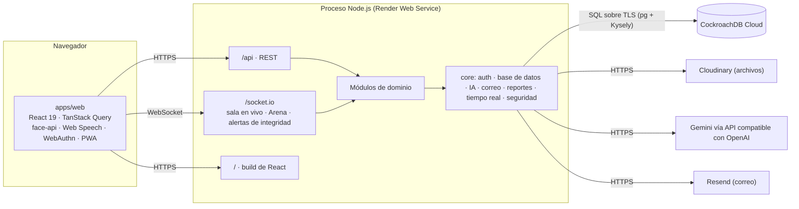

# Arquitectura

Ludoteka Campus es un **monolito modular**: un repositorio, un proceso de Node.js y una base de datos (CockroachDB). El mismo proceso entrega la API REST, el canal de Socket.IO y el build estático de React.

## Vista general

Los servicios externos guardan solo lo que la base no debe guardar: binarios (Cloudinary), inferencia de IA (Gemini) y envío de correo (Resend). Ninguno es imprescindible para operar: sin IA cada función usa su camino local, sin Resend el correo queda en la tabla `email_outbox` y sin Cloudinary la biblioteca no acepta archivos nuevos.

## Arranque de la API

`apps/api/src/main.ts`, en orden:

1. `loadEnv()` lee `apps/api/.env` (sin pisar variables ya definidas) y valida con zod (`core/config/env.ts`). Si `DATABASE_URL` trae `sslrootcert` y el archivo no existe en la máquina, lo quita: CockroachDB Cloud usa una CA pública.
2. `runMigrations()` aplica los archivos pendientes de `db/migrations` (ver [Modelo de datos](../datos.md#migraciones)). Si una falla, la API no arranca.
3. `seedIfEmpty()` siembra el colegio de demo si `users` está vacía; si no, solo recrea las cuentas de laboratorio que falten.
4. Crea la app Nest con prefijo global `api`, `trust proxy = 1` y sin `x-powered-by`.
5. Middlewares: cabeceras de seguridad (`core/security/headers.ts`), `cookie-parser`, cuerpo crudo de hasta 3 MB solo en las rutas de importación de Excel, y CORS con la lista de `CORS_ORIGIN`.
6. Si existe `apps/web/dist`, sirve el build y responde `index.html` a cualquier GET que no empiece por `/api` o `/socket.io`.
7. Escucha en `0.0.0.0:$PORT` (3000 por defecto).

Globales registrados en `app.module.ts`: `HttpExceptionFilter` (todo error sale como `{ error: { code, message } }`), `JwtAuthGuard` y `RolesGuard`, el emisor de eventos y el JWT de acceso (20 minutos).

## Módulos de dominio

Cada módulo vive en `apps/api/src/modules/<nombre>` y solo expone lo que pone en su `public-api.ts`.

| Módulo | Responsabilidad | Usa a |
|---|---|---|
| `identity` | Ingreso (contraseña, código, passkeys), sesiones, cuentas e importación, acudientes, ajustes | `legal` |
| `biometrics` | Consentimiento, registro y acceso facial | `identity` |
| `institution` | Años, periodos, grados, grupos, materias, matrículas y carga docente | — |
| `learning` | Cursos, unidades, lecciones, tareas, cartelera, foros | — |
| `assessment` | Banco de preguntas, evaluaciones e intentos, sala en vivo, planilla de notas, asistencia, rúbricas y alertas de riesgo | `learning` |
| `integrity` | Eventos de integridad en exámenes y suspensión | — |
| `certification` | Certificados con código verificable | `assessment` |
| `arena` | Competencia por equipos con código o QR | `learning` |
| `arcade` | Diez juegos calificados en el servidor y reto del día | `integrity`, funciones de `tutor` |
| `study` | Cuaderno, tarjetas SM-2, metas y sesiones de enfoque | `learning` |
| `library` | Archivos en Cloudinary, búsqueda híbrida, glosario, preguntas con citas | `learning` |
| `tutor` | Tutor IA y Mi ruta (generadores de ejercicios y maestría) | `identity`, `integrity`, `library`, `profile` |
| `profile` | Test «Descubre cómo aprendes» y perfil de método | — |
| `gamification` | XP, insignias, temporadas, rachas, misiones | (solo escucha eventos) |
| `notifications` | Bandeja de avisos y correos derivados de eventos | (solo escucha eventos) |
| `analytics` | Tableros, contadores del campus, reportes y Observatorio | funciones de `learning` y `library` |
| `governance` | Coordinación, rectoría, portal de familia y mensajes entre el personal | `profile` |
| `legal` | Documentos versionados, aceptaciones, exportación y solicitudes de datos | — |
| `health` | `GET /api/health` con ping a la base | — |

### Fronteras exigidas

`npm run deps:check` corre dependency-cruiser con dos reglas de severidad `error` (`apps/api/.dependency-cruiser.cjs`):

- **`cross-module-internals`:** un archivo de `modules/X` solo puede importar de otro módulo a través de su `public-api.ts`.
- **`listeners-are-not-imported`:** nadie importa `gamification`, `analytics` ni `notifications`; reaccionan a eventos.

La escritura de cada tabla la hace su módulo dueño. Los tableros y el Observatorio leen.

## Eventos de dominio

Lo transversal (XP, insignias, avisos, correo) se dispara con `@nestjs/event-emitter`. Los nombres están en `core/events/domain-events.ts`. La emisión ocurre en memoria, dentro del mismo proceso: no hay cola ni reintentos, así que un evento se pierde si el proceso cae justo después de emitirlo.

| Evento | Lo emite | Lo escucha |
|---|---|---|
| `lesson.completed`, `submission.graded` | learning | gamification |
| `attempt.graded` | assessment | gamification, tutor (maestría) |
| `integrity.violation` | integrity | notifications |
| `integrity.suspend` | integrity | assessment (suspende el intento) |
| `password.reset` | identity | notifications (correo) |
| `guardian.facial_revoked` | identity | biometrics (borra la plantilla) |
| `tutor.message`, `route.solved` | tutor | gamification |
| `news.published`, `news.read` | learning | notifications |
| `forum.reply`, `forum.mention` | learning | notifications |
| `forum.best_answer` | learning | notifications, gamification |
| `arena.finished` | arena | gamification |
| `arcade.finished` | arcade | gamification |
| `study.progress` | study | gamification |
| `profile.saved` | profile | gamification |
| `risk.alert_raised` | assessment | notifications |
| `meeting.scheduled` | governance | notifications (aviso y correo) |
| `meeting.responded` | governance | notifications |
| `guardian.message` | governance | notifications (aviso y correo) |
| `staff.message` | governance | notifications |
| `signature.requested` | governance, certification | notifications |
| `signature.decided` | governance | notifications |
| `badge.earned`, `badges.seen` | gamification | notifications |

## Tiempo real

Un único gateway de Socket.IO en el namespace por defecto (`core/realtime/realtime.gateway.ts`), montado sobre el mismo servidor HTTP.

- Al conectar, el cliente manda el JWT de acceso en `handshake.auth.token`. Con token válido el socket entra a la sala `user:<id>`; con token inválido o con cambio de clave pendiente se desconecta; sin token queda anónimo.
- `live:join { code }` une el socket a la sala `live:<CÓDIGO>` de una sala en vivo.
- Los módulos publican con `RealtimeService.to(sala, evento, datos)`.

| Evento | Sala | Origen | Lo consume |
|---|---|---|---|
| `live:roster`, `live:question`, `live:progress`, `live:ended` | `live:<código>` | assessment | `features/exam.tsx` |
| `arena:state` (vista por usuario) | `user:<id>` | arena | `features/arena.tsx` |
| `integrity:alert` | `user:<docente>` | integrity | Ningún componente lo escucha hoy; la página de integridad consulta cada 4 s |

Los avisos **no** llegan por socket: la web consulta `/api/notifications` cada 60 s. Las pantallas en vivo también consultan cada pocos segundos como respaldo si el socket se cae.

## Servicios del núcleo

- **Base de datos** (`core/database`): pool `pg` de 10 conexiones con Kysely. `withTx()` reintenta hasta 3 veces ante los códigos `40001` y `CR000` de CockroachDB. `readOnly()` abre una transacción de solo lectura con `statement_timeout` y rol restringido (la usa el Observatorio).
- **IA** (`core/ai/ai.service.ts`): cliente de la API compatible con OpenAI. Orden de modelos: `AI_MODEL_SMART` (solo en llamadas «inteligentes»), luego `AI_MODEL`, luego `AI_FALLBACK_MODELS`. Pasa al siguiente ante 404, 408, 429 o 5xx, respuesta vacía o tiempo agotado (30 s). Si no hay clave o fallan todos, devuelve `null` y la función usa su camino sin IA. Los embeddings (`gemini-embedding-2`, 768 dimensiones) no tienen modelo de respaldo. Cada uso se registra en `ai_usage` (función, modelo, usuario; nunca el contenido).
- **Correo** (`core/mail`): Resend si hay `RESEND_API_KEY`; siempre deja copia en `email_outbox`, redactada cuando el correo lleva códigos, enlaces de recuperación o claves temporales. Las cuentas `@eduquest.local` se redirigen a `LAB_OTP_INBOX`.
- **Reportes** (`core/reports`): PDF con pdfkit y Excel con exceljs. Cada reporte toma un número `LK-<año>-<secuencia>` de la secuencia `report_seq`, lo guarda en `report_log` e imprime un QR hacia `/verificar-reporte/<código>`.
- **Tareas al iniciar los módulos** (`onApplicationBootstrap`): Tutor sincroniza los temas de Mi ruta y Gamification el catálogo de insignias. Si hay Cloudinary, Library crea la guía de ejemplo cuando la biblioteca está vacía y genera hasta 25 portadas pendientes: descarga el PDF externo y dibuja su primera página, o lee la imagen `og:image` del enlace. Fuera de los servicios configurados (base, IA, correo y Cloudinary), estas son las únicas descargas de sitios externos que hace la API (ver [Seguridad](Security.md#protección-web)). Las portadas que faltan también se generan al indexar un PDF nuevo o al publicar un enlace.
- **Tareas periódicas:** temporizadores dentro del proceso. Assessment cierra salas en vivo abandonadas y Arena barre salas viejas cada 10 minutos; Governance envía el resumen semanal a acudientes cada hora si corresponde.

## Frontend

React 19 con Vite, TanStack Query y React Router 7. Todas las páginas se cargan bajo demanda. La web importa los esquemas y roles de `packages/contracts` directamente desde el código fuente. El compañero Luka o Luna es un solo componente que acompaña en todas las pantallas (`src/app/guide.tsx`); lee los mismos contadores del campus que el mapa y usa los comandos de voz mediante eventos del navegador. El detalle está en [Frontend](../frontend.md).

## Decisiones de diseño

| Decisión | Motivo | Consecuencia |
|---|---|---|
| Monolito modular en lugar de microservicios | Equipo pequeño, plan gratuito de Render y un dominio muy conectado | Fronteras exigidas por herramienta; un solo despliegue |
| Eventos para lo transversal | Gamificación y avisos tocan todo; sin eventos, cada módulo los importaría | Agregar una insignia o un aviso no toca el módulo que origina la acción |
| CockroachDB con Kysely y SQL a mano | CockroachDB es obligatorio; Kysely da tipos sin esconder el SQL | Migraciones en SQL puro, reintentos por serialización, sin triggers |
| Archivos en Cloudinary con subida firmada directa | El disco de Render es efímero y la base no es almacén de binarios | El archivo no pasa por la API; la API solo firma el ticket y registra el resultado |
| Biometría calculada en el navegador | No mover fotos de menores por la red | El servidor solo recibe vectores de 128 números y los guarda cifrados |
| Observatorio sobre vistas `v_*` con rol de solo lectura | Dejar que la IA escriba SQL sin darle acceso a tablas | Doble barrera: validador estático y permisos de la base |
| Arena con instantánea en la base | Sobrevivir reinicios del plan gratuito sin Redis | El estado de la sala se reconstruye desde `arena_rooms.snapshot` |
| Cada función de IA con camino local | La cuota gratuita de Gemini se agota | Tutor, Cuaderno, Mi ruta y Observatorio siguen funcionando sin IA |

## Límites conocidos

- **Una sola instancia.** Los retos de prueba de vida facial viven en memoria, los temporizadores corren en el proceso y Socket.IO no tiene adaptador compartido. Escalar a dos instancias exige mover esos retos a la base y agregar un adaptador (por ejemplo, Redis) a Socket.IO.
- **Plan gratuito de Render.** El servicio se duerme tras 15 minutos sin tráfico; la primera petición después tarda. Las salas en vivo y de Arena se recuperan desde la base.
