# Manual de usuario de Ludoteka Campus

| | |
|---|---|
| Sistema | Ludoteka Campus |
| Institución | Colegio Francisco Arango |
| Versión del documento | 1.0, octubre de 2026 |
| Dirección | [ludoteka-campus.onrender.com](https://ludoteka-campus.onrender.com) |
| Equipo | Darwin Joan Aveiga Mora (arquitectura y desarrollo full stack), Mariana Sofía Azabache Moreno (project manager, área creativa, diseño UI/UX y frontend), Julián Esteban Chávez Zamora (QA y apoyo en backend) |

> Las capturas de este manual se tomaron con datos de demostración (cursos, personas y notas inventadas). No muestran información real de estudiantes.

## Contenido

1. [Introducción](#1-introducción)
2. [Primeros pasos](#2-primeros-pasos)
3. [Conocer el campus](#3-conocer-el-campus)
4. [Estudiante](#4-estudiante)
5. [Docente](#5-docente)
6. [Coordinación](#6-coordinación)
7. [Rectoría](#7-rectoría)
8. [Acudiente](#8-acudiente)
9. [Administración](#9-administración)
10. [Preguntas frecuentes](#10-preguntas-frecuentes)
11. [Solución de problemas](#11-solución-de-problemas)
12. [Limitaciones conocidas](#12-limitaciones-conocidas)

## 1. Introducción

### Qué es Ludoteka Campus

Ludoteka Campus es el campus virtual del Colegio Francisco Arango. Cada persona entra a un mapa con los edificios que necesita según su rol: un estudiante ve sus cursos, juegos y herramientas de estudio; un docente ve su planilla de notas y su banco de preguntas; un acudiente ve el seguimiento de sus hijos. Luka (o Luna), el compañero de inteligencia artificial, acompaña como guía en todo el campus.

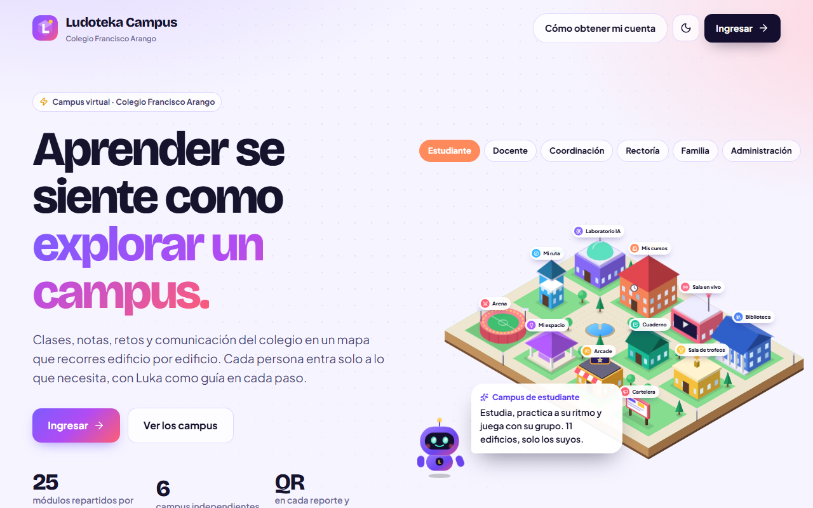

### Roles

| Rol | Para qué usa el campus |
|---|---|
| Estudiante | Estudiar lecciones, presentar prácticas y exámenes, jugar, repasar y preguntar al tutor |
| Docente | Crear contenido y evaluaciones, calificar, tomar asistencia, conducir salas en vivo, escribir a las familias |
| Coordinación | Hacer seguimiento a las alertas de riesgo, consolidar asistencia y citar a los acudientes |
| Rectoría | Ver los indicadores del colegio, firmar certificados y boletines, emitir comunicados oficiales |
| Acudiente | Seguir el avance de sus hijos, responder citaciones, autorizar el tutor de IA y el acceso facial |
| Administración | Crear y gestionar cuentas, montar la estructura académica, vincular acudientes y abrir cursos |

### Qué se necesita

- Un computador, tableta o celular con un navegador actualizado (Chrome, Edge, Safari o Firefox).
- Conexión a internet.
- Una cuenta entregada por el colegio. No hay registro público.
- Opcional: cámara (para el acceso facial) y micrófono (para los comandos de voz y el dictado).

### Convenciones de este manual

- Los textos en **negrita** son botones, pestañas o campos tal como aparecen en la pantalla.
- «Luka» se refiere al compañero de IA. Cada estudiante puede cambiarlo por «Luna» en Ajustes; las pantallas usan el nombre elegido.
- Las capturas son de computador. En el celular las mismas funciones están en la barra inferior y en el menú **Más** (ver [En el celular](#en-el-celular)).

## 2. Primeros pasos

### Cómo obtener la cuenta

El colegio crea todas las cuentas. Cuando secretaría o administración crea la suya, usted recibe un correo con el asunto «Tu cuenta de Ludoteka Campus», su correo de ingreso y una **clave temporal**. Si no le ha llegado, pida en secretaría que reenvíen su acceso.

### Ingresar

1. Abra la dirección del campus y pulse **Ingresar**.
2. Escriba su **Correo institucional** y su **Contraseña**, y pulse **Continuar**.

   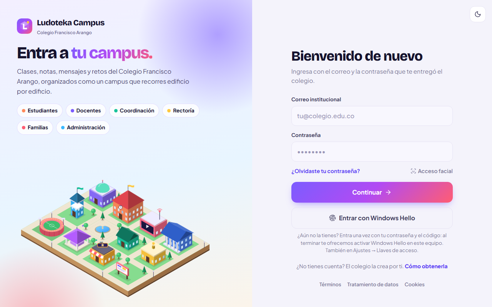

3. Revise su correo: le llega un código de 6 dígitos con el asunto «Tu código de ingreso». Escríbalo en **Código de verificación**; al completar el sexto dígito se envía solo.

   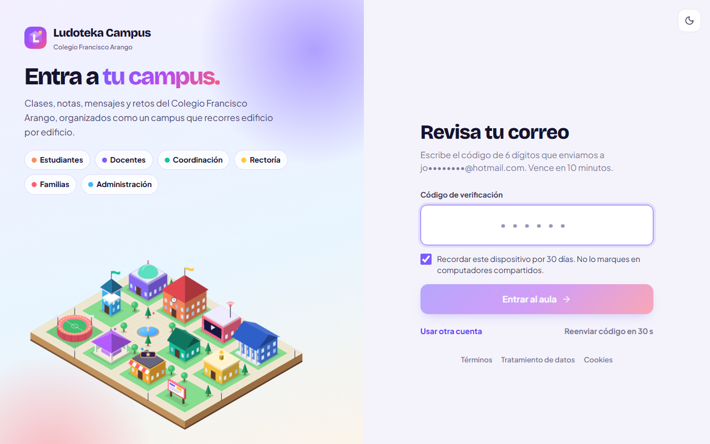

Datos útiles sobre el código:

- Vence a los 10 minutos y admite 5 intentos.
- Para pedir otro hay que esperar 30 segundos (**Reenviar código**). El código nuevo anula el anterior.
- La casilla **Recordar este dispositivo por 30 días** viene marcada. Mientras el equipo esté recordado no se le pedirá el código, pero sí la contraseña. **Desmárquela en computadores compartidos.**

### Primer ingreso

La primera vez que entra, el campus le pide tres cosas.

**1. Crear su contraseña.** Escriba la **Clave temporal (la del correo)**, la **Nueva contraseña** y repítala, y pulse **Guardar y entrar**. La contraseña debe tener al menos 8 caracteres, con al menos una letra y un número.

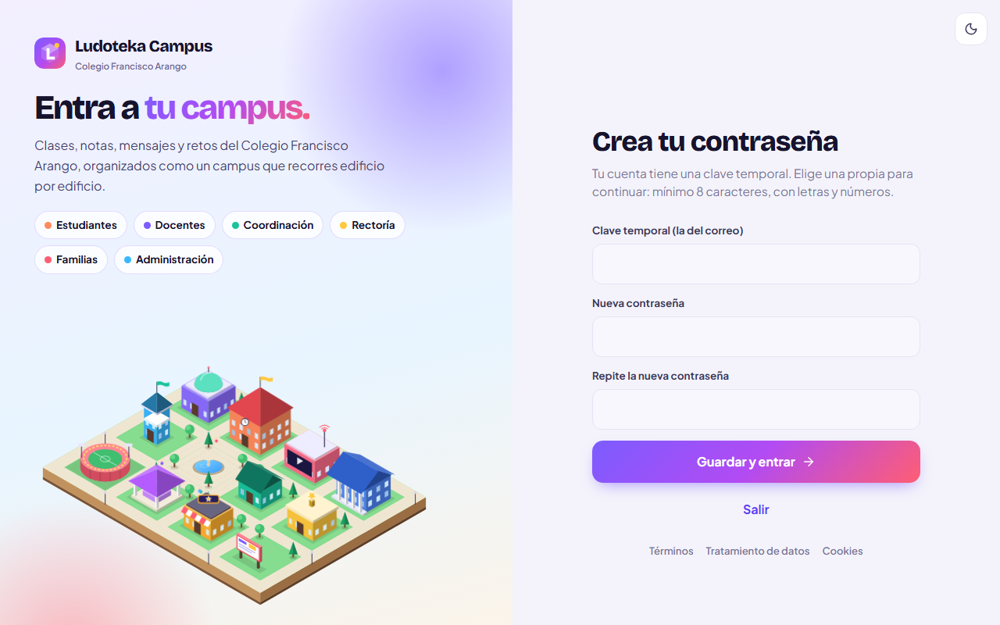

**2. Aceptar los documentos.** En la pantalla «Antes de entrar» puede abrir los términos y condiciones, la política de tratamiento de datos y el aviso de cookies. Marque la casilla de aceptación y pulse **Aceptar y entrar**.

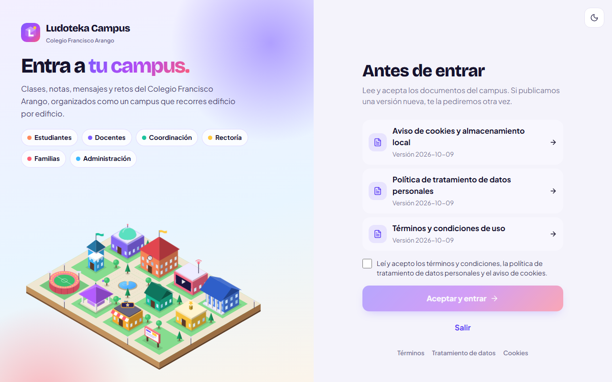

- Si es **acudiente de un menor**, la pantalla muestra «También aceptas en nombre de:» con sus hijos. Mientras usted no acepte, ellos no pueden usar el campus.
- Si es **estudiante menor de edad** y su acudiente ya tiene cuenta, verá «Falta la autorización de tu acudiente». Pídale que entre con su cuenta y acepte; después pulse **Ya aceptó, revisar de nuevo**.

**3. Recorrido con Luka.** La primera vez que llega a su campus, Luka le muestra cómo moverse en unos pocos pasos. Use **Siguiente** para avanzar o **Saltar** para cerrarlo. Puede repetirlo cuando quiera tocando a Luka (esquina inferior derecha) › **Recorrido del campus**.

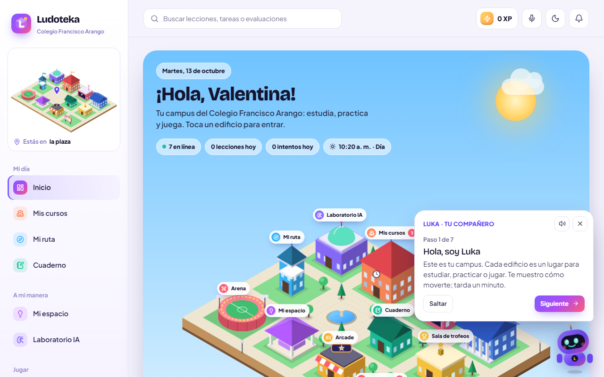

### Recuperar la contraseña

1. En la pantalla de ingreso pulse **¿Olvidaste tu contraseña?**.
2. Escriba su correo y pulse **Enviar enlace**.
3. Abra el correo «Recupera tu contraseña de Ludoteka Campus» y pulse **Elegir mi contraseña**. El enlace sirve una sola vez y vence en una hora.
4. Escriba la nueva contraseña y pulse **Guardar contraseña**. Al cambiarla se cierran sus sesiones en otros equipos y la cuenta se desbloquea.

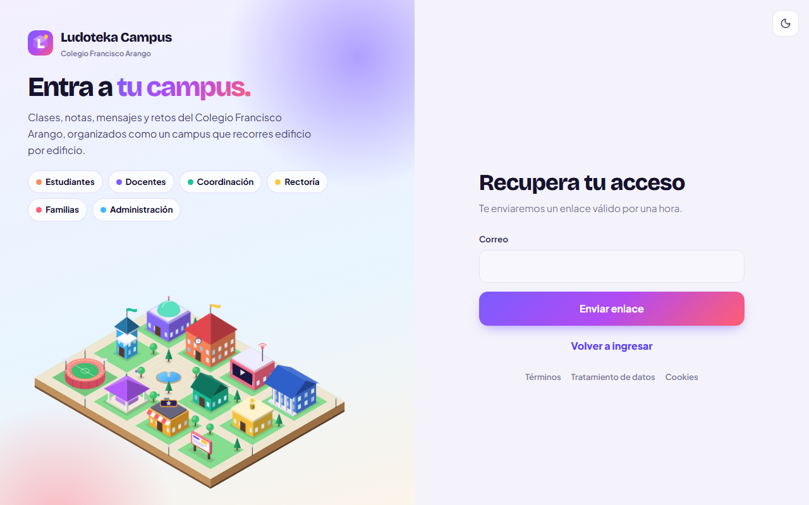

### Entrar más rápido

Además del equipo recordado, hay dos formas de entrar sin escribir el código.

**Windows Hello, Face ID o huella (llaves de acceso).** Después de entrar con contraseña y código, el inicio le ofrece «¿Entrar con Windows Hello la próxima vez?» (el nombre cambia según el equipo). Pulse **Activar Windows Hello** (o el nombre que aparezca) y siga las instrucciones de su dispositivo. También puede hacerlo en **Ajustes › Seguridad › Llaves de acceso**. Desde entonces, en la pantalla de ingreso pulse **Entrar con Windows Hello** (o Face ID, Touch ID, huella).

**Acceso facial.** Funciona con la cámara del equipo y una prueba de vida (parpadear o girar la cabeza).

1. Vaya a **Ajustes › Seguridad › Configurar acceso facial**.
2. Lea la «Autorización de datos biométricos» y pulse **Acepto el tratamiento**. Si es menor de edad, su acudiente debe autorizarlo antes desde su cuenta.
3. Pulse **Registrar mi rostro**, mire de frente a la cámara con buena luz y quédese quieto mientras se toman 5 muestras.
4. Para entrar, en la pantalla de ingreso pulse **Acceso facial** › **Entrar con mi rostro** y haga el gesto que se le pida.

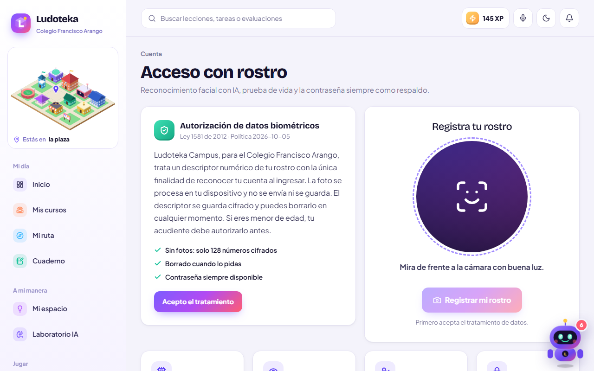

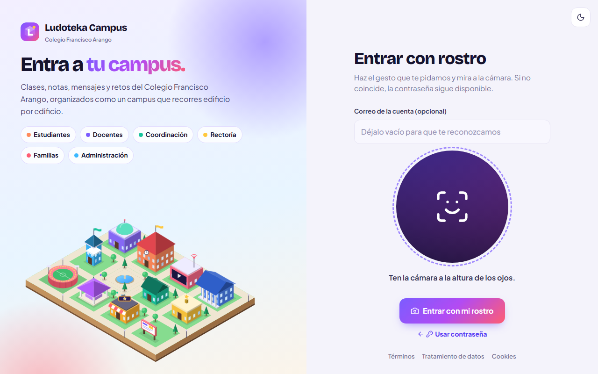

El campus no guarda fotos, solo un patrón numérico cifrado. Puede borrarlo cuando quiera con **Borrar mi rostro**. Tras 5 intentos fallidos el acceso facial se bloquea 15 minutos; la contraseña sigue funcionando.

### Una sesión por navegador

Cada navegador admite una sola sesión abierta a la vez. Si en el mismo navegador ya hay otra cuenta abierta, verá «Este navegador ya tiene abierta la sesión de…»: cierre esa sesión (icono de salir en la tarjeta inferior de la barra lateral, o **Más › Salir** en el celular) antes de entrar con otra cuenta. Varias cuentas sí pueden recordar el mismo equipo, por ejemplo en un portátil familiar.

## 3. Conocer el campus

### La pantalla principal

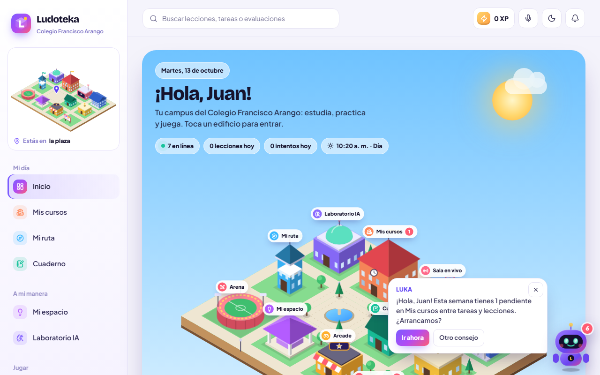

- **Barra lateral (izquierda):** el minimapa del campus (el marcador indica dónde está), los edificios de su rol agrupados por zona, y **Notificaciones** y **Ajustes** al final. En la tarjeta inferior están su nombre, su rol y el botón para salir.
- **Barra superior:** la experiencia acumulada (**XP**, solo estudiantes), el micrófono de comandos de voz, el botón de tema claro u oscuro y la campana de notificaciones.
- **El mapa:** toque cualquier edificio para entrar. El saludo y el cielo cambian con la hora del día.
- **Luka (esquina inferior derecha):** en el inicio le muestra un consejo según lo que tiene pendiente, con **Ir ahora** para abrirlo y **Otro consejo** para ver el siguiente. Cierre la nota con la **X**; no vuelve a salir mientras tenga abierta esa pestaña y reaparece cuando abra el campus de nuevo.

### En el celular

En el celular la barra lateral se reemplaza por una barra inferior con **Inicio**, los tres edificios principales de su rol y **Más**. Al tocar su avatar (arriba a la derecha) o **Más** se abre «Todo Ludoteka», con su perfil, el minimapa, todos los edificios, el cambio de tema y **Salir**.

| Inicio | Menú «Todo Ludoteka» |
|---|---|
| 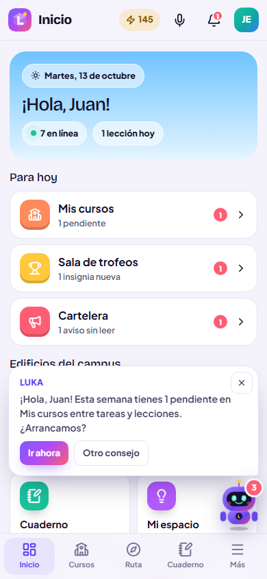 | 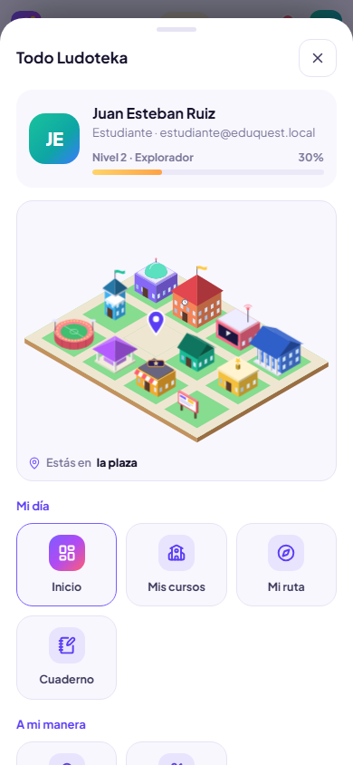 |

### Luka, su guía

Luka vive en la esquina inferior derecha de todas las pantallas. Flota, sigue el puntero con la mirada y saluda con la mano cuando llega algo nuevo o cuando lleva un rato sin actividad. El número rojo sobre él indica cuántas cosas tiene por revisar.

Tóquelo y le saluda en voz alta con un consejo y estas opciones:

| Opción | Qué hace |
|---|---|
| **Qué tengo pendiente** | Lista lo primero que debe atender y los edificios con pendientes; toque cualquiera para abrirlo |
| **Cómo funciona…** | Explica el edificio donde está, paso a paso |
| **Recorrido del campus** | Repite el recorrido guiado |
| **Preguntarme un tema** | Abre el tutor (estudiantes). Docentes y directivos ven **Consultar el Observatorio** |
| **Darme una orden por voz** | Activa el micrófono de comandos de voz |
| **Léeme esta página** | Lee en voz alta el contenido de la pantalla |
| **Elegir entre Luka y Luna** | Abre **Ajustes › Compañero IA** |

El botón del altavoz, arriba en el panel de Luka, lo silencia o le devuelve la voz; la preferencia se guarda en ese navegador. **Esc** o la **X** cierran el panel.

| Opciones de Luka | Qué tengo pendiente |
|---|---|
| 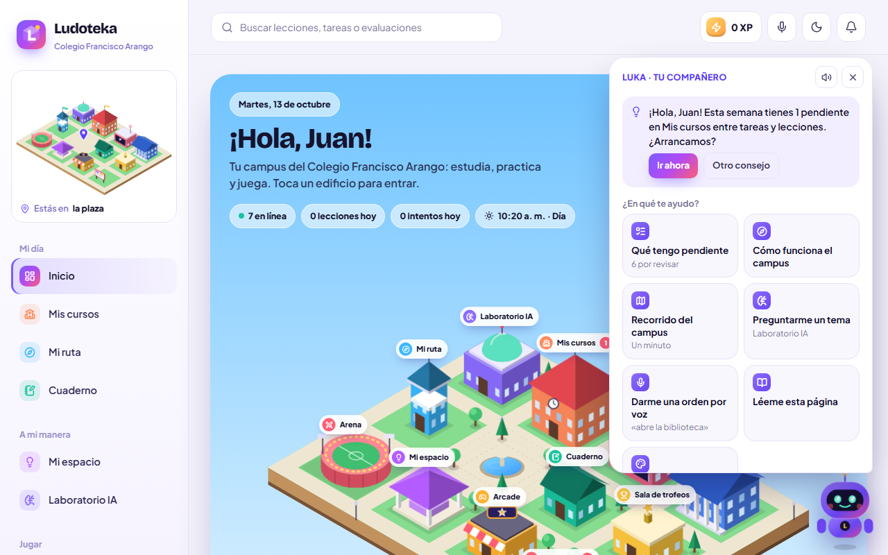 | 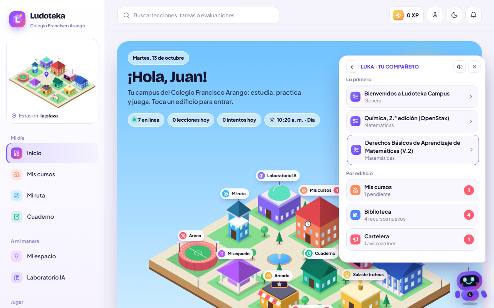 |

### Comandos de voz

Pulse el micrófono de la barra superior y hable. Para ver todas las frases, diga «qué puedo decir» o haga clic derecho sobre el micrófono.

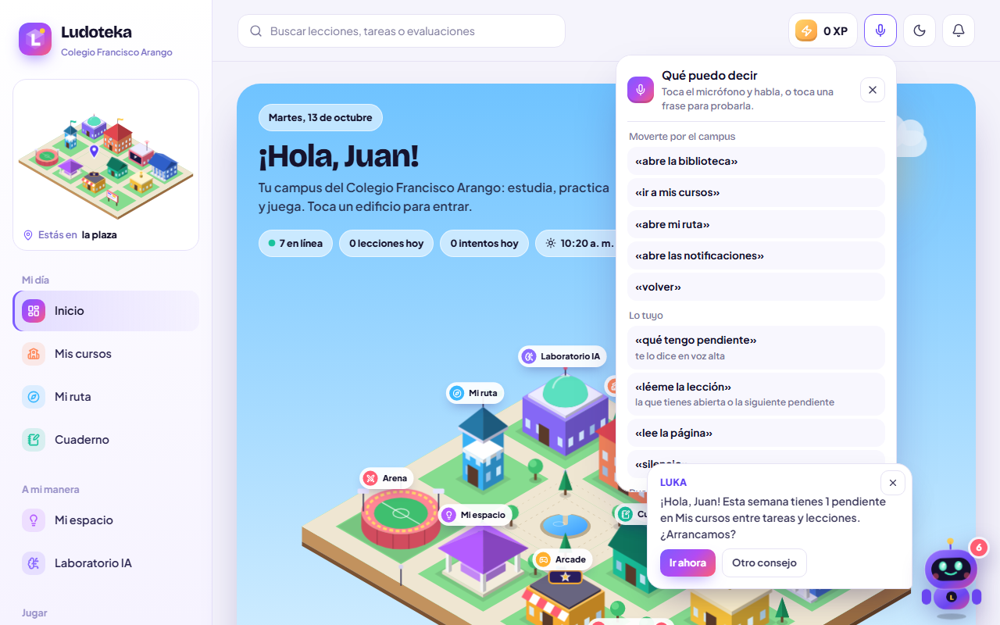

Algunos ejemplos:

- «abre la biblioteca», «ir a mis cursos», «abre las notificaciones», «volver»
- «qué tengo pendiente» (se lo dice en voz alta)
- «léeme la lección» (estudiantes)
- «busca en la biblioteca fotosíntesis»
- «pregúntale a Luka cómo sumo fracciones»
- «empieza un reto de fracciones» (estudiantes)
- «modo oscuro», «modo claro», «silencio»

En los campos de texto largos aparece además el botón **Dictar**, que convierte su voz en texto. La voz funciona en Chrome, Edge y Safari; el navegador le pedirá permiso para usar el micrófono.

### Notificaciones

La campana muestra cuántos avisos nuevos tiene. **Ver todas** abre la página de notificaciones, donde puede filtrar por **Sin leer** o por tipo (avisos, cartelera, foros, logros, citaciones, mensajes, firmas…). El botón **Ir** de cada aviso lo lleva a donde ocurrió y lo marca como leído.

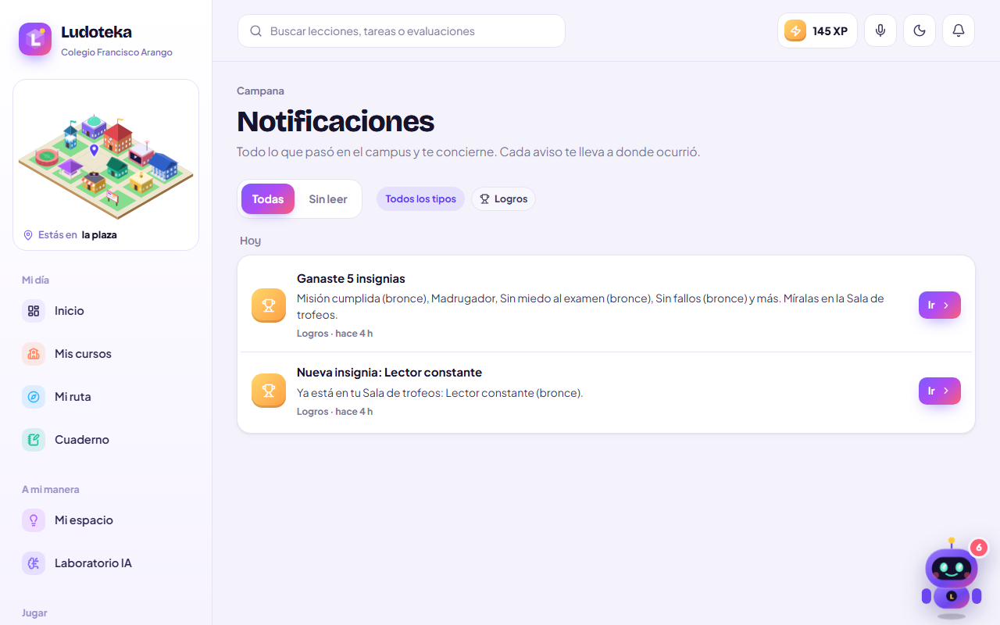

### Ajustes

En **Ajustes** hay cinco pestañas:

| Pestaña | Qué contiene |
|---|---|
| **Perfil** | Sus datos (los corrige secretaría) y el cambio de contraseña |
| **Seguridad** | Llaves de acceso, acceso facial, dispositivos de confianza, sesiones abiertas y **Cerrar sesión en todos los dispositivos** |
| **Compañero IA** | Elegir entre Luka y Luna, y la voz con la que le leen |
| **Apariencia** | Tema claro, oscuro o como el dispositivo |
| **Privacidad** | Los documentos que aceptó, **Descargar mis datos** y **Solicitar eliminación de mis datos** |

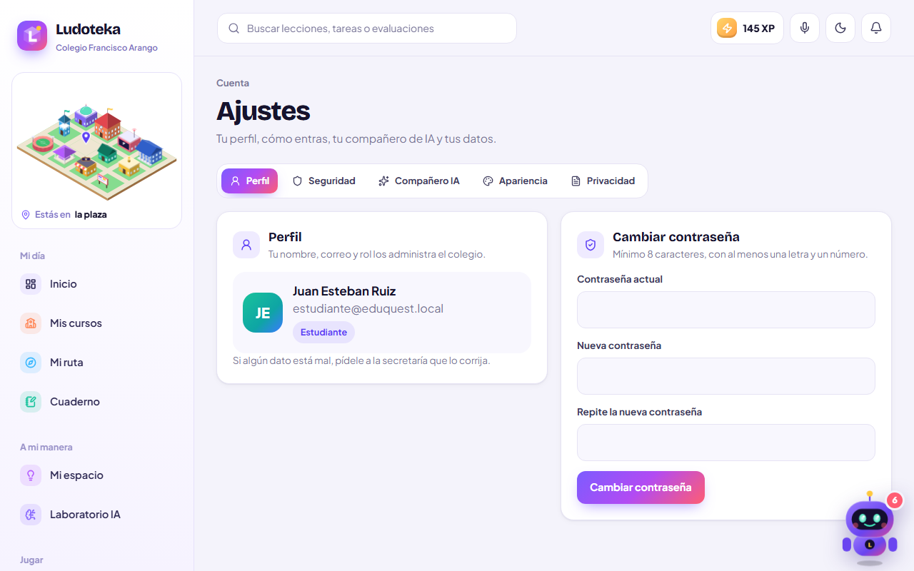

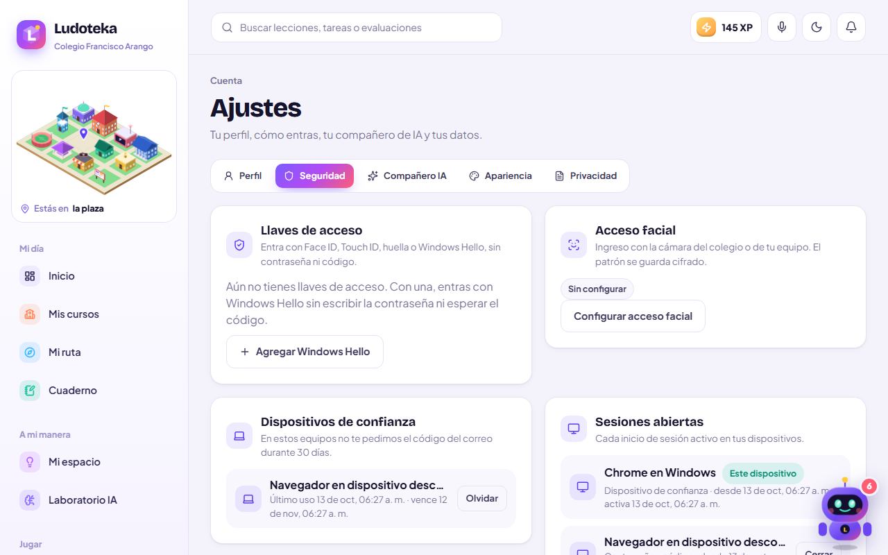

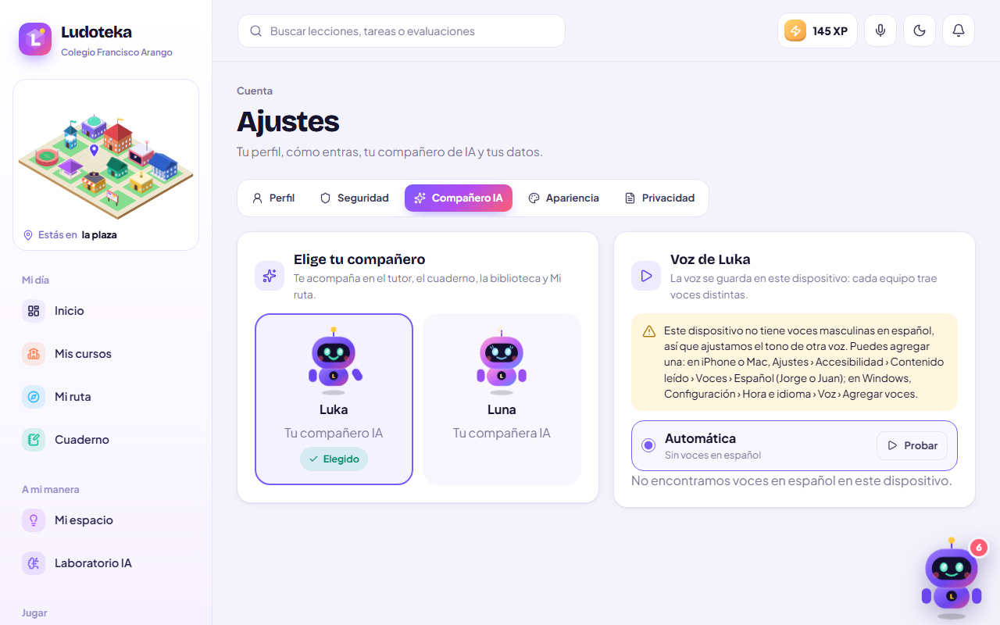

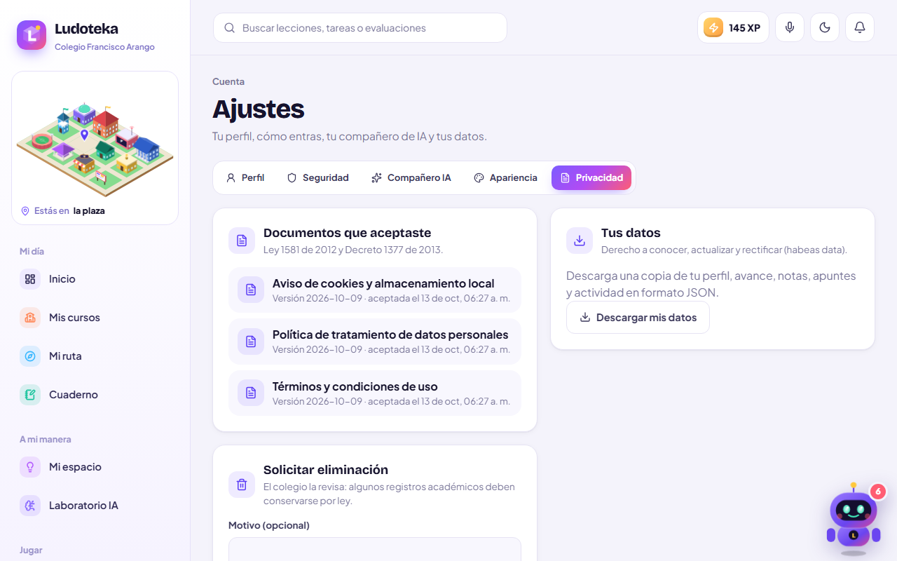

Si pierde un equipo, entre desde otro y use **Seguridad › Cerrar sesión en todos los dispositivos**: se cierran todas las sesiones y se olvidan los equipos de confianza.

Sobre sus datos (Ley 1581 de 2012): **Descargar mis datos** entrega un archivo con su perfil, avance, notas y actividad. **Solicitar eliminación** envía la solicitud al colegio, que tiene hasta 15 días hábiles para responder; algunos datos académicos deben conservarse por ley.

## 4. Estudiante

Sus edificios están en cuatro zonas: **Mi día** (Mis cursos, Mi ruta, Cuaderno), **A mi manera** (Mi espacio, Laboratorio IA), **Jugar** (Sala en vivo, Arena, Arcade, Sala de trofeos) y **Colegio** (Biblioteca, Cartelera).

### Mis cursos

Cada curso es un mapa de aventura con unidades y lecciones. La tarjeta de cada curso muestra cuántas lecciones lleva.

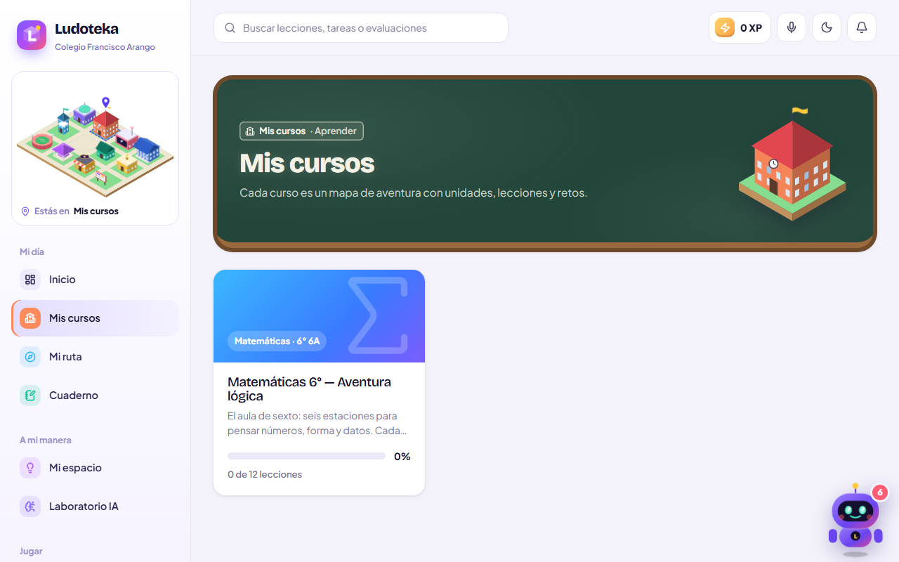

Al abrir un curso verá las unidades y sus lecciones como paradas del camino. La siguiente lección pendiente tiene la etiqueta **¡EMPIEZA!**. A la derecha están la **Liga del grupo** (ranking de XP) y el acceso al tutor.

**Completar una lección:**

1. Toque la lección en el mapa. Puede pulsar **Escuchar lección** para que se la lean.
2. Al terminar de leer, pulse **Marcar estación completa**.
3. Verá «¡Estación completada!» y ganará 25 XP (solo la primera vez). **Siguiente** lo devuelve al mapa.

| Lección | Lección completada |
|---|---|
| 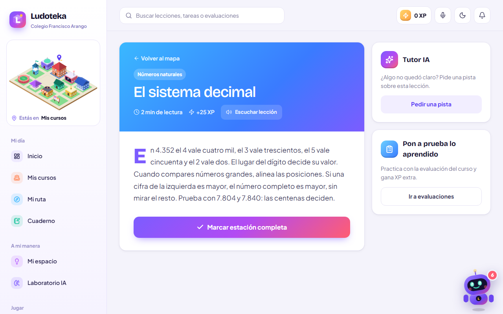 | 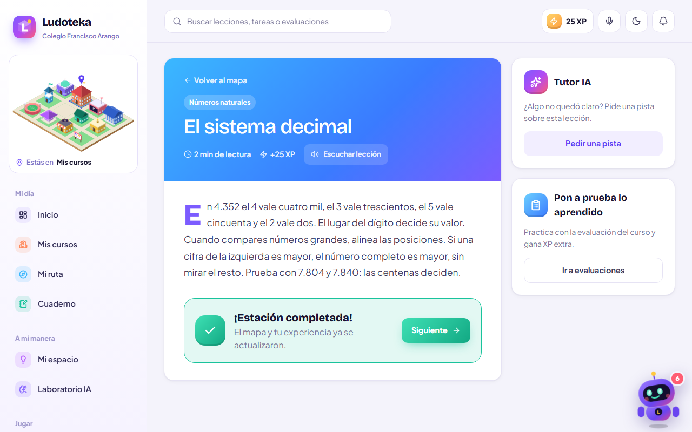 |

### Tareas y evaluaciones del curso

En el mapa del curso pulse **Tareas y evaluaciones**. Ahí están las evaluaciones, las tareas y el calendario del curso.

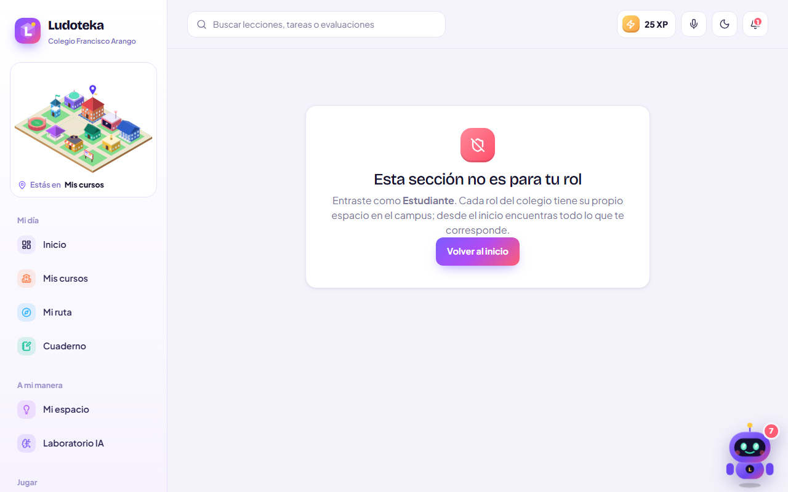

**Entregar una tarea:** escriba su respuesta en **Tu entrega** (o use **Dictar**) y pulse **Entregar**. Puede reenviarla; cuando el docente califique verá «Calificada» con la nota. Las entregas son de texto; no se adjuntan archivos.

**Presentar una práctica o un examen:**

1. Pulse **Comenzar** en la tarjeta de la evaluación.
2. Responda cada pregunta tocando una opción. Muévase con **Anterior**, **Siguiente** o los números de arriba. Cada respuesta se guarda al instante y puede cambiarla hasta entregar.
3. En la última pregunta pulse **Entregar evaluación**.

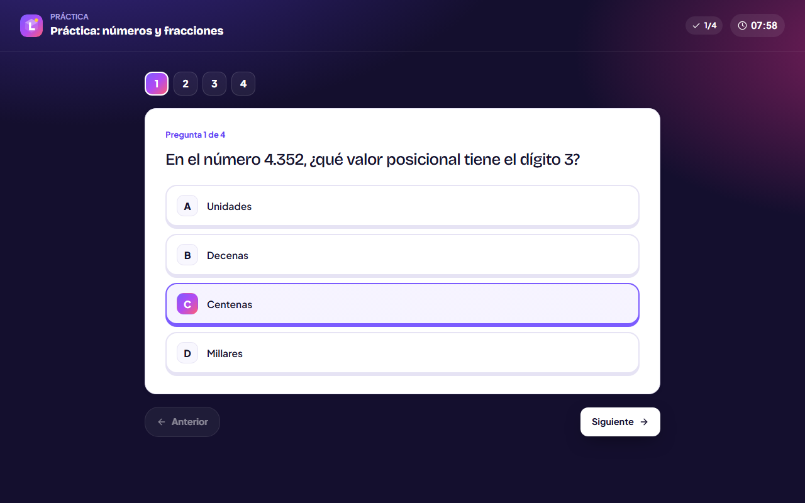

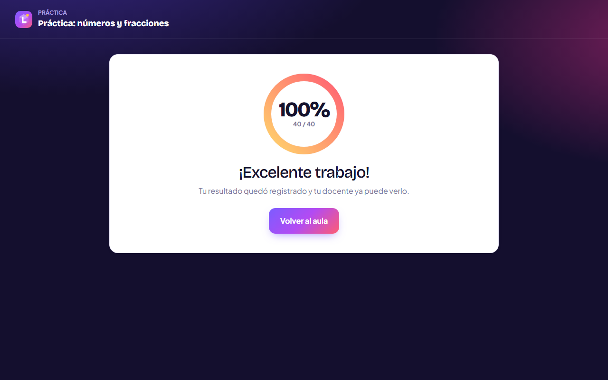

Diferencias entre práctica y examen:

- Las **prácticas** se pueden repetir y no tienen control de integridad.
- Los **exámenes** se presentan una sola vez, en pantalla completa («EXAMEN EN KIOSCO», «Integridad activa»). Salir de pantalla completa, cambiar de pestaña, perder el foco de la ventana o pulsar Esc genera un aviso: «Aviso N. Mantente en la pantalla del examen.». **Al tercer aviso el examen se suspende** y el docente recibe una alerta.
- Mientras hay un examen activo se apagan el tutor, el Arcade y Mi ruta.

### Sala en vivo

Cuando el docente proyecta un código:

1. Entre a **Sala en vivo**, escriba el código y pulse **Entrar**. Verá «¡Estás dentro!».
2. Cuando aparezca cada pregunta, toque uno de los cuatro colores. Solo hay un intento por pregunta.
3. Al cerrar la sala verá su puntaje; el resultado queda en sus notas.

| Escribir el código | Responder |
|---|---|
| 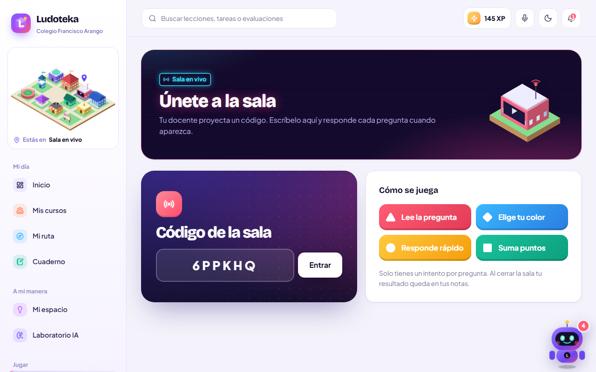 | 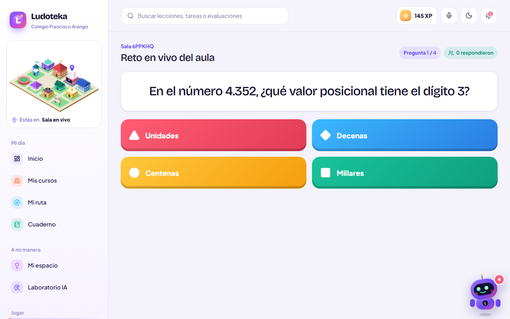 |

### Mi ruta

Mi ruta es un sendero de temas de matemáticas con retos que se ajustan a su nivel. Cada parada muestra su nivel (1 a 10) y sus estrellas.

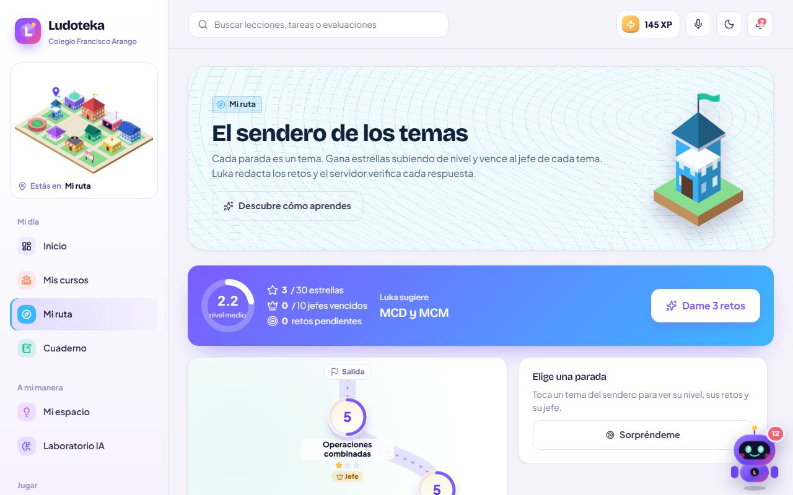

1. Toque un tema del sendero (o pulse **Dame 3 retos** para que Luka elija).
2. Pulse **3 retos**. Desde el nivel 4 se habilita el **Reto jefe**.
3. Escriba su respuesta y pulse **Responder**. Si se atasca, use **Pista** o **Dibujarlo**.

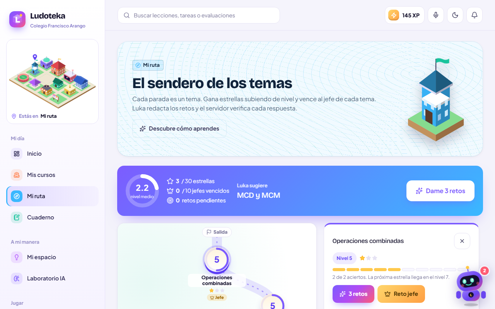

Reglas: dos aciertos seguidos suben un nivel y dos fallos seguidos lo bajan. Las estrellas se ganan en los niveles 4, 7 y 10. Vencer al jefe sube un nivel; perder no quita nada. Puede tener hasta 6 retos pendientes.

### Cuaderno

El Cuaderno reúne sus apuntes, tarjetas de repaso, sesiones de enfoque y metas.

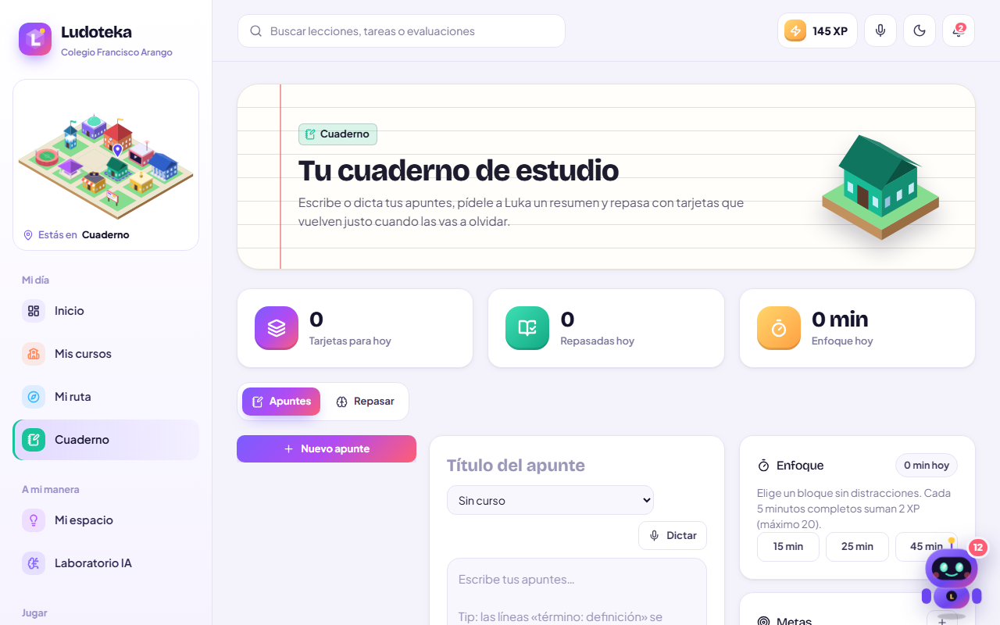

- **Apuntes:** pulse **Nuevo apunte**, escriba un título y el contenido (o díctelo) y pulse **Guardar**. Con **Resumir con Luka** obtiene las ideas clave y tarjetas sugeridas que puede crear con **Crear estas tarjetas**.
- **Repasar:** en la pestaña **Repasar** voltee cada tarjeta con **Ver respuesta** y califíquese con **Otra vez**, **Difícil**, **Bien** o **Fácil**. La tarjeta vuelve cuando está a punto de olvidarla.
- **Enfoque:** elija un bloque de **15**, **25** o **45** minutos sin distracciones. Cada 5 minutos completos suman 2 XP.
- **Metas:** pulse **+** y defina una meta diaria o semanal (tarjetas, minutos de enfoque, lecciones o retos).

### Mi espacio

Responda el cuestionario «Descubre cómo aprendes» (12 situaciones, unos 3 minutos) y Luka le recomendará uno de seis métodos: Teoría, Ejemplos resueltos, Juegos, Práctica y retos, Visual o Conversación. Puede cambiar de método cuando quiera y repetir el cuestionario una vez por periodo.

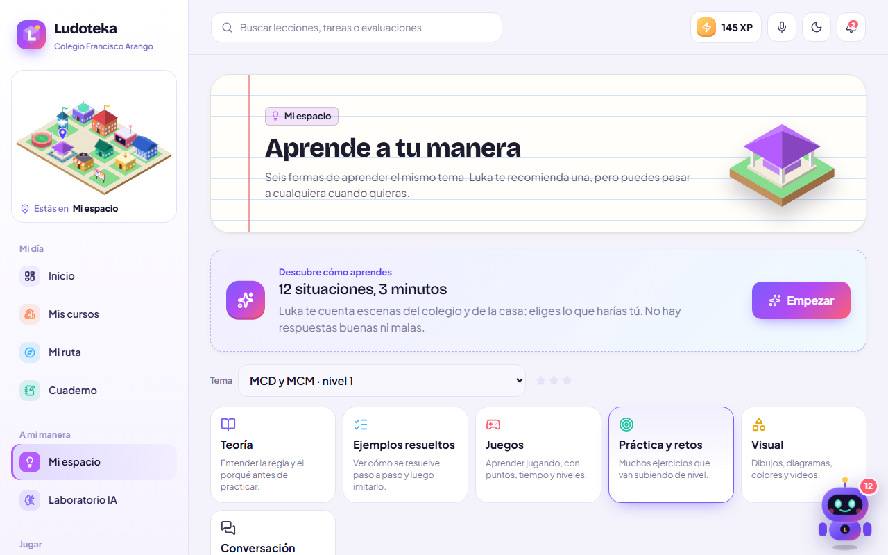

### Laboratorio IA (tutor)

El tutor da pistas paso a paso, nunca la respuesta final. Escriba o dicte su duda y pulse **Pedir pista**. Cuando usa la biblioteca del colegio, cita la guía y la página.

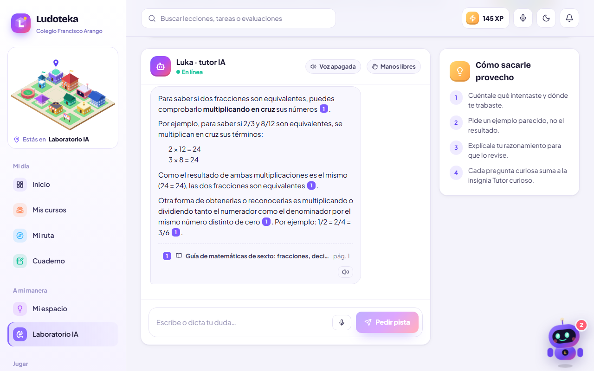

- **Voz activada** lee las respuestas en voz alta; **Manos libres** envía lo que dicta sin tocar el botón.
- Si es menor de edad, su acudiente debe autorizar el tutor desde su cuenta. Si no lo ha hecho, verá «Tu acudiente debe autorizar el tutor con IA desde su panel antes de que puedas usarlo.».
- El tutor se apaga mientras tenga un examen activo.

### Arena

La Arena es una competencia por equipos que abre el docente.

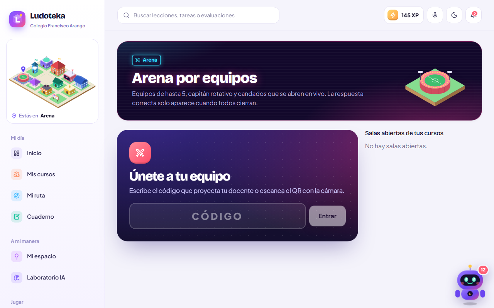

1. Escriba el código que proyecta el docente (o escanee el código QR) y pulse **Entrar**. El campus lo asigna a un equipo.
2. En cada pregunta todos votan. El capitán (rota en cada pregunta) cierra el candado con **Cerrar con…**. Si el capitán no responde, después de 30 segundos cualquiera puede pulsar **Tomar el mando**.
3. Al final se revela el podio. Gana XP por jugar, por cada acierto del equipo y por el puesto.

### Arcade

Diez juegos cortos ligados a sus temas, más un **Reto del día** igual para todo el colegio. Las preguntas y la calificación vienen del servidor.

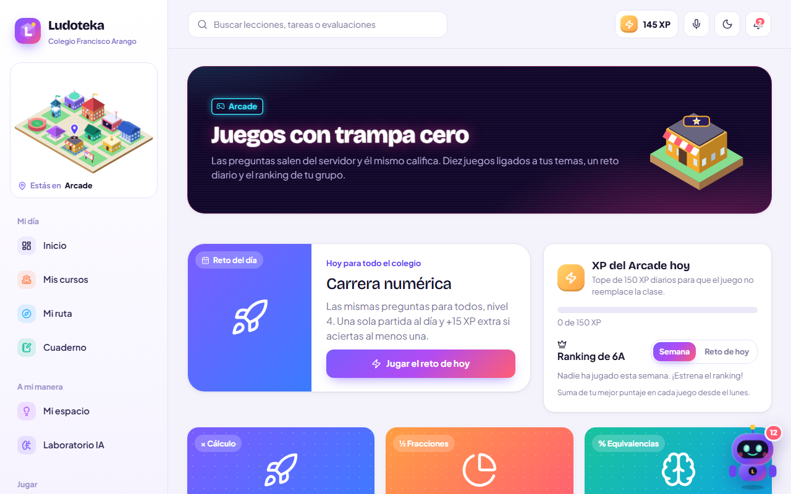

Pulse **Jugar** en la tarjeta de un juego, responda las rondas antes de que se acabe el tiempo y al final verá sus aciertos, puntos y XP. El Arcade da como máximo 150 XP al día, para que el juego no reemplace la clase.

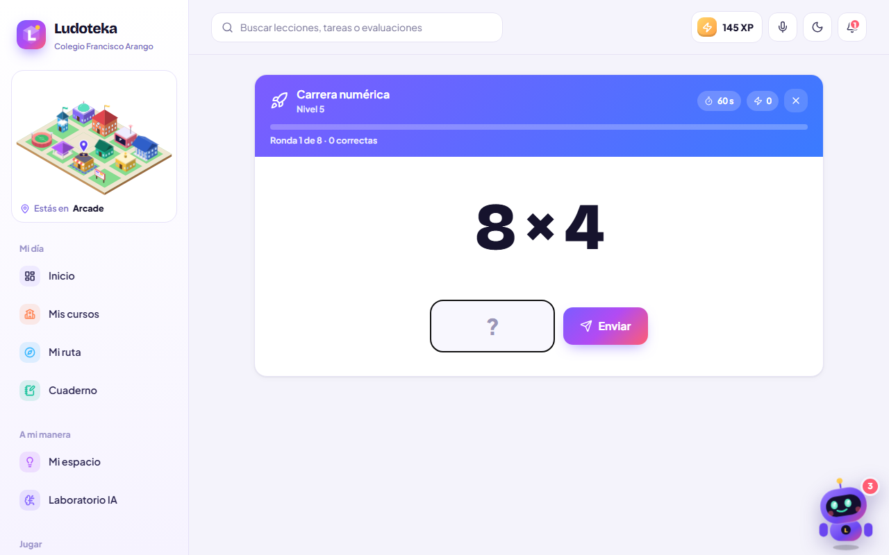

### Sala de trofeos

Aquí están su nivel (Aprendiz, Explorador, Estratega, Analista, Mentor), su racha de días, las insignias ganadas y por ganar, las misiones de la semana y sus certificados. La racha crece cada día con actividad (una lección, un reto, un repaso, una partida…) y se rompe si pasa un día sin actividad.

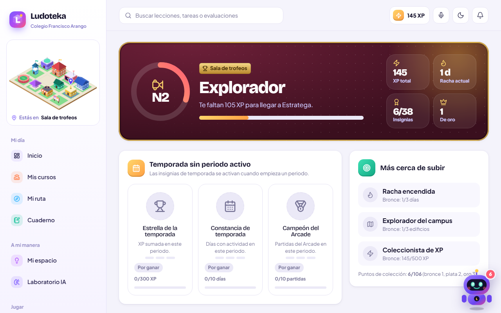

### Biblioteca

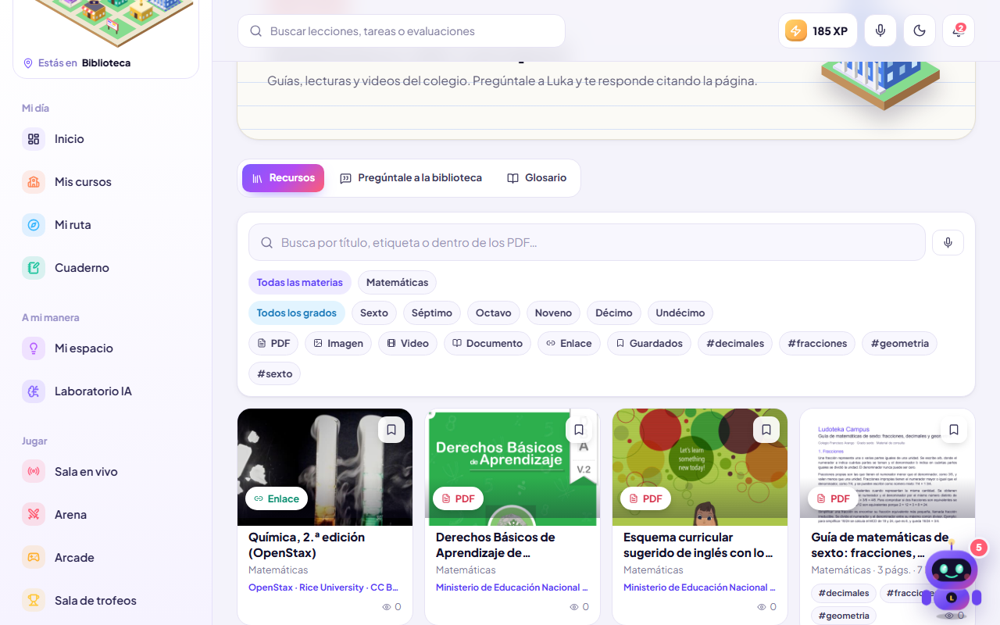

- **Recursos:** busque por título, etiqueta o dentro de los PDF, y filtre por materia, grado o tipo. El icono de marcador guarda un recurso; en el detalle puede anotar la página y una nota.
- **Pregúntale a la biblioteca:** Luka responde solo con lo que dicen los documentos y cita la página.
- **Glosario:** conceptos con definición y ejemplo.

### Cartelera

En **Novedades** están las circulares del colegio y los avisos de sus cursos. Si un aviso dice «Requiere confirmación», ábralo y pulse **Confirmo que la leí**. En **Foros de curso** puede abrir temas (**Nuevo tema**), responder, mencionar a alguien con @, adjuntar recursos de la biblioteca y reaccionar a las respuestas. El autor de un tema puede marcar la mejor respuesta.

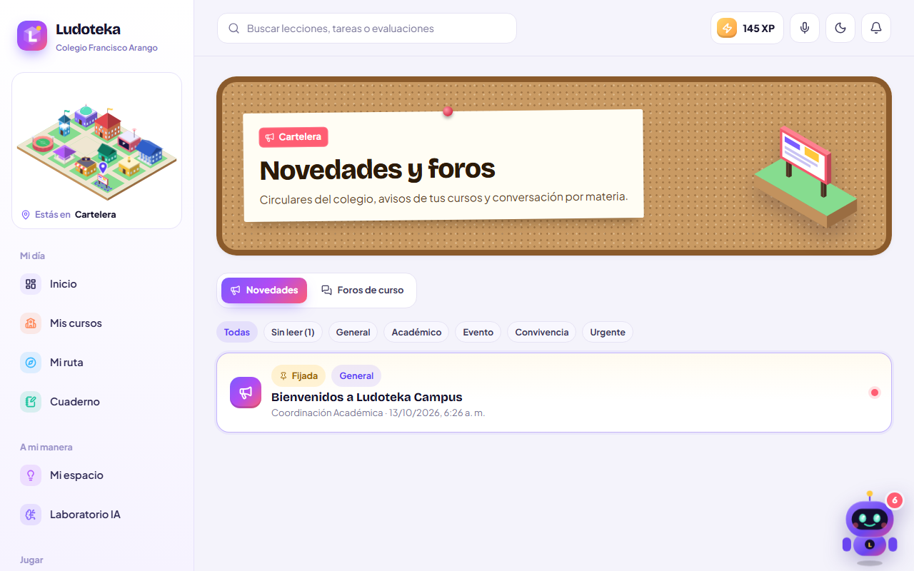

## 5. Docente

Sus edificios: **Enseñar** (Mis cursos, Planilla de notas, Banco de preguntas), **En clase** (Sala en vivo, Arena), **Comunicación** (Mensajes, Cartelera) y **Recursos** (Biblioteca, Observatorio).

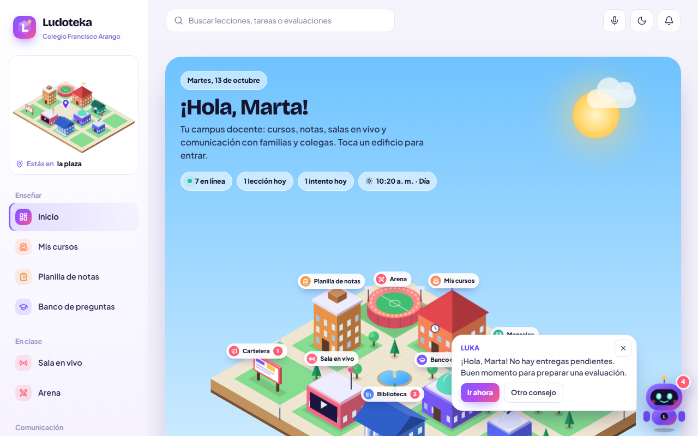

El inicio resume sus cursos, las entregas por calificar, las salas abiertas y los mensajes sin leer. La tarjeta «Tu semana docente» tiene accesos directos a las tareas más frecuentes.

### Contenido del curso

Abra **Mis cursos** y luego el curso. Los cursos los abre administración; usted les agrega unidades y lecciones.

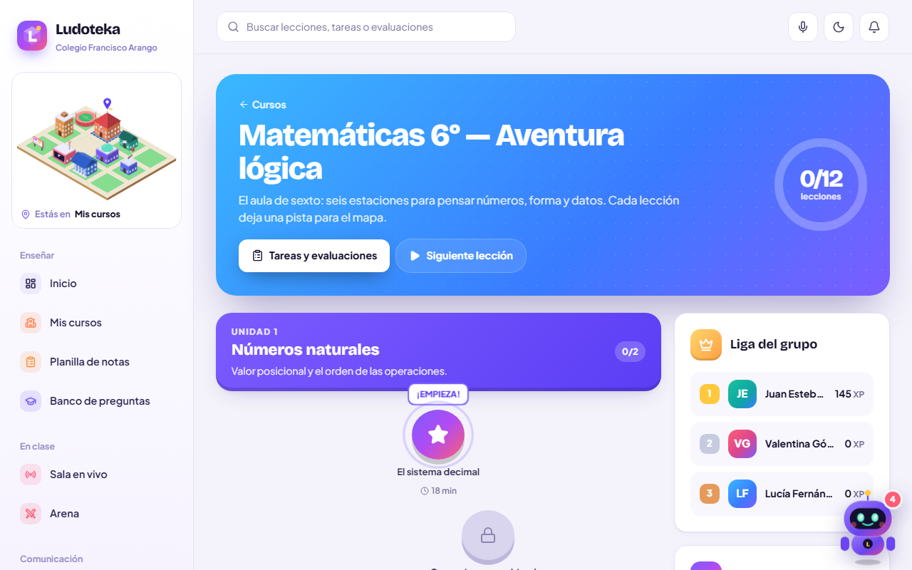

**Agregar una unidad con sus lecciones:**

1. Baje hasta el formulario **Nueva unidad**, escriba el **Título** y el **Resumen**, y pulse **Agregar unidad**.
2. El formulario cambia a **Nueva lección** para esa unidad. Escriba el **Título** y el **Contenido** (las líneas en blanco separan párrafos) y pulse **Agregar lección**. Repita para cada lección.

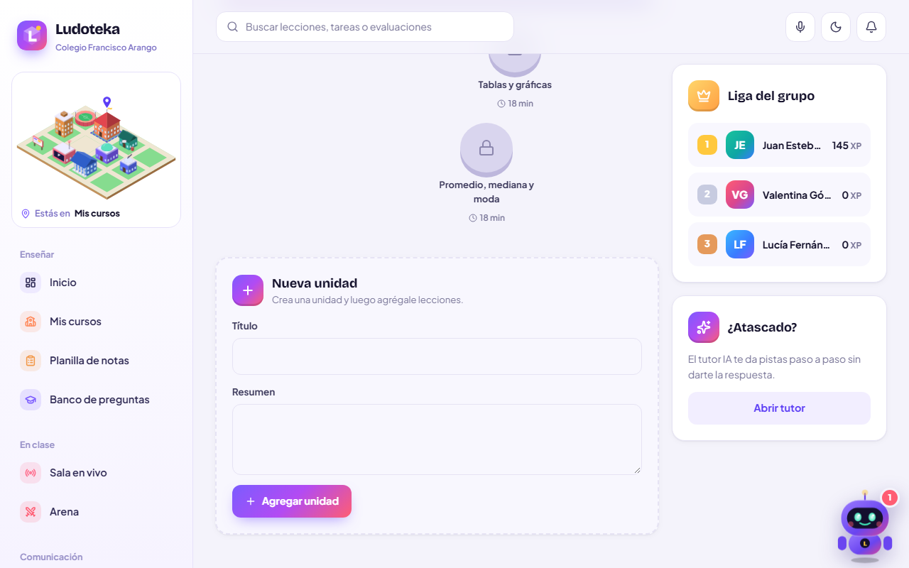

Las unidades y lecciones quedan visibles para los estudiantes en cuanto se crean. Revise bien el texto antes de guardar: por ahora no se pueden editar ni borrar desde la pantalla, y las lecciones solo se pueden agregar a la unidad recién creada (ver [Limitaciones conocidas](#12-limitaciones-conocidas)).

### Banco de preguntas y evaluaciones

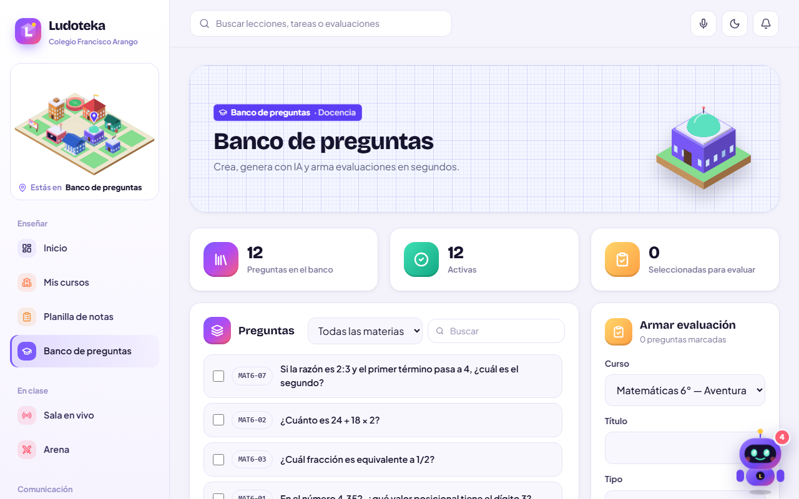

**Crear una pregunta:** en **Nueva pregunta** elija la **Materia**, escriba el **Enunciado**, las opciones **A** a **D**, marque la **Correcta** y, si quiere, una **Explicación** (se muestra en la Arena). Pulse **Guardar pregunta**.

**Generar con IA:** en **Generar con IA** elija el curso, escriba el tema y pulse **Pedir borradores**. Se crean dos preguntas en estado «Borrador» para que las revise.

**Armar una evaluación:**

1. Marque las preguntas en la lista.
2. En **Armar evaluación** elija el **Curso**, escriba el **Título** y el **Tipo**: **Práctica**, **Examen** o **En vivo**.
3. Pulse **Publicar evaluación**. Aparece de inmediato en el curso. Cada pregunta vale 10 puntos.

Los exámenes duran 10 minutos, se presentan una vez y en pantalla completa con control de integridad. Las prácticas se pueden repetir.

### Tareas y evaluaciones del curso (calificar)

En el mapa del curso pulse **Tareas y evaluaciones**. Desde aquí puede abrir una evaluación en vivo (**Abrir en vivo**), descargar sus resultados (**Excel**) y calificar las entregas de las tareas: escriba la **Nota**, un **Comentario** opcional y pulse **Calificar**.

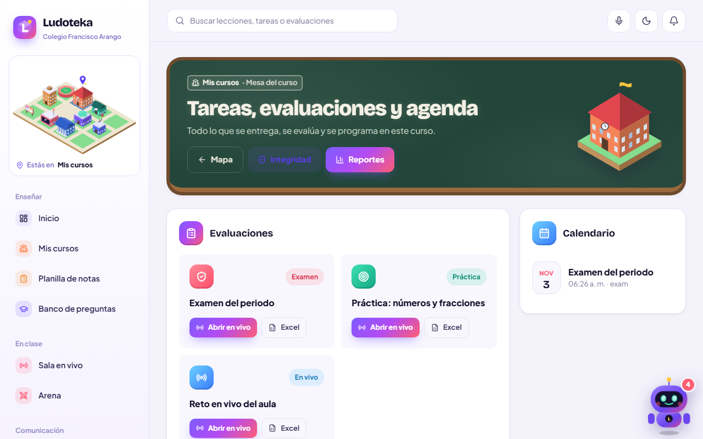

### Sala en vivo

1. Entre a **Sala en vivo**, elija una evaluación de tipo práctica o en vivo y pulse **Abrir sala**.

   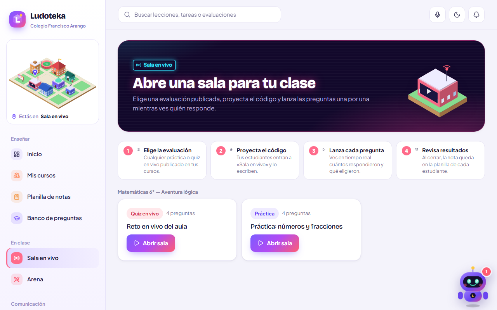

2. Proyecte el código. Los estudiantes lo escriben en su **Sala en vivo**. Cuando haya al menos uno, pulse **Empezar**.

   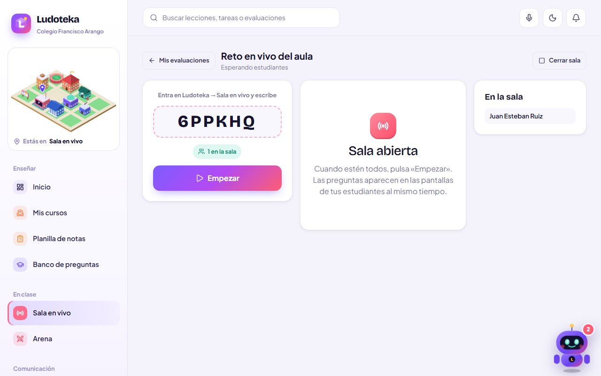

3. En cada pregunta verá cuántos respondieron y el conteo por opción. Puede **Mostrar respuesta correcta** y luego pasar a la **Siguiente pregunta**. En la última, **Terminar y ver resultados**.

   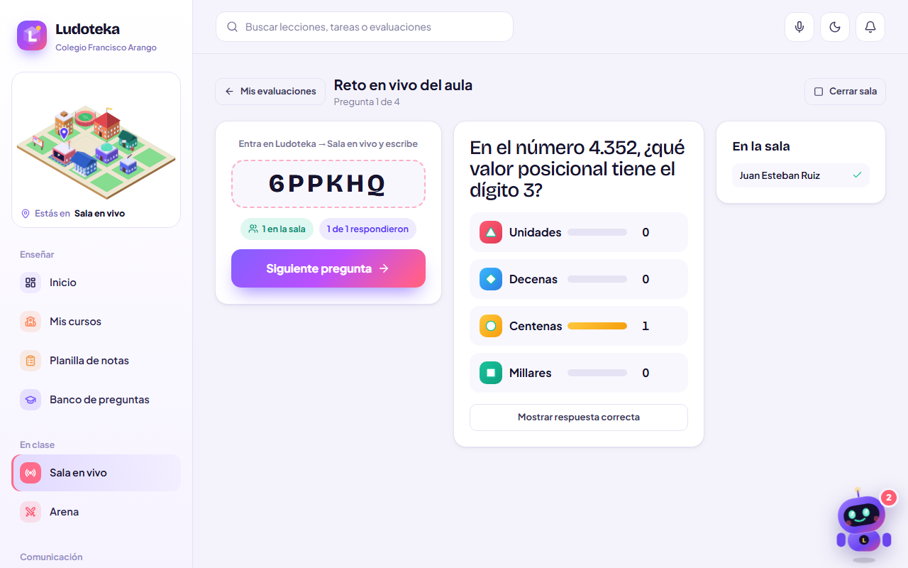

4. Los resultados quedan en la planilla de cada estudiante. **Cerrar sala** termina en cualquier momento y califica lo que cada uno respondió.

   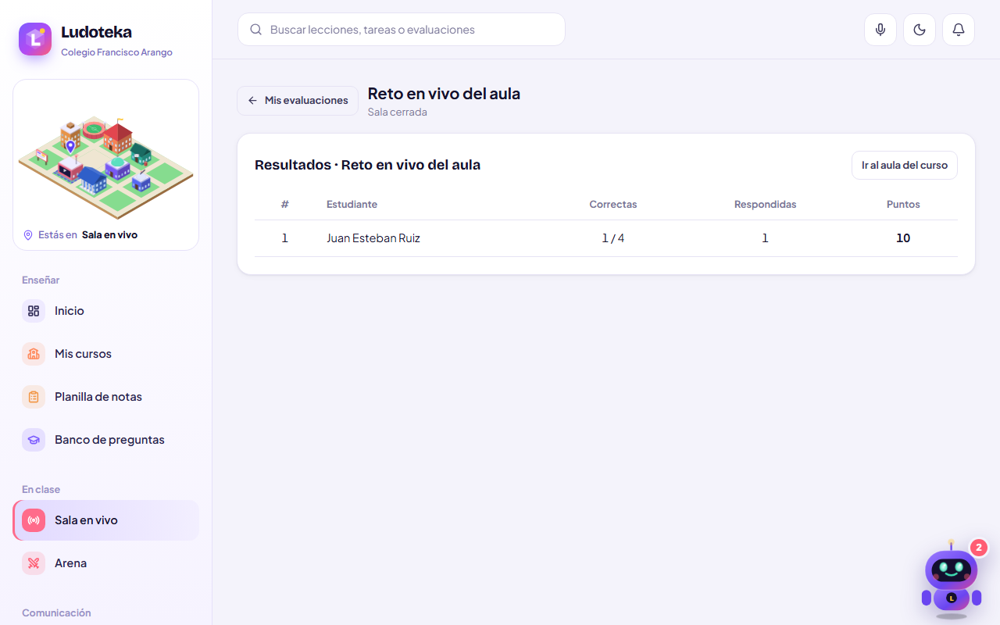

### Arena

En **Arena** › **Abrir una sala** elija el curso, las preguntas (al azar del banco o de una evaluación), la cantidad, los integrantes por equipo y el tiempo por pregunta. Luego pulse **Abrir proyector** para mostrar el código QR. El botón principal avanza las fases: **Empezar**, **Cerrar candados**, **Mostrar respuesta**, **Ver tabla**, **Siguiente pregunta** y **Revelar podio**. Durante una pregunta puede pausar o sumar 15 segundos.

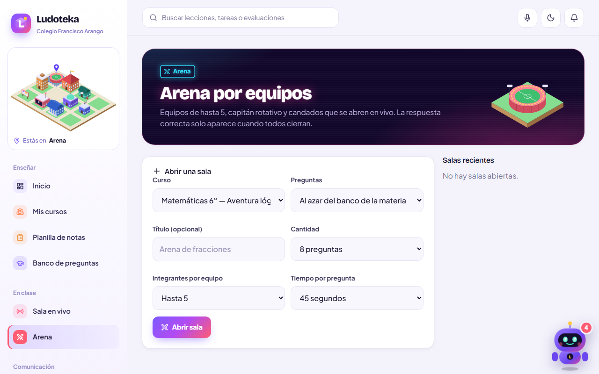

### Planilla de notas

La planilla calcula la nota definitiva en escala 1.0 a 5.0. Elija el curso arriba a la derecha.

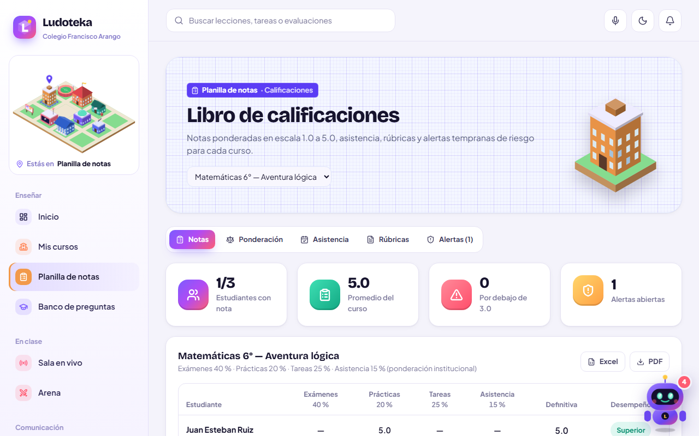

| Pestaña | Para qué sirve |
|---|---|
| **Notas** | Notas por categoría, definitiva y desempeño (Superior, Alto, Básico, Bajo). Exporta a **Excel** y **PDF** |
| **Ponderación** | Las categorías y sus pesos; deben sumar exactamente 100 % |
| **Asistencia** | Tomar asistencia por fecha |
| **Rúbricas** | Crear rúbricas y puntuar a cada estudiante por criterio |
| **Alertas** | Estudiantes en riesgo |

**Configurar la ponderación:** cada fila tiene un nombre, una fuente (Exámenes, Prácticas, Quiz en vivo, Tareas, Rúbricas o Asistencia) y un peso. Use **Agregar categoría** (hasta 6) y pulse **Guardar ponderación** cuando la suma marque 100 %. La ponderación institucional por defecto es Exámenes 40, Prácticas 20, Tareas 25 y Asistencia 15. **Las notas de la sala en vivo y de las rúbricas solo cuentan si agrega esas categorías.**

**Tomar asistencia:** elija la fecha, pulse **Todos presentes** si aplica y marque a cada estudiante con **P** (presente), **T** (tarde, cuenta media), **A** (ausente) o **E** (excusa, no cuenta). Pulse **Guardar asistencia**.

**Rúbricas:** pulse **Nueva rúbrica**, escriba el título, los criterios y sus puntos, y pulse **Crear rúbrica**. Luego escriba los puntos de cada estudiante y guarde la fila. La nota es 1 + 4 × (puntos / máximo).

**Alertas tempranas:** se recalculan al abrir la planilla. Aparecen por nota menor a 3.0, 15 % o más de inasistencias, 3 o más eventos de integridad en 60 días, o 14 días sin actividad, y se cierran solas cuando la causa desaparece. Puede marcarlas **En seguimiento** o **Resolver**. Los acudientes vinculados reciben un aviso.

### Integridad

En **Tareas y evaluaciones › Integridad** ve en tiempo real los eventos de los exámenes del curso: salidas de pantalla completa, cambios de pestaña, pérdida de foco y Esc. La página se actualiza sola cada 4 segundos.

### Reportes y certificados

En **Tareas y evaluaciones › Reportes** puede descargar el reporte del curso en Excel y el de integridad en PDF o Excel. En el panel **Estudiantes**:

- **Boletín** descarga el boletín individual en PDF.
- **Pedir firma** envía el boletín a rectoría.
- **Certificar** envía el certificado del curso a rectoría. Requiere un examen del curso con al menos 60 %.

Cada documento lleva un consecutivo `LK-año-número` y un código QR que cualquiera puede verificar.

### Mensajes

Hay dos pestañas: **Familias** (acudientes de sus estudiantes) y **Colegas**. Pulse **Nuevo mensaje**, elija a la persona, escriba y pulse **Enviar**. Cada conversación muestra el nombre y el rol; sus mensajes leídos muestran «· leído».

### Cartelera

En **Publicar novedad** escriba el **Título**, el **Mensaje** y la **Categoría**, elija los **Destinatarios** (sus grupos y cursos) y pulse **Publicar**. Puede programar la fecha, fijarla arriba y pedir confirmación de lectura. En sus publicaciones, **Ver acuses** muestra quién la leyó y quién la confirmó. En los foros de sus cursos puede fijar, cerrar o borrar temas, marcar respuestas y pedir a Luka un resumen del hilo.

### Biblioteca

En **Publicar recurso** suba un archivo (hasta 50 MB) o pegue un enlace, complete el título, la materia, el grado, la visibilidad (todo el colegio, un curso o pública) y las etiquetas, y pulse **Publicar**. Los PDF se leen automáticamente para que Luka pueda citarlos. La portada de la tarjeta también se genera sola: la primera página del PDF o, en los enlaces, la imagen que publica la página. En **Glosario** puede agregar términos.

### Observatorio

Haga preguntas en español sobre los datos de sus grupos, por ejemplo «¿Qué preguntas se fallan más?». Escriba o dicte la pregunta y pulse **Consultar**, o toque uno de los ejemplos. El resultado trae una tabla, un gráfico cuando aplica, el SQL ejecutado y el botón **CSV**. Las consultas son de solo lectura y usted solo ve sus grupos.

## 6. Coordinación

Sus edificios: **Seguimiento** (Alertas, Asistencia, Citaciones), **Académico** (Grupos y cursos, Consolidado de notas, Observatorio) y **Comunicación** (Mensajes, Cartelera, Biblioteca).

### Alertas (mesa de seguimiento)

Aquí llegan las alertas académicas y de convivencia de todos los grupos. Filtre por **Activas**, **Abiertas**, **En seguimiento** o **Cerradas**.

**Trabajar una alerta:**

1. Pulse **Bitácora** en la tarjeta de la alerta.
2. Escriba en **Nueva anotación** qué se habló, con quién y qué se acordó.
3. Pulse **Anotar** (la alerta pasa a «En seguimiento»), **Anotar y cerrar** o **Citar acudientes**.

### Citaciones

1. Pulse **Nueva citación** (o **Citar** en una alerta).
2. Busque al estudiante. Solo se pueden citar estudiantes con acudientes vinculados.
3. Elija **Fecha y hora** (al menos 30 minutos en el futuro), **Modalidad** (presencial o virtual), **Lugar o enlace** y **Motivo**.
4. Pulse **Enviar citación**. Cada acudiente recibe un aviso en el campus y un correo para confirmar.

En **Citaciones** verá el estado de cada una: «Por confirmar», «Confirmada», «No asistirá», «Realizada» o «Cancelada». Después de la reunión pulse **Realizada** y escriba lo acordado.

### Asistencia consolidada

Muestra las faltas y llegadas tarde por grupo en los últimos 30, 60 o 90 días, y la lista de estudiantes que superan el umbral (3 faltas o 15 % de las clases), con el botón **Citar**.

### Consolidado de notas

Es la planilla de notas de cualquier curso en modo consulta: las notas, la asistencia y las rúbricas las registra el docente. En la pestaña **Alertas** sí puede marcar alertas **En seguimiento** o **Resolver**.

### Cartelera y foros

Coordinación puede publicar para **Toda la comunidad**, por rol (estudiantes, acudientes, docentes…) o por grupo y curso, y puede emitir circulares urgentes con confirmación de lectura (los docentes no). En los foros de curso modera (fijar, cerrar, borrar) pero no publica.

**Mensajes** y **Observatorio** funcionan igual que para el docente, con dos diferencias: en Mensajes solo aparecen colegas y en el Observatorio se ven todos los grupos.

## 7. Rectoría

Sus edificios: **Dirección** (Tablero, Sala de firmas, Archivo de reportes), **Datos** (Observatorio) y **Comunicación** (Mensajes, Cartelera, Biblioteca).

### Tablero estratégico

Elija el año o un periodo. Las tarjetas muestran el promedio (1 a 5), la aprobación (estudiantes con 3.0 o más), la asistencia, las alertas y el uso de IA, con flechas que comparan con el periodo anterior. Debajo están el promedio por grado, el uso de IA por función, el riesgo por tipo y la comparación entre grupos.

### Sala de firmas

Aquí llegan los certificados (los pide el docente cuando el estudiante aprueba el examen del curso) y los boletines. Pulse **Ver** para revisar el PDF y luego **Firmar** o **Devolver**; al devolver se le pide una nota para quien lo solicitó. Los certificados firmados se pueden verificar públicamente con su código QR.

### Comunicados oficiales

Lista los comunicados ya emitidos. **Ir a la cartelera** abre el formulario de publicación con la casilla «Comunicado oficial de Rectoría» marcada; el comunicado aparece en la cartelera con ese sello.

### Archivo de reportes

El historial de todos los documentos emitidos con su consecutivo verificable, y los reportes institucionales **Uso de biblioteca e IA** y **Usuarios de la institución** para 7, 30 o 90 días.

## 8. Acudiente

Sus edificios: **Familia** (Mis hijos, Mensajes) y **Colegio** (Cartelera, Biblioteca).

### Mis hijos

Por cada hijo verá:

- Lecciones completadas, promedio reciente (1 a 5), tareas pendientes y XP.
- **Citaciones** del colegio, para responder **Asistiré** o **No puedo**.
- **Lo que viene** en los próximos 14 días, **Notas recientes** y **Asistencia** de los últimos 30 días.
- **Alertas académicas** abiertas y **Cómo aprende** (el resultado de «Descubre cómo aprendes»).
- **Docentes**: toque uno para escribirle.
- **Boletín PDF** para descargar el boletín.

La casilla **Resumen semanal por correo (viernes)** le envía cada viernes un resumen; **Enviármelo ahora** lo envía de inmediato.

### Autorizaciones

Al final de la tarjeta de cada hijo está el bloque **Autorizaciones**. Pulse **Autorizar** o **Revocar** en cada permiso:

- **Uso del tutor con inteligencia artificial.** Sin esta autorización, un menor no puede usar el Laboratorio IA. Los mensajes llegan a la IA sin nombre ni datos personales.
- **Acceso con reconocimiento facial.** Sin ella, un menor no puede registrar su rostro. Revocar borra el patrón facial guardado.
- **Tratamiento de datos académicos.**

Cada decisión queda registrada con fecha.

### Mensajes

Pulse **Nuevo mensaje**, elija al docente (aparecen agrupados por hijo con sus materias), escriba y pulse **Enviar**. El docente recibe un aviso y un correo.

### Cartelera

Usted ve las **Novedades** dirigidas a acudientes o a los grupos de sus hijos. Si una pide confirmación, pulse **Confirmo que la leí**.

## 9. Administración

Sus edificios: **Administración** (Usuarios, Institución), **Datos** (Observatorio) y **Comunicación** (Mensajes, Cartelera, Biblioteca).

### Orden recomendado al iniciar el año

1. **Institución › Estructura:** crear grados, grupos y materias (con la plantilla o la estructura base).
2. **Usuarios:** crear o importar las cuentas de docentes, estudiantes (con su grupo) y acudientes.
3. **Institución › Acudientes:** revisar o crear los vínculos entre acudientes y estudiantes.
4. **Institución › Estructura › Asignación docente:** asignar cada docente a su materia y grupo.
5. **Institución › Cursos:** abrir los cursos.

El año lectivo y sus periodos no se crean desde la pantalla; los prepara el equipo técnico (ver el [Manual de instalación](manual-de-instalacion.md)).

### Usuarios

**Crear una cuenta:**

1. Pulse **Nueva cuenta**.
2. Escriba el **Nombre completo**, el **Correo** y elija el **Rol**.
3. Si es estudiante, elija el **Grupo**. Si es acudiente, escriba en **Acudiente de** los correos de sus estudiantes.
4. Marque **Es menor de edad** si aplica (viene marcada para estudiantes).
5. Pulse **Crear y enviar acceso**. La persona recibe por correo su clave temporal.

**Importar desde Excel:**

1. Pulse **Importar** › **Descargar plantilla**. La hoja «Usuarios» tiene las columnas `nombre_completo`, `correo`, `rol`, `grupo`, `menor_de_edad` y `acudiente_de`. La hoja «Instrucciones» explica cada una.
2. Llene una fila por persona. El rol puede ser estudiante, docente, coordinador, rector, acudiente o administrador. El grupo se escribe como 6A o 10B. En `acudiente_de` van los correos de los estudiantes separados por punto y coma; el estudiante puede estar en el mismo archivo.
3. Pulse **Elegir archivo** y suba el .xlsx o .csv (máximo 2000 filas). Antes de crear nada verá una revisión fila por fila con los errores y advertencias.
4. Pulse **Crear n cuentas**. Las filas con errores se omiten.

Si desmarca el envío de correos, el campus le deja descargar las claves temporales en un CSV **una sola vez**: entréguelas en sobre cerrado y destruya el archivo después.

**Gestionar una cuenta:** pulse **Gestionar** en la fila de la persona.

| Acción | Qué hace |
|---|---|
| **Reenviar acceso** | Genera una clave temporal nueva, la envía por correo y cierra las sesiones |
| **Exigir cambio de clave** | Obliga a cambiar la contraseña en el próximo ingreso |
| **Cerrar sesiones** | Cierra todas sus sesiones y olvida sus equipos de confianza |
| **Desactivar** / **Reactivar** | Bloquea o devuelve el acceso; reactivar también desbloquea la cuenta |
| **Datos** | Corregir nombre, rol o la marca de menor de edad |

**Solicitudes de eliminación de datos:** cuando alguien la pide desde Ajustes, aparece en Usuarios la tarjeta «Solicitudes de eliminación de datos» con el plazo de 15 días hábiles. Marque **Atendida** cuando haya desactivado la cuenta o suprimido los datos (el campus no borra nada automáticamente), o **Rechazar** indicando el motivo legal.

### Institución

**Estructura:**

- **Plantilla de estructura:** **Descargar plantilla** (hojas «Grupos» y «Materias»), **Subir plantilla llena** o **Usar estructura base** (grados 6.° a 11.° con grupos A y B y 10 materias). Revise la vista previa y pulse **Crear lo que falta**; lo que ya existe se conserva.
- Formularios individuales: **Grupos**, **Materias**, **Asignación docente** y **Matrícula**. Estos formularios se limpian al guardar pero no muestran mensaje de confirmación; verifique el resultado en las listas.

**Acudientes:** la tabla de vínculos muestra cada acudiente con su estudiante, parentesco y estado. Use **Nuevo vínculo** (acudiente, estudiante, parentesco) › **Vincular**, o **Revocar** para quitarlo.

**Cursos:** **Nuevo curso** (título, descripción, materia, grupo y año) › **Abrir curso**. El curso queda publicado de inmediato, con administración como docente a cargo.

## 10. Preguntas frecuentes

**No me llegó el correo con la cuenta.** Revise la carpeta de spam. Si no está, pida en secretaría que usen **Reenviar acceso**.

**No me llega el código de 6 dígitos.** Espere un minuto y revise spam. Luego use **Reenviar código** (cada 30 segundos). Si sigue sin llegar, verifique con secretaría que su correo esté bien escrito.

**¿Puedo usar el campus en el celular?** Sí. Todas las funciones están en la barra inferior y en **Más**. En el celular también puede activar Face ID o la huella.

**¿Por qué no puedo usar el tutor de IA?** Si es menor de edad, su acudiente debe autorizarlo en **Mis hijos › Autorizaciones**. El tutor también se apaga durante un examen.

**Se suspendió mi examen.** Al tercer aviso de integridad el examen se suspende y no se califica. Hable con su docente.

**¿Qué ve la inteligencia artificial de mí?** Al tutor y a los resúmenes llegan los textos sin nombres ni datos personales. En el Observatorio, los nombres de estudiantes se reemplazan antes de enviar la pregunta.

**¿Cómo cambio entre Luka y Luna?** En **Ajustes › Compañero IA**.

**Quiero una copia de mis datos o que los borren.** En **Ajustes › Privacidad** use **Descargar mis datos** o **Solicitar eliminación de mis datos**.

## 11. Solución de problemas

| Mensaje | Qué hacer |
|---|---|
| «Correo o contraseña incorrectos» | Revise mayúsculas y que el correo sea el institucional. Si no la recuerda, use **¿Olvidaste tu contraseña?** |
| «Demasiados intentos fallidos. Intenta de nuevo en N minuto(s).» | Espere el tiempo indicado (crece con cada fallo, hasta 60 minutos) o recupere la contraseña |
| «Tu cuenta está desactivada. Comunícate con el colegio.» | Pida a administración que la reactive |
| «Este navegador ya tiene abierta la sesión de…» | Cierre la otra sesión en ese navegador antes de entrar |
| «Código incorrecto. Te quedan N intentos.» | Escriba el último código recibido; los anteriores dejan de servir |
| «El código venció o ya se usó.» / «Superaste los intentos.» | Vuelva a escribir la contraseña para recibir un código nuevo |
| «Espera N segundos para pedir otro código.» | Espere y pulse **Reenviar código** |
| «Por seguridad cerramos tu sesión en todos los dispositivos.» | Vuelva a ingresar; si no fue usted, cambie la contraseña |
| «No reconocimos el rostro. Te quedan N intentos…» | Busque buena luz y mire de frente, o use la contraseña |
| «Acceso facial bloqueado por intentos fallidos…» | Espere la hora indicada o entre con contraseña |
| El micrófono no funciona | Permita el micrófono en el navegador y use Chrome, Edge o Safari |
| La pantalla no carga o se ve vacía | Recargue la página. Si el campus estuvo sin uso un rato, la primera carga puede tardar más de lo normal |

Si el problema sigue, escriba a secretaría indicando su correo, la hora y una captura del mensaje.

## 12. Limitaciones conocidas

Estas son diferencias entre lo que podría esperarse y lo que el campus hace hoy. Están documentadas para evitar confusiones mientras se resuelven.

- **Tareas:** las entregas son solo de texto, sin archivos adjuntos ni fecha límite visible. Los docentes todavía no pueden crear tareas, anuncios del curso ni eventos del calendario desde la pantalla.
- **Contenido:** las unidades, lecciones, preguntas y evaluaciones no se pueden editar ni borrar desde la pantalla. Las lecciones solo se agregan a la unidad recién creada.
- **Exámenes:** duran siempre 10 minutos y, al llegar a 00:00, el examen no se entrega solo; hay que pulsar **Entregar evaluación**.
- **Mapa del curso:** los candados de las lecciones son decorativos; todas las lecciones se pueden abrir.
- **Buscador superior:** la caja «Buscar lecciones, tareas o evaluaciones» del computador todavía no busca.
- **Año lectivo y periodos:** no hay pantalla para crearlos; los prepara el equipo técnico.
- **Coordinación y acudientes:** coordinación no tiene pantalla para vincular acudientes; lo hace administración en **Institución › Acudientes**.
- **Formularios de Institución:** los de grupos, materias, asignación docente, matrícula y cursos no muestran mensajes de éxito ni de error.
- **Resumen semanal:** el correo dice que se apaga desde Ajustes, pero la casilla está en **Mis hijos**.
- **Restablecer contraseña:** la pantalla pide la contraseña una sola vez, sin confirmación.
- **Aviso de cookies:** indica que la sesión dura 7 días; en realidad dura hasta 14 días si no se cierra.
- **Autorización de datos académicos:** se registra la decisión del acudiente, pero el campus todavía no la aplica.
