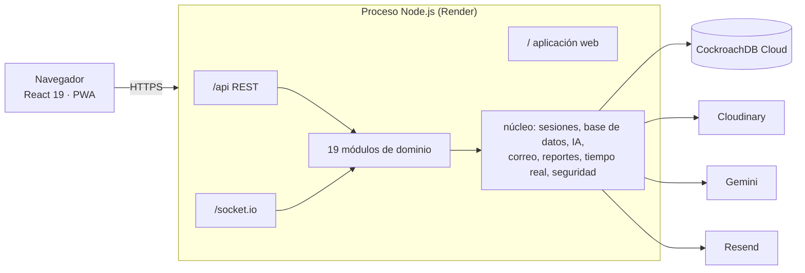
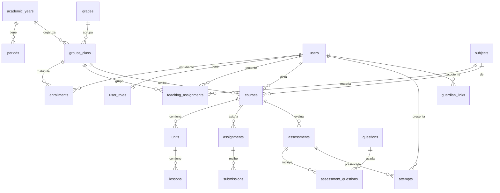

# Manual técnico de Ludoteka Campus

| | |
|---|---|
| Sistema | Ludoteka Campus (antes EduQuest) |
| Institución | Colegio Francisco Arango |
| Versión del documento | 1.0, octubre de 2026 |
| Producción | [ludoteka-campus.onrender.com](https://ludoteka-campus.onrender.com) |
| Equipo | Darwin Joan Aveiga Mora (arquitectura y desarrollo full stack), Mariana Sofía Azabache Moreno (project manager, área creativa, diseño UI/UX y frontend), Julián Esteban Chávez Zamora (QA y apoyo en backend) |

## Contenido

1. [Introducción](#1-introducción)
2. [Descripción general](#2-descripción-general)
3. [Requisitos](#3-requisitos)
4. [Arquitectura](#4-arquitectura)
5. [Tecnologías](#5-tecnologías)
6. [Estructura del código](#6-estructura-del-código)
7. [Modelo de datos](#7-modelo-de-datos)
8. [Seguridad](#8-seguridad)
9. [Configuración](#9-configuración)
10. [Instalación y despliegue](#10-instalación-y-despliegue)
11. [Mantenimiento](#11-mantenimiento)
12. [Respaldo y recuperación](#12-respaldo-y-recuperación)
13. [Monitoreo](#13-monitoreo)
14. [Calidad y pruebas](#14-calidad-y-pruebas)
15. [Solución de problemas](#15-solución-de-problemas)
16. [Glosario](#16-glosario)

## 1. Introducción

### Propósito

Este manual explica cómo está construido Ludoteka Campus y cómo se instala, configura, mantiene y diagnostica. Sirve para que una persona que no participó en el desarrollo pueda hacerse cargo del sistema.

### Público

Desarrolladores, personal de sistemas del colegio y evaluadores técnicos. Se asume conocimiento básico de Node.js, SQL y Git. Para el uso de la aplicación está el [Manual de usuario](manual-de-usuario.md).

### Alcance

Cubre la aplicación web, la API, la base de datos, los servicios externos y el despliegue en Render. Los detalles de cada tema están en los documentos de referencia de `docs/`, que este manual enlaza.

## 2. Descripción general

Ludoteka Campus es el campus virtual gamificado del Colegio Francisco Arango. Reúne en una sola aplicación web:

- **Aula:** cursos, unidades, lecciones, tareas, cartelera y foros.
- **Evaluación:** banco de preguntas, prácticas, exámenes en modo kiosco con control de integridad y sala en vivo.
- **Calificaciones:** planilla ponderada (escala 1.0 a 5.0), asistencia, rúbricas y alertas de riesgo.
- **Juego:** campus isométrico, XP, rachas, insignias, Arcade de 10 juegos y Arena por equipos.
- **Estudio:** Laboratorio IA con historial y títulos automáticos, Mi ruta adaptativa, Cuaderno con tarjetas de repaso, metas y sesiones de enfoque.
- **Biblioteca:** archivos con búsqueda híbrida y tutor de IA que cita sus fuentes.
- **Gobierno escolar:** coordinación, rectoría, portal de familia, mensajes y Observatorio (preguntas en español convertidas a SQL de solo lectura).
- **Cuentas y acceso:** contraseña con código por correo, dispositivos de confianza, passkeys y acceso facial.
- **Ley 1581:** documentos legales versionados, aceptación (el acudiente acepta por el menor), descarga y solicitud de eliminación de datos.

Hay seis roles: Estudiante, Docente, Coordinación, Rectoría, Acudiente y Administración. Qué ve y qué puede hacer cada uno está en [Roles y permisos](../roles-y-permisos.md).

## 3. Requisitos

### Usuario final

| Elemento | Requisito |
|---|---|
| Navegador | Safari 14 o superior (iPhone, iPad, Mac) o Chrome 90 o superior (Android, Windows, macOS, Linux). Edge actual funciona por ser Chromium |
| Conexión | Internet permanente; la aplicación no trabaja sin conexión |
| Correo | Un buzón real para recibir el código de ingreso y la clave temporal |
| Cámara | Solo para el acceso facial |
| Micrófono | Solo para dictado y comandos de voz |
| Lector biométrico o PIN del sistema | Solo para passkeys (Windows Hello, Face ID, Touch ID o huella) |

### Servidor y servicios

| Elemento | Requisito | En producción hoy |
|---|---|---|
| Node.js | 20 o superior (22 recomendado) | 22.14.0 |
| Base de datos | CockroachDB con soporte de `VECTOR` y `CREATE VECTOR INDEX`, e índices vectoriales habilitados | CockroachDB Cloud v26.2.7, `feature.vector_index.enabled = true` |
| Usuario de la base | Administrador del clúster (lo exige el Observatorio para `SET LOCAL ROLE`) | Usuario por defecto de CockroachDB Cloud |
| Hospedaje | Cualquier servidor que ejecute Node y exponga HTTPS | Render, Web Service gratuito, región Virginia |
| Archivos | Cloudinary | Cuenta gratuita |
| IA | Proveedor compatible con la API de OpenAI | Google Gemini (AI Studio) |
| Correo | Resend con dominio verificado | Resend |

Solo hay un proceso: no se necesita Redis, colas ni servidor de archivos. Con más de una instancia el sistema no funciona bien (ver [Límites conocidos](Architecture.md#límites-conocidos)).

## 4. Arquitectura

**Monolito modular:** un repositorio, un proceso de Node.js y una base de datos. El mismo proceso entrega la API REST (`/api`), el canal de tiempo real (`/socket.io`) y la aplicación web compilada (`/`).



**Capas:**

| Capa | Ubicación | Responsabilidad |
|---|---|---|
| Presentación | `apps/web` | Pantallas, campus isométrico, sesión del navegador, voz, rostro y passkeys |
| Contratos | `packages/contracts` | Roles y esquemas zod compartidos: la web y la API validan con las mismas reglas |
| Aplicación | `apps/api/src/modules` | Reglas de negocio por módulo; cada uno expone solo su `public-api.ts` |
| Núcleo | `apps/api/src/core` | Infraestructura compartida |
| Datos | `db/migrations` y CockroachDB | Esquema versionado en SQL |

**Comunicación entre módulos:**

- **Síncrona, en una sola dirección:** un módulo llama a otro solo por su fachada `public-api.ts`. `npm run deps:check` rechaza cualquier otra importación.
- **Por eventos:** XP, insignias, avisos y correos reaccionan a eventos de dominio (`lesson.completed`, `attempt.graded`, `risk.alert_raised`…). Los eventos viven en memoria, sin cola.

**Tiempo real:** Socket.IO para la sala en vivo, la Arena y las alertas de integridad. Las pantallas en vivo también consultan cada pocos segundos por si el socket se cae. Los avisos se consultan cada 60 s.

El detalle (arranque, tabla de módulos, eventos y decisiones de diseño) está en [Arquitectura](Architecture.md).

## 5. Tecnologías

| Capa | Tecnología |
|---|---|
| Lenguaje | TypeScript 5 en modo `strict` en todo el repositorio |
| Frontend | React 19, Vite 7, TanStack Query 5, React Router 7, Radix UI, Framer Motion, vite-plugin-pwa |
| Biometría y voz | `@vladmandic/face-api`, Web Speech API, WebAuthn (`@simplewebauthn/browser`) |
| Backend | NestJS 11 (Express), Socket.IO 4, `@nestjs/event-emitter`, `@nestjs/throttler`, helmet |
| Datos | CockroachDB, Kysely 0.28, driver `pg` |
| Autenticación | JWT de acceso de 20 minutos, refresh opaco en cookie `HttpOnly`, argon2id, `@simplewebauthn/server` |
| Validación | zod 3 |
| Reportes | pdfkit, exceljs, qrcode |
| Pruebas y calidad | Playwright (WebKit y Chromium), dependency-cruiser |
| Despliegue | Render (Node 22) |

## 6. Estructura del código

```
apps/api              API NestJS
  src/main.ts         Arranque: variables, migraciones, siembra, servidor
  src/app.module.ts   Registro de módulos y guardias globales
  src/core/           auth, config, database, ai, mail, reports, realtime, security, events
  src/modules/        Un directorio por módulo con controller, service, module y public-api.ts
  scripts/            library-seed.ts (carga de la biblioteca)
apps/web              Aplicación React
  src/app/            Router, shell, navegación por rol, guía Luka/Luna
  src/features/       Pantallas por área
  src/shared/         Sesión, cliente HTTP, voz, rostro, passkeys, catálogo de edificios
  src/ui/             Componentes base y dibujo isométrico
  e2e/                Pruebas Playwright
packages/contracts    Roles y esquemas zod
db/migrations         Esquema SQL (0000 a 0034)
db/seeds              Contenido demo y manifiesto de la biblioteca
docs/manuales         Manuales en Markdown, capturas (img/) y PDF (pdf/)
render.yaml           Definición del servicio en Render
```

Convenciones de código y cómo agregar endpoints, tablas, eventos o módulos: [Desarrollo](../desarrollo.md).

## 7. Modelo de datos

112 tablas y 12 vistas (producción, octubre de 2026), agrupadas por módulo. Claves `UUID`, fechas `TIMESTAMPTZ` calculadas en hora de Bogotá, enumeraciones como `STRING` con `CHECK` y sin triggers. Entidades académicas principales:



- Un **curso** es único por materia, grupo y año, y tiene un docente.
- Una **matrícula** es única por estudiante y año.
- Una **evaluación** es de tipo `practice`, `exam` o `live`; solo puede haber un intento activo por estudiante y evaluación.
- El **Observatorio** solo lee doce vistas `v_*` con el rol `ludoteka_reader`.
- La **biblioteca** guarda fragmentos de texto con un índice de texto completo en español y un vector de 768 dimensiones para la búsqueda semántica.

Tablas por módulo, migraciones y particularidades de CockroachDB: [Modelo de datos](../datos.md).

## 8. Seguridad

| Tema | Resumen |
|---|---|
| Ingreso | Contraseña (argon2id) más código de 6 dígitos por correo. Un dispositivo de confianza evita el código por 30 días. Passkeys y rostro como alternativas sin contraseña |
| Sesión | JWT de acceso de 20 minutos por pestaña; refresh opaco de 14 días en cookie `HttpOnly`, rotativo, con detección de reuso. Una sola cuenta por navegador |
| Autorización | Rol en cada ruta (`@Roles`) y relación en cada dato (docente–curso, acudiente–hijo, estudiante–matrícula) |
| Protección web | helmet con CSP estricta y HSTS; límite de peticiones por IP y por cuenta; bloqueo progresivo |
| Biometría | El rostro se procesa en el navegador; el servidor recibe vectores de 128 números y los guarda cifrados con AES-256-GCM |
| IA | Cada función quita los datos personales que no necesita; el Observatorio corre en una transacción de solo lectura con rol restringido |
| Datos personales | Ley 1581: aceptación versionada, autorización del acudiente para menores, descarga y solicitud de eliminación |
| Secretos | Solo en variables de entorno; nunca en el repositorio |

El detalle y la lista de riesgos conocidos pendientes están en [Seguridad](Security.md).

## 9. Configuración

Toda la configuración es por variables de entorno, validadas al arrancar (`apps/api/src/core/config/env.ts`). Si falta una obligatoria, la API no arranca.

| Variable | Obligatoria | Para qué |
|---|---|---|
| `DATABASE_URL` | Sí | Conexión a CockroachDB |
| `JWT_SECRET` | Sí | Firma de sesiones y códigos |
| `APP_PUBLIC_URL`, `CORS_ORIGIN` | Sí, en producción | Dominio público: enlaces de correo, QR, passkeys y CORS |
| `AI_*` | No | Proveedor de IA; sin clave, todo usa el camino local |
| `CLOUDINARY_URL` | Para la biblioteca | Subida de archivos |
| `RESEND_API_KEY`, `MAIL_FROM` | Sí, en producción | Códigos de ingreso, claves temporales y avisos |
| `LAB_OTP_INBOX` | No | Buzón que recibe los códigos de las cuentas de laboratorio |
| `FACIAL_*` | No | Umbral, bloqueo, retención y llave del acceso facial |
| `INTEGRITY_SUSPEND_AFTER` | No | Violaciones antes de suspender un examen (3) |
| `SEED_PASSWORD` | Sí, en una base vacía | Clave de las cuentas de laboratorio |

Valores, valores por defecto y cuáles son secretos: [Operación](../operacion.md#variables-de-entorno). Plantilla: `apps/api/.env.example`.

## 10. Instalación y despliegue

Paso a paso en el [Manual de instalación](manual-de-instalacion.md). En resumen:

1. Crear el clúster de CockroachDB y el usuario.
2. Crear las cuentas de Cloudinary, Google AI Studio y Resend.
3. Crear el servicio en Render desde `render.yaml` y cargar las variables secretas.
4. Al arrancar, la API aplica las migraciones y siembra el colegio de demostración.
5. Entrar con la cuenta de administración de laboratorio y crear las cuentas reales.

Cada push a la rama principal vuelve a desplegar. Si una migración falla, Render mantiene la versión anterior.

**Docker:** el `Dockerfile` construye la misma aplicación en una imagen de producción (multi-etapa, Node 22, usuario `node`, healthcheck propio). `docker-compose.yml` la levanta con el `.env` y `docker-compose.cockroach.yml` le suma una CockroachDB local de un nodo para trabajar sin tocar la nube. Render no usa la imagen; sigue con el runtime de Node. Ver [Instalación con Docker](manual-de-instalacion.md#5-instalación-con-docker).

## 11. Mantenimiento

| Tarea | Frecuencia | Cómo |
|---|---|---|
| Cambiar el modelo de IA | Cuando Google retire un modelo o cambie la cuota | [Operación](../operacion.md#cambiar-el-modelo-de-ia) |
| Rotar secretos | Si se exponen o sale alguien del equipo | [Operación](../operacion.md#rotar-secretos) |
| Completar los vectores de la biblioteca | Después de cargar archivos si la cuota de IA se agotó | `npm run library:seed -w @eduquest/api` |
| Reintentar una portada de la biblioteca | Si un recurso quedó sin portada | `UPDATE library_items SET cover_url = NULL WHERE id = '…'` y reiniciar el servicio ([Operación](../operacion.md#biblioteca-y-embeddings)) |
| Regenerar los manuales en PDF | Después de editar un manual o sus capturas | Lo hace el equipo con su herramienta local; el PDF debe quedar en el mismo commit que el Markdown |
| Aplicar migraciones | Automático en cada despliegue | `npm run migrate` para hacerlo a mano |
| Actualizar dependencias | Cada periodo académico | `npm outdated`, actualizar, y correr `typecheck`, `deps:check`, `build` y e2e |
| Nuevo año lectivo | Una vez al año | El año y sus periodos se crean con SQL (ver abajo); después administración crea grupos, carga docente, matrículas y cursos en Institución |
| Revisar solicitudes de datos | Semanal | Administración → Usuarios (tarjeta «Solicitudes de eliminación de datos») |

**Nuevo año lectivo:** la aplicación no tiene pantalla para años ni periodos. En la consola SQL del clúster:

```sql
UPDATE academic_years SET is_current = false WHERE is_current;
INSERT INTO academic_years (name, starts_on, ends_on, is_current) VALUES ('2027', '2027-01-18', '2027-11-30', true);
INSERT INTO periods (academic_year_id, name, position, starts_on, ends_on)
SELECT id, v.name, v.position, v.starts_on::DATE, v.ends_on::DATE
FROM academic_years
CROSS JOIN (VALUES
  ('Periodo 1', 1, '2027-01-18', '2027-04-09'),
  ('Periodo 2', 2, '2027-04-12', '2027-06-18'),
  ('Periodo 3', 3, '2027-07-06', '2027-09-10'),
  ('Periodo 4', 4, '2027-09-13', '2027-11-30')
) AS v (name, position, starts_on, ends_on)
WHERE academic_years.name = '2027';
```

Ajuste las fechas al calendario del colegio. Los grupos pertenecen a un año, así que después hay que crearlos de nuevo para el año nuevo (la plantilla de estructura de Institución crea lo que falte) y matricular a los estudiantes.

**Cambios al esquema:** un archivo nuevo en `db/migrations` con el siguiente número. Nunca se edita una migración ya aplicada, porque no tiene efecto.

**Ambiente local:** el `.env` local apunta a la misma base de producción. Todo script que se corra en local (`migrate`, `seed`, `library:seed`) modifica producción.

## 12. Respaldo y recuperación

| Qué | Dónde vive | Respaldo |
|---|---|---|
| Código | GitHub (`Joan-Mora/ludoteka-campus`) | El propio historial de Git |
| Datos | CockroachDB Cloud | Respaldos administrados del clúster. Revisar la frecuencia y la retención del plan en la consola de CockroachDB Cloud → **Backup and Restore** |
| Archivos de la biblioteca | Cloudinary | La base guarda el `public_id`, la fuente y la licencia de cada archivo; el manifiesto `db/seeds/library/manifest.json` permite volver a cargar la biblioteca oficial |
| Plantillas faciales | Base de datos, cifradas | Dependen de `FACIAL_ENC_KEY` (o de `JWT_SECRET` si está vacía). **Guarde esa llave en un gestor de secretos:** sin ella las plantillas no se pueden leer |
| Configuración | Render → Environment | Mantener una copia de los valores en un gestor de secretos del colegio |

**Recuperar el servicio:**

1. Si el despliegue nuevo falla, Render sigue sirviendo el anterior. Corrija y vuelva a hacer push, o use **Rollback** en Render.
2. Si se dañaron datos, restaure desde la consola de CockroachDB Cloud y verifique con `GET /api/health`.
3. Si se perdió la llave facial, cada persona debe registrar su rostro de nuevo desde Ajustes.

## 13. Monitoreo

| Qué | Dónde |
|---|---|
| Servicio y base | `GET /api/health` responde `{"ok":true,"db":"up"}` |
| Registros | Render → Logs |
| Correos | Tabla `email_outbox` (`sent` o `logged`) |
| Uso de IA | Tabla `ai_usage` por función y modelo |
| Auditoría | Tabla `audit_log`: ingresos, bloqueos, reuso de sesión y cambios de cuentas |
| Observatorio | Tabla `nl_queries` |

## 14. Calidad y pruebas

| Control | Comando | Qué asegura |
|---|---|---|
| Tipos | `npm run typecheck` | Contratos, API, scripts y web compilan en modo estricto |
| Fronteras | `npm run deps:check` | Ningún módulo usa archivos internos de otro |
| Build | `npm run build` | Lo mismo que corre Render |
| Pruebas de extremo a extremo | `npm run e2e -w @eduquest/web` | Rutas públicas y de cada rol, sin errores de JavaScript ni de CSP ni desborde horizontal; flujos de ingreso, passkeys, una cuenta por navegador, foros, sala en vivo, mensajes, Arcade, Mi ruta y biblioteca |

Las pruebas corren en cuatro perfiles: iPhone 13, iPad y Safari de escritorio (WebKit) y Pixel 7 (Chromium). `npm run e2e:prod -w @eduquest/web` repite el smoke contra producción. Detalle en [Desarrollo](../desarrollo.md#pruebas).

**Antes de cada entrega:** `typecheck`, `deps:check` y las pruebas e2e del área modificada.

## 15. Solución de problemas

| Síntoma | Causa probable | Qué hacer |
|---|---|---|
| El despliegue no queda en vivo | Una migración falló o falta `DATABASE_URL` o `JWT_SECRET` | Leer Render → Logs; corregir con una migración nueva |
| La primera carga tarda medio minuto | El plan gratuito durmió el servicio tras 15 minutos sin uso | Esperado; un plan pago lo evita |
| El tutor, el Cuaderno o Mi ruta responden sin IA | Cuota de Gemini agotada o `AI_API_KEY` vacía | Revisar la cuota en Google AI Studio; el sistema sigue funcionando |
| No llegan los códigos de ingreso | `RESEND_API_KEY` vacía o dominio sin verificar | Revisar `email_outbox` y la configuración de Resend |
| «Este navegador ya tiene abierta la sesión de…» | Otra cuenta tiene sesión en ese navegador | Cerrar esa sesión y volver a entrar |
| Las passkeys fallan tras cambiar de dominio | `APP_PUBLIC_URL` o `CORS_ORIGIN` no coinciden con el dominio | Ajustar ambas variables |
| El acceso facial no reconoce a nadie | Cambió la llave facial | Restaurar la llave anterior o volver a registrar los rostros |
| Falla subir a la biblioteca | `CLOUDINARY_URL` vacía o revocada | Revisar la variable en Render |
| Un recurso de la biblioteca no tiene portada | El sitio no publica `og:image`, el PDF externo no se pudo descargar, o la portada está pendiente (se generan 25 por arranque) | Ver «Sin portada para…» en Render → Logs; reintentar con `cover_url = NULL` |
| El Observatorio responde error de permisos | El usuario de la base no es administrador del clúster | Usar un usuario administrador en `DATABASE_URL` |

Más casos en [Operación](../operacion.md#solución-de-problemas).

## 16. Glosario

| Término | Significado |
|---|---|
| Acudiente | Padre, madre o tutor legal vinculado a uno o más estudiantes |
| Campus | Pantalla de inicio en forma de mapa isométrico; cada sección es un edificio |
| Código de ingreso | Número de 6 dígitos que llega al correo después de la contraseña |
| Dispositivo de confianza | Navegador en el que no se pide el código durante 30 días |
| Embedding | Vector numérico que representa el significado de un texto; permite la búsqueda semántica |
| Kiosco | Modo de examen a pantalla completa que registra salidas y cambios de pestaña |
| Luka o Luna | Compañero guía de la aplicación |
| Migración | Archivo SQL numerado que cambia el esquema de la base |
| Observatorio | Módulo que convierte preguntas en español a consultas SQL de solo lectura |
| Passkey | Llave de acceso guardada en el dispositivo (Windows Hello, Face ID, Touch ID, huella) |
| Refresh | Credencial de larga duración en cookie que renueva el acceso sin volver a entrar |
| SM-2 | Algoritmo de repetición espaciada de las tarjetas del Cuaderno |
| XP | Puntos de experiencia que se ganan al aprender y jugar |
